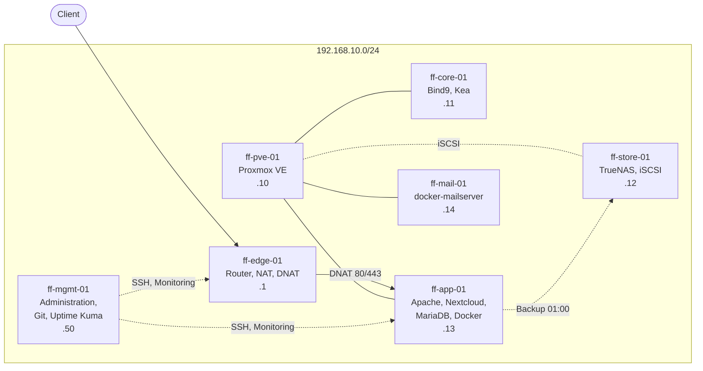

# Fraîche Flow – Homelab mit Proxmox, DNS, Nextcloud, Mail und Monitoring

Virtuelle Unternehmensumgebung für ein fiktives Unternehmen („Fraîche Flow“): Aufbau, Absicherung, Backup, Überwachung und technische Abnahme.

## Projektprofil

| Autor | Ibrahim Kilic |
|---|---|
| Kontext | Lernprojekt in der Umschulung zum Fachinformatiker für Systemintegration. Testlabor, kein Produktivbetrieb |
| Meine Arbeit | Einrichtung, Konfiguration, Tests, Fehlersuche und Dokumentation |
| Technik | Hyper-V, Proxmox VE 9.1, Debian, TrueNAS, Bind9, Kea, Apache, MariaDB, Nextcloud, Docker, Uptime Kuma |
| Umfang | 7 Systeme, 22 Dokumentationsseiten, 31 Abbildungen |
| Ergebnis | Technische Abnahme mit Auflagen: 14 von 15 Anforderungen erfüllt, eine teilweise |

## Ausgangssituation und Aufgabe

Eine Stadt möchte Parks, Sportflächen und Außenbereiche automatisch bewässern und an heißen Tagen mit feinem Sprühnebel kühlen („Fraîche Flow“). Bevor dafür reale Geräte ausgerollt werden, entsteht ein digitaler Zwilling: eine getrennte Testumgebung, in der Netz, Dienste, Speicher, Backup und Überwachung zuerst erprobt werden.

Meine Aufgabe war, diese Testumgebung aufzubauen: sieben virtuelle Systeme einrichten, Dienste in Betrieb nehmen, Zugang und Backup absichern, eine Überwachung aufbauen und am Ende prüfen, ob alles belegbar funktioniert. Die Sensoren und Steuergeräte selbst gehören nicht zum Lab.

## In 60 Sekunden

- Ein kleines Firmennetz aus sieben virtuellen Systemen: Router, Proxmox, DNS und DHCP, Speicher, Webportal, Mailserver und ein Verwaltungsrechner.
- Die Dienste sind Ende zu Ende geprüft, zum Beispiel der Weg Name → Webserver → Nextcloud → Datenbank.
- Jede Nacht läuft ein Backup. Scheitert es oder bleibt die Meldung aus, kommt ein Alarm.
- Die Anmeldung per SSH geht nur mit Schlüssel, mit Gegenprobe geprüft.
- Was nicht geprüft oder noch offen ist, steht ausdrücklich in der Dokumentation.

## Architektur



| Host | IP | Aufgabe |
|---|---|---|
| ff-edge-01 | 192.168.10.1 | Router, NAT, Portweiterleitung (DNAT) für Port 80 und 443 |
| ff-pve-01 | 192.168.10.10 | Proxmox VE 9.1: VMs core und app, LXC-Container mail |
| ff-core-01 | 192.168.10.11 | DNS (Bind9), DHCP (Kea) |
| ff-store-01 | 192.168.10.12 | TrueNAS mit iSCSI-Targets für Daten und Backup |
| ff-app-01 | 192.168.10.13 | Apache, Nextcloud, MariaDB, Docker (Portainer, chrony), Backup |
| ff-mail-01 | 192.168.10.14 | Mailserver (docker-mailserver) im LXC-Container |
| ff-mgmt-01 | 192.168.10.50 | Administrationsclient, Git, Uptime Kuma |

## Was besonders ist

- **Backup mit Alarmierung:** Nächtliches Skript mit Prüfung. Fehler lösen eine Mail aus, und bleibt die Meldung aus, gibt es ebenfalls Alarm. → [Backup-Skript](docs/11_Backup_Skript.md), [Backup-Alarm](docs/12_Backup_Alarm.md)
- **Wiederherstellung getestet:** Mailserver-Container aus dem Proxmox-Backup zurückgeholt und mit dem Original verglichen (55 von 55 Dateien). → [Container-Backup](docs/13_Container_Backup_Restore.md)
- **SSH-Härtung:** Nur Schlüssel, auf allen Servern mit Gegenprobe geprüft. → [Alle Server](docs/08_SSH_Alle_Server.md)
- **Monitoring:** Zwölf Prüfungen in Uptime Kuma mit Mailalarm. → [Monitoring](docs/19_Monitoring_Kuma.md)
- **Technische Abnahme:** 15 Anforderungen mit Nachweis geprüft. → [Abnahme](docs/20_Abnahme.md)

## Dokumentation

Jede Seite folgt demselben Aufbau: Ziel, Grundlagen, Meine Umsetzung, Ergebnis, Worauf zu achten ist, Dateien.

**Überblick und Netz**

| Seite | Inhalt |
|---|---|
| [00 Übersicht](docs/00_Uebersicht.md) | Projektprofil, Ergebnis |
| [01 Architektur](docs/01_Architektur.md) | Netz, Systeme, Rollen |
| [02 Management und Git](docs/02_Management_Git.md) | Administrationsclient, Versionierung |
| [03 Router, NAT und DNAT](docs/03_Edge_NAT_DNAT.md) | Router und Portweiterleitung |
| [04 DNS mit Bind9](docs/04_DNS_Bind9.md) | Zonen, Prüfung mit `dig` |
| [05 DHCP mit Kea](docs/05_DHCP_Kea.md) | Adressvergabe |

**Zugang (SSH)**

| Seite | Inhalt |
|---|---|
| [06 SSH-Schlüssel und Alias](docs/06_SSH_Schluessel.md) | Schlüsselpaar, Passphrase |
| [07 Passwort-Anmeldung abschalten](docs/07_SSH_Passwort_abschalten.md) | Drop-in, Gegenprobe |
| [08 SSH auf allen Servern](docs/08_SSH_Alle_Server.md) | Alle fünf Server |

**Speicher und Backup**

| Seite | Inhalt |
|---|---|
| [09 TrueNAS und iSCSI](docs/09_TrueNAS_iSCSI.md) | Speicher für Proxmox |
| [10 Backup-Ziel per iSCSI](docs/10_Backup_Ziel.md) | `target02` |
| [11 Backup-Skript](docs/11_Backup_Skript.md) | Nächtliche Sicherung |
| [12 Backup-Alarm](docs/12_Backup_Alarm.md) | Mail und Push |
| [13 Container-Backup und Restore-Test](docs/13_Container_Backup_Restore.md) | vzdump |

**Dienste**

| Seite | Inhalt |
|---|---|
| [14 Nextcloud mit Apache](docs/14_Nextcloud_Apache.md) | VHosts, MariaDB, TLS |
| [15 Docker und Compose](docs/15_Docker_Compose.md) | Container, feste Image-Stände |
| [16 Portainer mit HTTPS-Proxy](docs/16_Portainer_Proxy.md) | Reverse Proxy |
| [17 Zeitserver chrony](docs/17_chrony.md) | NTP im Container |
| [18 Mailserver](docs/18_Mailserver.md) | docker-mailserver |
| [19 Monitoring mit Uptime Kuma](docs/19_Monitoring_Kuma.md) | Prüfungen, Alarm |

**Abschluss**

| Seite | Inhalt |
|---|---|
| [20 Technische Abnahme](docs/20_Abnahme.md) | Nachweismatrix, Auflagen |
| [21 Troubleshooting](docs/21_Troubleshooting.md) | Fehlerbild, Ursache, Lösung |

## Offene Punkte

Bewusst dokumentiert, siehe [Abnahme](docs/20_Abnahme.md): VM-Restore (nur der Container getestet), persönliche Administratorkonten, eigene Zertifizierungsstelle statt selbstsigniertem Zertifikat und ein Git-Remote für die Konfigurationen. Als Restrisiko bleibt der Speicher als Einzelpunkt.

## Hinweis

Die Umgebung wurde zu Lern- und Testzwecken aufgebaut. Kennwörter, private Schlüssel und andere Zugangsdaten sind nicht enthalten. Konfigurationen stehen als Auszüge auf den Themenseiten.

```text
docs/       Dokumentation (Seiten 00 bis 21) mit Abbildungen unter docs/images/
```
