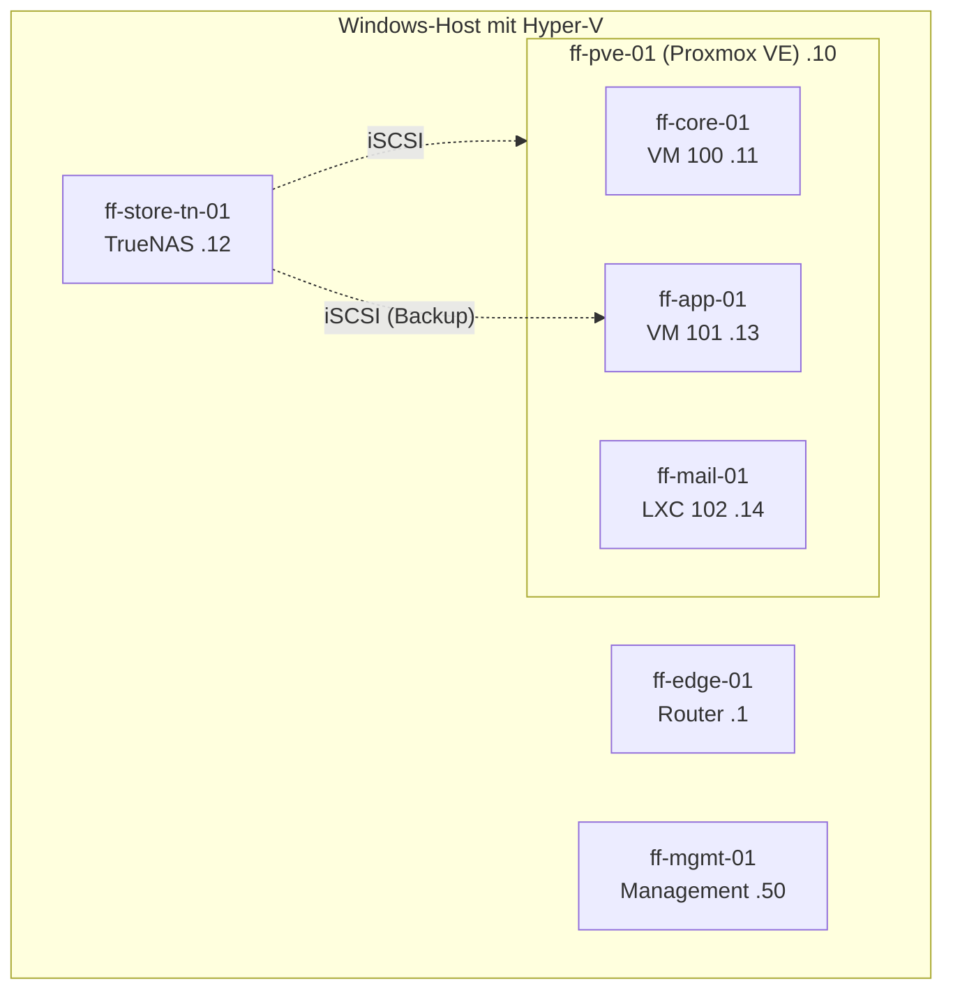
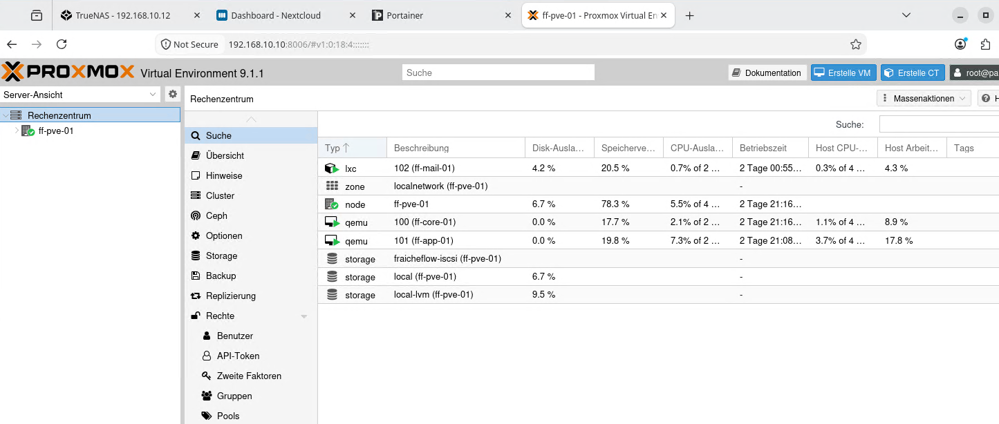

# Architektur des Labs

> Sieben virtuelle Systeme im Netz 192.168.10.0/24. Nur der Router ff-edge-01 verbindet sie mit der Außenwelt.

## Ziel

Die Seite zeigt, wie das Lab aufgebaut ist: welche Systeme es gibt, wie sie zusammenhängen und in welcher Reihenfolge sie entstanden sind. Das Lab ist ein **digitaler Zwilling**, also eine isolierte, virtuelle Kopie einer Infrastruktur für das fiktive Unternehmen Fraîche Flow (Bewässerung und Sprühnebel für eine Stadt). Änderungen werden dort erprobt, bevor sie in einem echten Netz Schaden anrichten können. Typische Risiken ohne eine solche Testumgebung sind doppelt vergebene IP-Adressen, nicht nachvollziehbare Änderungen und Fehler, die sich nicht wiederholen lassen.

## Grundlagen

Das Lab besteht aus mehreren Schichten, die ineinander liegen:

| Schicht | Aufgabe |
|---|---|
| **Äußerer Hypervisor** | Hyper-V auf einem Windows-Host, bereitgestellt vom Remote-Lab. Darauf laufen vier virtuelle Maschinen |
| **Privater Switch „Firmennetz“** | Virtueller Switch nur für die VMs. Er trennt das Lab vom Rest. Ein Ausgang führt nur über den Router ff-edge-01 |
| **Innerer Hypervisor** | Proxmox VE in der VM ff-pve-01. Er betreibt zwei VMs und einen LXC-Container |

Dass ein Hypervisor in einer VM läuft, heißt **Nested Virtualization** (geschachtelte Virtualisierung). Sie muss auf dem äußeren Host für die VM ausdrücklich freigegeben werden. Zusätzlich braucht die Netzwerkkarte der Proxmox-VM das **MAC-Spoofing**, sonst verwirft der äußere Switch die Pakete der inneren VMs, weil deren MAC-Adressen für ihn unbekannt sind.

Das Netz heißt `192.168.10.0/24` mit der Domain `fraicheflow.test`. Das Gateway ist 192.168.10.1.



## Meine Umsetzung

### Systeme und Rollen

| Host | IP | Typ | Rolle |
|---|---|---|---|
| ff-edge-01 | 192.168.10.1 (innen), 10.100.20.128 (außen) | Hyper-V-VM | Router, NAT, DNAT, siehe [Edge, NAT und DNAT](03_Edge_NAT_DNAT.md) |
| ff-pve-01 | 192.168.10.10 | Hyper-V-VM | Proxmox VE 9.1, Weboberfläche auf Port 8006 |
| ff-core-01 | 192.168.10.11 | Proxmox-VM 100 | DNS ([Bind9](04_DNS_Bind9.md)), DHCP ([Kea](05_DHCP_Kea.md)) |
| ff-store-01 | 192.168.10.12 | Hyper-V-VM (Name `ff-store-tn-01`) | TrueNAS, iSCSI, siehe [TrueNAS und iSCSI](09_TrueNAS_iSCSI.md) |
| ff-app-01 | 192.168.10.13 | Proxmox-VM 101 | Nextcloud, Docker, Backup |
| ff-mail-01 | 192.168.10.14 | Proxmox-LXC 102 | [Mailserver](18_Mailserver.md) |
| ff-mgmt-01 | 192.168.10.50 | Hyper-V-VM | Administration, Git, [Uptime Kuma](19_Monitoring_Kuma.md) |

Der Hostname von TrueNAS lautet `ff-store-01`, die VM in Hyper-V heißt `ff-store-tn-01`.



*Abbildung 1: Proxmox mit VM 100 (ff-core-01), VM 101 (ff-app-01), Container 102 (ff-mail-01) und dem iSCSI-Speicher `fraicheflow-iscsi`*

### Aufbaureihenfolge

Jeder Schritt hängt vom vorherigen ab: Ohne Router kein Internet, ohne Internet keine Pakete.

| Schritt | System | Inhalt |
|---|---|---|
| 1 | Hyper-V | Privater Switch `Firmennetz`, Enhanced Session Mode für Zwischenablage und Bildschirmgröße |
| 2 | ff-edge-01 | Router mit zwei Netzwerkkarten, Forwarding und NAT |
| 3 | ff-mgmt-01 | Administrations-VM, siehe [Management und Git](02_Management_Git.md) |
| 4 | ff-pve-01 | Proxmox VE mit Nested Virtualization |
| 5 | ff-core-01 | Erste VM in Proxmox, darauf DHCP und DNS |
| 6 | ff-store-01, ff-app-01 | Speicher und Anwendungsserver |
| 7 | ff-app-01, ff-mail-01 | Webplattform, Container, Mailserver |
| 8 | alle | SSH-Härtung, Backup, Alarmierung, Monitoring, Abnahme |

### Einstellungen der Proxmox-VM in Hyper-V

| Einstellung | Wert | Grund |
|---|---|---|
| Generation | 2 | UEFI-Start |
| Prozessor | 4 vCPU, `ExposeVirtualizationExtensions = True` | Nested Virtualization |
| Arbeitsspeicher | fest, 6128 MB bei der Installation, später auf 6144 MB erhöht und zeitweise auf 5198 MB gesenkt | Dynamischer Speicher funktioniert mit Nested Virtualization nicht |
| Festplatte | 250 GB | Platz für die inneren VMs |
| Netzwerk | `Firmennetz`, MAC-Spoofing an | Die inneren VMs senden mit eigenen MAC-Adressen |
| Secure Boot | aus | Wurde für den Proxmox-Start ausgeschaltet |
| Proxmox VE | 9.1-1 | Das ISO 9.2-1 wurde in der Hyper-V-VM der Generation 2 nicht gefunden („no device with valid ISO found“) |

Die Freigabe der Nested Virtualization und des MAC-Spoofings erfolgt in PowerShell auf dem Hyper-V-Host:

```powershell
Set-VMProcessor -VMName ff-pve-01 -ExposeVirtualizationExtensions $true
Set-VMNetworkAdapter -VMName ff-pve-01 -MacAddressSpoofing On
```

Zur Prüfung zeigt `Get-VMProcessor` den Wert `True`, und in ff-pve-01 meldet `lscpu` `Virtualization: VT-x`:

```bash
ssh root@192.168.10.10 "lscpu | grep -i virtualization"
```

### Einstellungen von ff-core-01 in Proxmox

| Einstellung | Wert |
|---|---|
| BIOS | UEFI (OVMF) mit EFI-Datenträger |
| Gast-Agent | QEMU Agent an |
| Prozessor und Speicher | 2 Kerne, 2048 MB RAM, minimal 1024 MB (Ballooning) |
| Festplatte | 32 GB |
| Start | „Beim Booten starten“ an |
| Software | Debian ohne Desktop, nur SSH-Server |

Nach der Installation wurde `sudo` eingerichtet und der Benutzer `ibrahim` der Gruppe `sudo` hinzugefügt.

### Prüfung des Gesamtbilds

```bash
ssh -i ~/.ssh/fraicheflow_ed25519 student@192.168.10.13 hostname
dig @192.168.10.11 mail.fraicheflow.test +short
ssh -i ~/.ssh/fraicheflow_ed25519 root@192.168.10.10 'pct list'
```

| Befehl | Erwartung |
|---|---|
| `ssh … hostname` | `ff-app-01`: ff-mgmt-01 erreicht den Server per Schlüssel |
| `dig … mail.fraicheflow.test +short` | `192.168.10.14`: der DNS-Server löst auf |
| `pct list` auf ff-pve-01 | Container 102 `running` |

## Ergebnis

Alle sieben Systeme laufen im Netz `192.168.10.0/24`, sind von ff-mgmt-01 aus erreichbar und lösen ihre Namen über ff-core-01 auf. Der Weg nach außen führt nur über ff-edge-01. Proxmox betreibt zwei VMs und einen LXC-Container.

Nicht gelöst: Der Speicher ist ein Einzelpunkt, denn Daten und Backup liegen auf demselben TrueNAS. Der Proxmox-Knoten war in der Übersicht zu rund 78 % mit Arbeitsspeicher belegt, für weitere Systeme müsste die Kapazität zuerst geplant werden.

## Worauf zu achten ist

| Punkt | Hintergrund |
|---|---|
| Vorgaben zuerst lesen | Die Proxmox-VM wurde zuerst mit selbst gewählten Werten (4096 MB dynamischer RAM, 2 vCPU, 40 GB) installiert. Danach fielen die genauen Vorgaben aus den Unterlagen auf, und ff-pve-01 wurde neu installiert. Aufgetreten im Lab |
| Proxmox 9.2-1 startet nicht | In Hyper-V Generation 2 meldete das Installationsmedium „no device with valid ISO found“. Mit 9.1-1 lief die Installation. Aufgetreten im Lab |
| Dynamischer RAM | Für die Proxmox-VM fest einstellen, sonst bricht Nested Virtualization |
| Arbeitsspeicher des Hyper-V-Hosts | Reicht der freie RAM nicht, startet eine VM nicht (`0x8007000E`). Im Lab musste der Speicher von ff-pve-01 zeitweise verringert werden, siehe [Docker und Docker Compose](15_Docker_Compose.md) und [Troubleshooting](21_Troubleshooting.md) |
| MAC-Spoofing vergessen | VMs in Proxmox bekämen dann keine Verbindung ins Netz |
| Namen von Hostname und VM | TrueNAS heißt als Host `ff-store-01`, als Hyper-V-VM `ff-store-tn-01`. In der Dokumentation immer klarstellen, was gemeint ist |

## Dateien

Diese Seite hat keine eigenen Konfigurationsdateien. Die Einstellungen von Hyper-V und Proxmox stehen in den Verwaltungsoberflächen.
