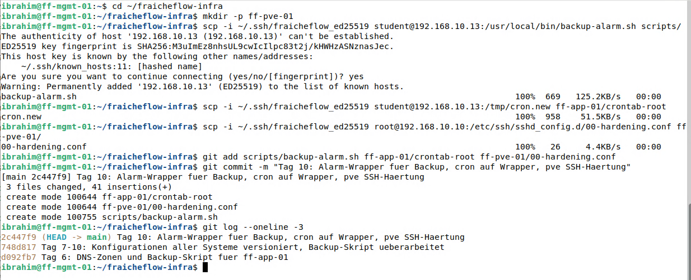
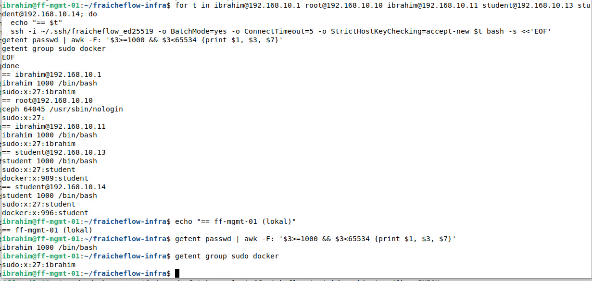

# Management-Client und Git

> Alle Server werden von einem Rechner aus verwaltet (ff-mgmt-01). Dort hält Git jede Änderung an Konfigurationen und Skripten fest.

## Ziel

Alle Server werden von einem einzigen Rechner aus verwaltet: ff-mgmt-01. Von dort laufen SSH-Zugriffe, Tests und die Überwachung. Dort liegt auch das Git-Repository `fraicheflow-infra`, das alle Konfigurationen und Skripte versioniert. So lässt sich später nachvollziehen, was wann geändert wurde, und ein früherer Stand wiederherstellen.

## Grundlagen

ff-mgmt-01 ist ein **Arbeitsplatz** und kein Server. Er ist ein Linux-Client (Debian 13.7 mit Cinnamon), von dem aus Administratoren auf andere Systeme zugreifen, testen und dokumentieren. Linux wurde statt Windows gewählt, weil es weniger Arbeitsspeicher und CPU braucht, die Fernwartung über SSH Standard ist und sich Befehle als reiner Text einfach dokumentieren lassen.

**Git** speichert den Verlauf von Dateien. Drei Orte spielen zusammen:

| Ort | Bedeutung | Befehl zum Übergang |
|---|---|---|
| Arbeitsverzeichnis (Working Directory) | Die Dateien, an denen man arbeitet | `git add <Datei>` |
| Staging Area | Vorgemerkte Änderungen für den nächsten Commit | `git commit -m "…"` |
| Repository | Dauerhaft gespeicherte Stände (Commits) mit Autor, Zeit, Nachricht und Hash | `git log` |

| Begriff | Bedeutung |
|---|---|
| **Commit** | Ein gespeicherter Stand. Er hat einen Hash (Kennung), den Autor und eine Nachricht |
| **Branch** | Ein eigener Entwicklungszweig, in dem man ausprobieren kann, ohne den Hauptzweig zu stören |
| **Merge-Konflikt** | Entsteht, wenn zwei Zweige dieselbe Stelle verschieden ändern. Git kann dann nicht automatisch entscheiden |
| **`git revert`** | Macht einen Commit durch einen neuen Gegen-Commit rückgängig. Die Historie bleibt erhalten und ist im Team sicher. `git reset --hard` dagegen schreibt die Historie um |

## Meine Umsetzung

**1. Git-Identität festlegen.** Git speichert in jedem Commit Name und E-Mail des Autors. Ohne diese Angabe ist nicht nachvollziehbar, wer was geändert hat:

```bash
git config --global user.name "Ibrahim Kilic"
git config --global user.email "ibrahim.kilic@example.invalid"
git config --global --list
```

Die Domain `.invalid` ist reserviert und steht für eine bewusst nicht echte Adresse. Zuerst wurde versehentlich `user.mail` statt `user.email` gesetzt. Git prüft Schlüsselnamen nicht und meldet keinen Fehler, benutzt `user.mail` aber nicht. Die Korrektur:

```bash
git config --global user.email "ibrahim.kilic@example.invalid"
git config --global --unset user.mail
```

**2. Übungen zum Arbeitsablauf.** In einem lokalen Übungsrepository wurde der gesamte Ablauf trainiert: Repository anlegen (`git init`), Datei hinzufügen und committen, Commit-Nachricht mit `git commit --amend` korrigieren, Feature-Branch (`git switch -c`), Merge als Fast-forward, Merge-Konflikt erzeugen und lösen, Fehler mit `git revert` zurücknehmen. Beim Auflösen des Konflikts wurden beide Regeln bewusst behalten: SSH aus dem Admin-Netz bleibt erlaubt, aus unbekannten Netzen wird es abgelehnt.

**3. Repository für das Lab.** Auf ff-mgmt-01 liegt das Repository unter `~/fraicheflow-infra`, Branch `main`. Konfigurationen werden von den Servern geholt und gezielt eingecheckt:

```bash
cd ~/fraicheflow-infra
scp -i ~/.ssh/fraicheflow_ed25519 student@192.168.10.13:/usr/local/bin/backup-alarm.sh scripts/
git add scripts/backup-alarm.sh ff-app-01/crontab-root ff-pve-01/00-hardening.conf
git commit -m "Tag 10: Alarm-Wrapper fuer Backup, cron auf Wrapper, pve SSH-Haertung"
git log --oneline -3
git status --short
```

`scp` kopiert Dateien über SSH. Die Dateien werden einzeln mit Namen hinzugefügt (`git add <Datei>`) und nicht pauschal mit `git add .`, damit keine Zugangsdaten oder Zufallsdateien im Verlauf landen.



*Abbildung 1: `scp` vom Server, `git add`, `git commit` und `git log --oneline` mit den letzten drei Commits*

Der Verlauf enthält Commits zu den einzelnen Zwischenständen (Konfiguration, DNS-Zonen, Backup-Skript, Alarm-Wrapper, SSH-Härtung).

**4. Benutzer und Gruppen prüfen.** Ein einziger Befehl fragt auf allen Servern ab, welche Benutzer es gibt und wer in den Gruppen `sudo` und `docker` ist:

```bash
for t in ibrahim@192.168.10.1 root@192.168.10.10 ibrahim@192.168.10.11 student@192.168.10.13 student@192.168.10.14; do
  echo "== $t"
  ssh -i ~/.ssh/fraicheflow_ed25519 -o BatchMode=yes -o ConnectTimeout=5 $t bash -s <<'EOF'
getent passwd | awk -F: '$3>=1000 && $3<65534 {print $1, $3, $7}'
getent group sudo docker
EOF
done
```

| Teil | Bedeutung |
|---|---|
| `getent passwd` | Listet Benutzer aus allen Quellen des Systems |
| `awk -F: '$3>=1000 && $3<65534'` | Nur normale Benutzer (Kennung ab 1000), keine Systemkonten |
| `getent group sudo docker` | Mitglieder der Gruppen mit Administratorrechten |
| `BatchMode=yes` | Keine Rückfrage nach einem Passwort. Schlägt der Schlüssel fehl, bricht der Befehl ab |



*Abbildung 2: Auf ff-edge-01, ff-core-01, ff-app-01 und ff-mail-01 steht je ein Benutzer in der Gruppe `sudo`, ff-pve-01 wird als `root` verwaltet. In der Gruppe `docker` stand zu diesem Zeitpunkt noch `student`. Sie wurde später geleert, siehe [Docker und Docker Compose](15_Docker_Compose.md)*

## Ergebnis

ff-mgmt-01 erreicht alle Server per SSH, die Zugänge sind in [SSH auf allen Servern](08_SSH_Alle_Server.md) beschrieben. Das Repository enthält Konfigurationen und Skripte mit nachvollziehbaren Commit-Nachrichten. Ein Remote (zum Beispiel GitHub) besteht noch nicht, das Repository liegt nur auf ff-mgmt-01.

Offen bleibt: Auf den Servern teilen sich Administratoren gemeinsame Konten (`ibrahim` auf ff-edge-01 und ff-core-01, `student` auf ff-app-01 und ff-mail-01, `root` auf ff-pve-01). Persönliche Konten je Administrator sind nicht eingerichtet.

## Worauf zu achten ist

| Punkt | Hintergrund |
|---|---|
| Hostname nach der Installation | Der Installer vergibt `debian`, wenn der Rechnername nicht geändert wird. `sudo sed -i 's/debian/ff-mgmt-01/g' /etc/hosts` ersetzt nur mit dem Flag `g` alle Vorkommen. Ohne `g` entstand im Lab `ff-mgmt-01.ff-mgmt-01.fraicheflow.test`. Danach `cat /etc/hosts` und `hostname -f` prüfen. Aufgetreten im Lab |
| `user.mail` statt `user.email` | Git meldet keinen Fehler. `git config --global --list` prüfen. Aufgetreten im Lab |
| `-all` statt `--all` | Lange Optionen brauchen zwei Bindestriche, sonst liest Git die Buchstaben einzeln. Aufgetreten im Lab |
| `systemd-resolved` fehlt | Debian 13 liefert es nicht mit, `resolvectl` fehlte. `sudo apt install systemd-resolved` und Neustart. Aufgetreten im Lab |
| Zugangsdaten im Repository | Passwörter, private Schlüssel und Tokens gehören nie in Git. Dateien einzeln hinzufügen und vor dem Veröffentlichen mit `grep` nach Zugangsdaten suchen |
| Nachricht eines Commits ändern | `git commit --amend` ändert den Hash. Nur verwenden, solange der Commit noch nicht geteilt ist |
| Schlüssel wird ignoriert | In `authorized_keys` fehlt der Schlüsseltyp am Zeilenanfang. Die Zeile muss mit `ssh-ed25519 ` beginnen, siehe [SSH auf allen Servern](08_SSH_Alle_Server.md) |

Weitere Fälle in [Troubleshooting](21_Troubleshooting.md).

## Dateien

Das Git-Repository `fraicheflow-infra` liegt auf ff-mgmt-01 und ist hier nicht abgelegt. Die Konfigurationen und Skripte stehen auf den Themenseiten.
