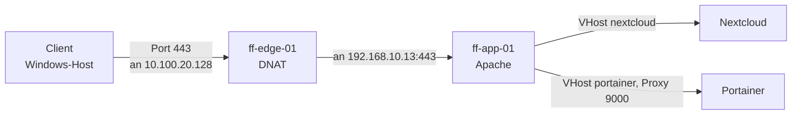
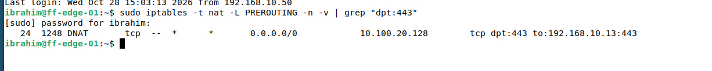
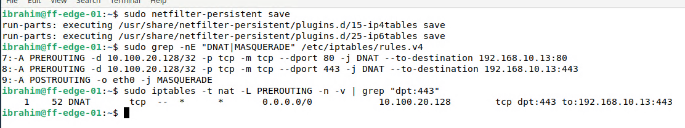

# Router, NAT und Portweiterleitung

> Der Router ist die einzige Tür nach außen. Er lässt interne Rechner ins Internet (NAT) und leitet Anfragen auf Port 80 und 443 an den Webserver weiter (DNAT).

## Ziel

ff-edge-01 ist die einzige Tür zwischen dem Lab-Netz und der Außenwelt. Er soll zwei Dinge leisten:

- Interne Rechner gelangen ins Internet (**NAT**), obwohl ihre Adressen dort nicht gültig sind.
- Zugriffe von außen auf Port 80 und 443 landen beim Webserver ff-app-01 (**DNAT**).

## Grundlagen

Ein **Router** leitet Pakete zwischen Netzen weiter. Linux tut das nur, wenn die Weiterleitung (`ip_forward`) eingeschaltet ist. Die Adressen aus `192.168.0.0/16` sind **private Adressen**: Im Internet werden sie nicht geroutet.

| Begriff | Bedeutung |
|---|---|
| **NAT** (Network Address Translation) | Der Router schreibt Adressen in Paketen um |
| **SNAT / Masquerading** | Ausgehend: Der Router ersetzt die interne Absenderadresse durch seine eigene äußere. Mehrere interne Rechner teilen sich so eine Adresse. `MASQUERADE` ist die Variante für Schnittstellen mit wechselnder Adresse (DHCP) |
| **DNAT** (Destination NAT) | Eingehend: Der Router ersetzt die Zieladresse. Anfragen an die äußere Adresse und einen Port gehen an einen internen Rechner |
| **Chain** | Regelkette in `iptables`. `PREROUTING` wird vor der Entscheidung über den Weg des Pakets durchlaufen und ist der Ort für DNAT. `POSTROUTING` danach und ist der Ort für Masquerading |

Der Weg einer Anfrage von außen:



Der Router hat zwei Netzwerkkarten:

| Karte | Netz | Adresse | Herkunft |
|---|---|---|---|
| `eth0` (WAN, außen) | Netz des Remote-Labs | 10.100.20.128/24, Standardroute über 10.100.20.254 | DHCP |
| `eth1` (LAN, innen) | Firmennetz | 192.168.10.1/24 | statisch |

## Meine Umsetzung

Alle Befehle laufen auf ff-edge-01 (Debian 13).

**1. Weiterleitung einschalten und dauerhaft speichern.** Die Einstellung steht in einer eigenen Datei, damit sie einen Neustart überlebt:

```bash
echo "net.ipv4.ip_forward=1" | sudo tee /etc/sysctl.d/99-ip-forward.conf
sudo sysctl --system
cat /proc/sys/net/ipv4/ip_forward
```

Die letzte Zeile zeigt `1`. Eine Datei `/etc/sysctl.conf` gibt es auf Debian 13 nicht mehr, Einstellungen gehören nach `/etc/sysctl.d/`.

**2. NAT für ausgehenden Verkehr.** Pakete, die über `eth0` nach außen gehen, bekommen die äußere Adresse des Routers:

```bash
sudo iptables -t nat -A POSTROUTING -o eth0 -j MASQUERADE
sudo apt install -y iptables-persistent
sudo netfilter-persistent save
```

| Option | Bedeutung |
|---|---|
| `-t nat` | Tabelle für Adressumschreibung |
| `-A POSTROUTING` | Regel ans Ende der Kette `POSTROUTING` anhängen |
| `-o eth0` | Nur für Pakete, die über `eth0` hinausgehen |
| `-j MASQUERADE` | Aktion: Absenderadresse durch die der Schnittstelle ersetzen |

`iptables-persistent` lädt gespeicherte Regeln beim Start. `netfilter-persistent save` schreibt die aktuellen Regeln nach `/etc/iptables/rules.v4`. Belegt sind Datei und Regel durch die Ausgaben in Schritt 3.

**3. Zustand prüfen, Neustart und erneut prüfen.**

```bash
ip -br a
cat /proc/sys/net/ipv4/ip_forward
grep -rs ip_forward /etc/sysctl.d/
sudo iptables -t nat -S
sudo cat /etc/iptables/rules.v4
```

```text
eth0    UP    10.100.20.128/24
eth1    UP    192.168.10.1/24
1
/etc/sysctl.d/99-ip-forward.conf:net.ipv4.ip_forward=1
-P PREROUTING ACCEPT
-P INPUT ACCEPT
-P OUTPUT ACCEPT
-P POSTROUTING ACCEPT
-A POSTROUTING -o eth0 -j MASQUERADE
```

Nach `sudo reboot` wurde dasselbe noch einmal geprüft: Die Kennung des Systemstarts (`hostnamectl`, Boot ID) hatte sich geändert, `eth1` stand weiter auf `192.168.10.1/24`, `ip_forward` auf `1`, und die Regel `MASQUERADE` war vorhanden. Beim ersten Versuch, die Regeln mit Zählern anzuzeigen, wurde `-V` statt `-v` getippt. `-V` zeigt nur die Version von `iptables` (hier 1.8.11 mit `nf_tables`). Zählerstände zeigt `-L -n -v`.

**4. Test aus dem Lab.** Von ff-mgmt-01 aus erreicht `ping 1.1.1.1` das Internet, ebenso die Paketquellen. Damit wirken Routing und NAT. Der Zähler der Regel zählt dabei mit:

```bash
sudo iptables -t nat -L POSTROUTING -n -v
```

**5. DNAT-Regeln für Port 80 und 443.** Anfragen an die äußere Adresse des Routers gehen an ff-app-01:

```bash
sudo iptables -t nat -A PREROUTING -p tcp -d 10.100.20.128 --dport 80  -j DNAT --to-destination 192.168.10.13:80
sudo iptables -t nat -A PREROUTING -p tcp -d 10.100.20.128 --dport 443 -j DNAT --to-destination 192.168.10.13:443
```

| Option | Bedeutung |
|---|---|
| `-A PREROUTING` | Kette, die vor der Wegentscheidung durchlaufen wird |
| `-p tcp -d 10.100.20.128 --dport 80` | Nur TCP-Pakete an die äußere Adresse des Routers auf Port 80 |
| `-j DNAT --to-destination 192.168.10.13:80` | Ziel durch ff-app-01 ersetzen |

Vor der Änderung war `PREROUTING` leer, in `POSTROUTING` stand nur die Regel `MASQUERADE`.

**6. Von außen testen.** Als externer Client dient der Windows-Host des Remote-Labs. Er liegt nicht im Lab-Netz. In seiner `hosts`-Datei (`C:\Windows\System32\drivers\etc\hosts`) steht:

```text
10.100.20.128 portainer.fraicheflow.test
```

Der Test geschieht auf dem Windows-Host. Nur dort zeigt der Zähler, dass der Verkehr wirklich den Router durchläuft. Ein Test direkt von ff-app-01 würde den Router umgehen. Danach werden die Zähler auf ff-edge-01 angesehen:

```bash
sudo iptables -t nat -L PREROUTING -n -v
sudo iptables -t nat -L PREROUTING -n -v | grep "dpt:443"
```

Beim ersten Test über HTTP zählte die Regel für Port 80 26 Pakete, und Portainer erschien im Browser des Windows-Hosts ([Portainer mit HTTPS-Proxy](16_Portainer_Proxy.md)). Später zählte die Regel für Port 443 24 Pakete.



*Abbildung 1: Die Regel für Port 443 hat 24 Pakete weitergeleitet*

**7. Regeln dauerhaft speichern.** Ohne Speichern gehen die DNAT-Regeln beim nächsten Neustart verloren:

```bash
sudo netfilter-persistent save
sudo grep -nE "DNAT|MASQUERADE" /etc/iptables/rules.v4
```



*Abbildung 2: `netfilter-persistent save` und die Zeilen in `rules.v4`: DNAT für 80 und 443, dazu `MASQUERADE`*

## Ergebnis

Interne Rechner erreichen das Internet über NAT, und das ist nach einem Neustart weiter so. Anfragen von außen auf Port 80 und 443 werden an ff-app-01 weitergeleitet, die Zähler belegen es. Die Regeln stehen in `/etc/iptables/rules.v4`.

Nicht belegt: Ein Neustart von ff-edge-01 nach dem Speichern der DNAT-Regeln wurde nicht gesondert getestet. Nachgewiesen ist der Inhalt von `rules.v4`. Filterregeln (eine Firewall in der Tabelle `filter`) sind nicht Teil dieser Seite.

## Worauf zu achten ist

| Punkt | Hintergrund |
|---|---|
| Regeln gehen beim Neustart verloren | `iptables` hält Regeln nur im Arbeitsspeicher. `netfilter-persistent save` nach jeder Änderung. Die DNAT-Regeln waren zuerst nicht gespeichert und wurden nachträglich gesichert. Aufgetreten im Lab |
| Test vom falschen Ort | Von ff-app-01 aus umgeht der Test den Router. Nur ein Zugriff von außen erhöht den Zähler |
| `-V` und `-v` | Großbuchstabe zeigt die Version, Kleinbuchstabe ausführliche Ausgabe mit Zählern. Aufgetreten im Lab |
| Äußere Adresse ändert sich | `eth0` bekommt die Adresse per DHCP. Ändert sie sich, passen die DNAT-Regeln mit `-d 10.100.20.128` und die `hosts`-Einträge nicht mehr |
| Regel mit Adresse und Port | `-d` und `--dport` begrenzen die Weiterleitung auf diesen einen Dienst. Ohne `-d` würde jeder Verkehr an Port 80 umgeleitet, auch der zum Router selbst |
| Einzelpunkt | Fällt ff-edge-01 aus, gibt es weder Internet noch Zugriff von außen |
| Angriffsfläche | Eine DNAT-Regel macht einen internen Dienst von außen erreichbar. Nur Ports weiterleiten, die gebraucht werden |

Weitere Fälle in [Troubleshooting](21_Troubleshooting.md).

## Dateien

- `/etc/iptables/rules.v4` auf ff-edge-01

Die Datei liegt im Lab und ist hier nicht als Datei abgelegt. Die wichtigen Teile stehen oben auf der Seite.
