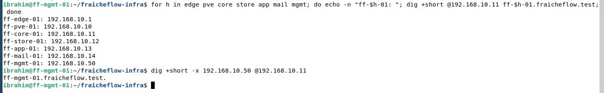

# DNS mit Bind9

> Ein eigener Namensserver übersetzt Namen wie `ff-app-01.fraicheflow.test` in IP-Adressen, damit sich niemand Zahlen merken muss.

## Ziel

Alle Systeme im Labor sollen sich über Namen erreichen, zum Beispiel `ff-app-01.fraicheflow.test` statt `192.168.10.13`. Dafür läuft auf ff-core-01 ein eigener Namensserver für die interne Domain `fraicheflow.test`. Er beantwortet nur Anfragen aus dem Labornetz und leitet alles andere an öffentliche DNS-Server weiter.

## Grundlagen

**DNS** (Domain Name System) übersetzt Namen in Adressen und umgekehrt. **Bind9** ist der verbreitetste Namensserver unter Linux, der Dienst heißt `named`. Die Daten stehen in **Zonen**, das sind Textdateien mit **Resource Records**:

| Record | Aufgabe | Beispiel im Lab |
|---|---|---|
| `SOA` | Kopfzeile der Zone mit Seriennummer und Zeiten | `ff-core-01.fraicheflow.test.` als Hauptserver |
| `NS` | Welcher Server für die Zone zuständig ist | ff-core-01 |
| `A` | Name zeigt auf eine IPv4-Adresse | `ff-app-01` zeigt auf 192.168.10.13 |
| `CNAME` | Alias, zweiter Name für einen vorhandenen Namen | `portal` zeigt auf ff-app-01 |
| `MX` | Mailserver der Domain, mit Rangfolge | `mail.fraicheflow.test` |
| `PTR` | Rückrichtung: Adresse zeigt auf einen Namen | 13 zeigt auf ff-app-01 |

Die **Forward-Zone** (`fraicheflow.test`) beantwortet „Name zu Adresse“, die **Reverse-Zone** (`10.168.192.in-addr.arpa`) beantwortet „Adresse zu Name“. Der Zonenname der Reverse-Zone besteht aus den Netzanteilen der Adresse in umgekehrter Reihenfolge.

Zwei Regeln sind wichtig:

- **Seriennummer:** Bei jeder Änderung muss die Seriennummer im `SOA`-Record steigen, sonst erkennen andere Server die Änderung nicht. Das Schema `JJJJMMTTNN` (Jahr, Monat, Tag, laufende Nummer) macht die Nummer lesbar.
- **Punkt am Ende:** Ein Name mit abschließendem Punkt ist vollständig (`ff-app-01.fraicheflow.test.`). Ohne Punkt hängt Bind die Zone noch einmal an.

## Meine Umsetzung

Der Server läuft auf ff-core-01 (192.168.10.11).

**1. Pakete installieren.**

```bash
sudo apt update && sudo apt install -y bind9 bind9-utils
```

**2. Zonen bekanntmachen.** In `/etc/bind/named.conf.local` stehen die beiden Zonen. `type master` heißt: Dieser Server hält die Originaldaten.

```text
zone "fraicheflow.test" {
    type master;
    file "/etc/bind/db.fraicheflow.test";
};

zone "10.168.192.in-addr.arpa" {
    type master;
    file "/etc/bind/db.10.168.192";
};
```

**3. Forward-Zone schreiben** (`/etc/bind/db.fraicheflow.test`, Auszug):

```text
$TTL 3600
@   IN SOA ff-core-01.fraicheflow.test. admin.fraicheflow.test. (
        2026102701 ; Serial
        3600       ; Refresh
        900        ; Retry
        604800     ; Expire
        3600 )     ; Negative Cache TTL
@   IN NS    ff-core-01.fraicheflow.test.
@   IN MX 10 mail.fraicheflow.test.

ff-edge-01  IN A 192.168.10.1
ff-pve-01   IN A 192.168.10.10
ff-core-01  IN A 192.168.10.11
ff-store-01 IN A 192.168.10.12
ff-app-01   IN A 192.168.10.13
ff-mail-01  IN A 192.168.10.14
mail        IN A 192.168.10.14
ff-mgmt-01  IN A 192.168.10.50

dns       IN CNAME ff-core-01.fraicheflow.test.
storage   IN CNAME ff-store-01.fraicheflow.test.
pve       IN CNAME ff-pve-01.fraicheflow.test.
portal    IN CNAME ff-app-01.fraicheflow.test.
nextcloud IN CNAME ff-app-01.fraicheflow.test.
portainer IN CNAME ff-app-01.fraicheflow.test.
```

| Teil | Bedeutung |
|---|---|
| `$TTL 3600` | Standardzeit in Sekunden, die andere Server eine Antwort zwischenspeichern dürfen |
| `SOA` mit Serial | Hauptserver, Ansprechpartner (`admin.…`) und Seriennummer im Schema `JJJJMMTTNN` |
| Refresh, Retry, Expire | Zeiten, nach denen ein zweiter Server nachfragt, es wiederholt und die Zone verwirft. Im Lab gibt es keinen zweiten Server, sie bleiben Standardwerte |
| Negative Cache TTL | Wie lange „gibt es nicht“ zwischengespeichert wird |
| `@` | Steht für die Zone selbst (`fraicheflow.test.`) |
| `MX 10` | Mails für die Domain gehen an `mail.fraicheflow.test`, die Zahl ist die Rangfolge (kleiner = bevorzugt) |
| `A` | Feste Zuordnung Name zu Adresse |
| `CNAME` | Alias auf einen vorhandenen Namen. So zeigt `portal` immer dorthin, wo ff-app-01 liegt |

`mail` ist bewusst ein `A`-Record und kein Alias: Ein `MX`-Eintrag darf nicht auf einen Alias zeigen.

**4. Reverse-Zone schreiben** (`/etc/bind/db.10.168.192`). Sie hat dieselbe Kopfzeile wie die Forward-Zone, danach stehen nur noch Zeilen nach dem Muster „letzte Stelle der Adresse zeigt auf Name“, zum Beispiel:

```text
1   IN PTR ff-edge-01.fraicheflow.test.
13  IN PTR ff-app-01.fraicheflow.test.
50  IN PTR ff-mgmt-01.fraicheflow.test.
```

**5. Allgemeine Einstellungen.** In `/etc/bind/named.conf.options`:

```text
acl internal-network {
    192.168.10.0/24;
};

options {
    directory "/var/cache/bind";
    allow-query { localhost; internal-network; };
    allow-transfer { none; };
    recursion yes;
    dnssec-validation no;
    forwarders {
        9.9.9.9;
        1.1.1.1;
    };
    listen-on-v6 { none; };
};
```

| Einstellung | Wirkung |
|---|---|
| `acl internal-network` | Gibt dem Labornetz einen Namen, der unten verwendet wird |
| `allow-query` | Nur der Server selbst und das Labornetz dürfen fragen |
| `allow-transfer { none; }` | Niemand darf die ganze Zone herunterladen. Sonst ließe sich die Liste aller Hosts mit einer Anfrage abrufen |
| `recursion yes` | Der Server löst auch fremde Namen auf, nicht nur die eigene Zone |
| `forwarders` | Fremde Namen werden an 9.9.9.9 und 1.1.1.1 weitergereicht |
| `dnssec-validation no` | Schaltet die Signaturprüfung ab. Das vermeidet im Lab Fehlermeldungen, senkt aber die Sicherheit |
| `listen-on-v6 { none; }` | Kein Lauschen auf IPv6, das Labornetz nutzt nur IPv4 |

Zusätzlich steht in `/etc/default/named` die Option `-4` (`OPTIONS="-u bind -4"`), damit `named` ausschließlich IPv4 verwendet. Diese Änderung wirkt erst nach `sudo systemctl restart named`, ein `reload` reicht nicht.

**6. Prüfen und laden.** Erst die Syntax prüfen, dann laden:

```bash
sudo named-checkconf
sudo named-checkzone fraicheflow.test /etc/bind/db.fraicheflow.test
sudo named-checkzone 10.168.192.in-addr.arpa /etc/bind/db.10.168.192
sudo rndc reload
```

`named-checkconf` schweigt, wenn alles stimmt. `named-checkzone` meldet `loaded serial …` und `OK`.

**7. Clients auf den Server zeigen.** ff-core-01 fragt sich selbst (`127.0.0.1`). ff-mgmt-01 hat seine Netzwerkeinstellungen im NetworkManager, dort stand der DNS-Server zunächst manuell auf `1.1.1.1`. Deshalb konnte der Client interne Namen nicht auflösen. Mit `nmcli` wird der DNS-Server im Profil geändert und sofort angewendet:

```bash
nmcli connection show
sudo nmcli connection modify "Wired connection 1" ipv4.dns 192.168.10.11
sudo nmcli device reapply eth0
resolvectl status
```

`nmcli connection show` nennt den Profilnamen (hier `Wired connection 1`, Gerät `eth0`). `modify` speichert den neuen DNS-Server dauerhaft im Profil, `reapply` wendet ihn auf die laufende Verbindung an, ohne sie zu trennen. `resolvectl status` muss danach `192.168.10.11` als DNS-Server zeigen.

**8. Auflösung testen.** `@192.168.10.11` fragt gezielt den eigenen Server, ohne diese Angabe würde `dig` den Resolver des Clients fragen.

```bash
for h in edge pve core store app mail mgmt; do echo -n "ff-$h-01: "; dig +short @192.168.10.11 ff-$h-01.fraicheflow.test; done
dig +short -x 192.168.10.50 @192.168.10.11
```



*Abbildung 1: Sieben Namen lösen auf die richtigen Adressen auf, die Rückauflösung von 192.168.10.50 liefert ff-mgmt-01*

## Ergebnis

Alle sieben Systeme lösen vorwärts auf, die Rückauflösung wurde für 192.168.10.50 gezeigt. Die Aliasnamen (`dns`, `storage`, `pve`, `portal`, `nextcloud`, `portainer`) und der Mailserver (`mail`, `MX`) sind in derselben Zone eingetragen und werden von den späteren Diensten benutzt. Ob die Reverse-Zone für jede einzelne Adresse geprüft wurde, ist nicht belegt, gezeigt ist nur ein Beispiel.

## Worauf zu achten ist

| Punkt | Hintergrund |
|---|---|
| Seriennummer erhöhen | Ohne höhere Nummer wird eine Änderung nicht sauber übernommen. In der Zone stieg die Nummer bei jeder Anpassung, zuletzt auf `2026102701` |
| `named-checkzone` vor `rndc reload` | `rndc reload` meldet `server reload successful`, auch wenn eine Zone wegen eines Fehlers gar nicht geladen wurde. Erst die Prüfung zeigt den Fehler |
| Alias und `A` nicht mischen | Für einen Namen darf nur ein Record-Typ existieren. Im Lab entstand die Meldung `CNAME and other data`, als `portal` zugleich `A` und `CNAME` war |
| Punkt am Ende der Namen | Ohne Punkt hängt Bind die Zone noch einmal an |
| Record-Typ nicht vergessen | Fehlt in einer Zeile das `A`, meldet `named-checkzone` `unknown RR type`. Auch hier hilft die Prüfung vor dem Laden |
| Alter Zwischenspeicher auf dem Client | Der Resolver von ff-mgmt-01 speicherte eine negative Antwort. Nach der Korrektur der Zone half `resolvectl flush-caches` |
| Client-DNS prüfen | Der Client fragte zunächst `1.1.1.1` und kannte deshalb keine internen Namen. `resolvectl status` zeigt, welcher Server wirklich gefragt wird. Im Lab trat das bei ff-mgmt-01 auf |
| Reverse-Zone mitpflegen | Wird eine Adresse geändert (im Lab ff-app-01 von .30 auf .13), müssen `A` und `PTR` angepasst werden |

Im Lab aufgetreten waren der CNAME-Konflikt, der Zwischenspeicher, das fehlende `A`, der falsche Client-DNS und die Adressänderung von ff-app-01, die übrigen Punkte sind allgemeine Hinweise. Weitere Fälle in [Troubleshooting](21_Troubleshooting.md).

## Dateien

- `/etc/bind/` auf ff-core-01: `db.fraicheflow.test`, `db.10.168.192`, `named.conf.local`, `named.conf.options`

Die Datei liegt im Lab und ist hier nicht als Datei abgelegt. Die wichtigen Teile stehen oben auf der Seite.
