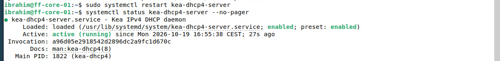
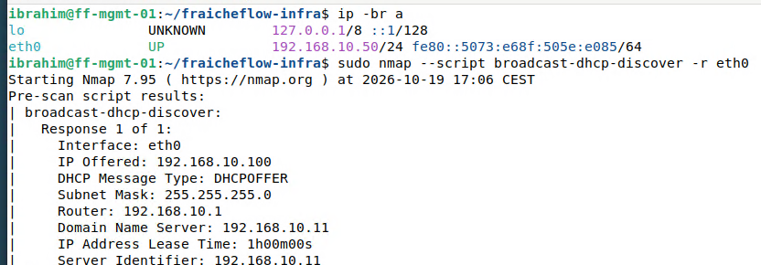

# DHCP mit Kea

> Ein DHCP-Server verteilt automatisch Adresse, Gateway und DNS-Server an neue Geräte. Getestet ist das erste Angebot an einen Client, nicht die ganze Vergabe.

## Ziel

Geräte im Labornetz sollen ihre Netzwerkeinstellungen automatisch erhalten: eine Adresse, das Gateway und den DNS-Server. Niemand muss sie von Hand eintragen. Die Server selbst behalten feste Adressen, DHCP ist für weitere Clients gedacht.

## Grundlagen

**DHCP** (Dynamic Host Configuration Protocol) verteilt Netzwerkeinstellungen. Ein neues Gerät kennt zunächst weder eine Adresse noch den Server. Deshalb läuft die Vergabe in vier Schritten ab:

| Schritt | Nachricht | Bedeutung |
|---|---|---|
| 1 | Discover | Der Client fragt per Broadcast: „Gibt es einen DHCP-Server?“ |
| 2 | Offer | Der Server bietet eine freie Adresse samt Optionen an |
| 3 | Request | Der Client nimmt das Angebot an |
| 4 | Acknowledge | Der Server bestätigt, die Adresse ist für eine bestimmte Zeit vergeben (Lease) |

Für die Vergabe braucht der Server drei Angaben:

- **Subnetz und Pool:** das Netz und den Bereich, aus dem er Adressen verteilt.
- **Optionen:** Gateway und DNS-Server, die der Client mitbekommt.
- **Lease-Zeit:** wie lange eine Adresse gültig ist, bevor der Client sie erneuern muss.

**Kea** ist der DHCP-Server von ISC. Seine Konfiguration ist eine JSON-Datei (`/etc/kea/kea-dhcp4.conf`). Der Pool darf sich nicht mit festen Adressen überschneiden, sonst vergibt der Server Adressen doppelt.

## Meine Umsetzung

Kea läuft auf ff-core-01 (192.168.10.11) und ist so aufgebaut:

| Einstellung | Wert |
|---|---|
| Netz | 192.168.10.0/24 |
| Pool | 192.168.10.100 bis 192.168.10.150 (feste Adressen liegen außerhalb: .1, .10 bis .14, .50) |
| Optionen | Gateway 192.168.10.1, DNS 192.168.10.11 |
| Lease-Zeit | 3600 Sekunden |
| Netzwerkkarte | `ens18` |

**1. Paket installieren.** Debian startet den Dienst sofort, allerdings mit einer Standardkonfiguration, die das Labornetz nicht kennt.

```bash
sudo apt update && sudo apt install -y kea-dhcp4-server
```

**2. Namen der Netzwerkkarte ermitteln.** Kea nimmt Anfragen nur auf den Karten an, die in der Konfiguration stehen. Der Name der Karte hängt vom System ab: Debian benennt sie nach ihrem Steckplatz (`ens18` = Ethernet, PCI-Slot 18), auf anderen Rechnern heißt sie `ens33`, `enp0s3` oder `eth0`. Deshalb wird der Name nicht übernommen, sondern geprüft:

```bash
ip -br a
```

Die Karte mit der Adresse 192.168.10.11 heißt hier `ens18`.

**3. Konfiguration schreiben.** Die Originaldatei wird vorher gesichert. `tee` schreibt mit Administratorrechten, ein einfaches `>` würde in `/etc` scheitern.

```bash
sudo cp /etc/kea/kea-dhcp4.conf /etc/kea/kea-dhcp4.conf.orig
sudo tee /etc/kea/kea-dhcp4.conf > /dev/null <<'ENDE'
{
  "Dhcp4": {
    "interfaces-config": { "interfaces": [ "ens18" ] },
    "lease-database": { "type": "memfile", "lfc-interval": 3600 },
    "valid-lifetime": 3600,
    "subnet4": [
      {
        "id": 1,
        "subnet": "192.168.10.0/24",
        "pools": [ { "pool": "192.168.10.100 - 192.168.10.150" } ],
        "option-data": [
          { "name": "routers", "data": "192.168.10.1" },
          { "name": "domain-name-servers", "data": "192.168.10.11" }
        ]
      }
    ]
  }
}
ENDE
```

Bedeutung der Einstellungen:

| Einstellung | Bedeutung |
|---|---|
| `"Dhcp4"` | Hauptabschnitt für den IPv4-Dienst, alles Weitere steht darin |
| `"interfaces"` | Netzwerkkarte, auf der Kea Anfragen annimmt (`ens18`) |
| `"lease-database"` mit `memfile` | Die vergebenen Adressen (Leases) werden in einer Datei gespeichert. `lfc-interval` räumt sie alle 3600 Sekunden auf |
| `"valid-lifetime"` | Gültigkeit einer Adresse in Sekunden (3600 = 1 Stunde) |
| `"subnet4"` mit `"subnet"` | Das Netz, für das Kea zuständig ist (192.168.10.0/24). `"id"` ist die interne Nummer dieses Netzes |
| `"pools"` | Bereich, aus dem Adressen vergeben werden (.100 bis .150) |
| `"routers"` | Gateway, das die Clients erhalten |
| `"domain-name-servers"` | DNS-Server, den die Clients erhalten |

**4. Dienst neu starten und prüfen.** Der Start mit der neuen Datei ist der eigentliche Test: Kea liest die Konfiguration beim Start und weigert sich bei Fehlern.

```bash
sudo systemctl restart kea-dhcp4-server
systemctl status kea-dhcp4-server --no-pager
```



*Abbildung 1: `active (running)` und `enabled`, der Dienst startet auch beim Booten*

**5. Adressangebot testen.** Von ff-mgmt-01 wird eine DHCP-Anfrage (Discover) gesendet, ohne dass eine Adresse übernommen wird. Fehlt `nmap`, vorher `sudo apt install -y nmap`.

```bash
sudo nmap --script broadcast-dhcp-discover -r eth0
```



*Abbildung 2: Der Server bietet 192.168.10.100 mit Gateway und DNS an*

## Ergebnis

Kea läuft und beantwortet Anfragen aus dem Labornetz. Das Angebot (Offer) enthält die erste freie Adresse des Pools (192.168.10.100), das Gateway 192.168.10.1, den DNS-Server 192.168.10.11 und eine Gültigkeit von einer Stunde. Getestet ist damit der erste Teil der Vergabe. Die vollständige Vergabe an einen neu angeschlossenen Client wurde nicht durchgespielt.

## Worauf zu achten ist

| Punkt | Hintergrund |
|---|---|
| JSON genau schreiben | Ein fehlendes Komma, ein fehlender Doppelpunkt oder eine falsche Klammer macht die ganze Datei ungültig |
| Kartenname prüfen und exakt schreiben | Der Name muss mit `ip -br a` übereinstimmen. Schon ein Leerzeichen (`"ens18 "`) benennt eine Karte, die es nicht gibt, und Kea würde dort nicht lauschen. Im Lab stand zunächst genau das in der Datei |
| Pool und feste Adressen trennen | Der Pool darf keine Serveradresse enthalten |
| Nur ein DHCP-Server im Netz | Ein zweiter Server würde parallel Angebote machen |
| Syntaxtest | `sudo kea-dhcp4 -t /etc/kea/kea-dhcp4.conf` meldete im Lab `Unable to open file`, obwohl die Datei lesbar war. Maßgeblich ist deshalb der erfolgreiche Dienststart (Journal: `sudo journalctl -u kea-dhcp4-server -n 15 --no-pager`, Zeile `DHCP4_STARTED`) |

Im Lab aufgetreten waren die ersten zwei Punkte sowie die Meldung beim Syntaxtest, die übrigen sind allgemeine Hinweise. Weitere Fälle in [Troubleshooting](21_Troubleshooting.md).

## Dateien

- `/etc/kea/kea-dhcp4.conf` auf ff-core-01

Die Datei liegt im Lab und ist hier nicht als Datei abgelegt. Die wichtigen Teile stehen oben auf der Seite.
