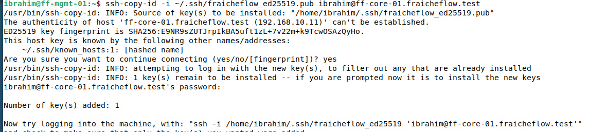
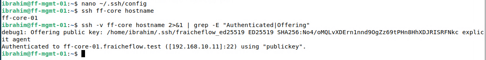

# SSH-Schlüssel und Alias

> Der Verwaltungsrechner meldet sich mit einem Schlüssel statt mit einem Passwort an. Das ist sicherer und bequemer.

## Ziel

Der Verwaltungsrechner ff-mgmt-01 soll sich an den Servern mit einem Schlüsselpaar anmelden statt mit einem Passwort. Diese Seite richtet den Schlüssel ein und testet ihn am Server ff-core-01. Das Abschalten der Passwort-Anmeldung folgt erst auf der nächsten Seite, damit der Zugang nie gefährdet ist.

## Grundlagen

Bei der **Schlüssel-Anmeldung** (Public-Key-Authentifizierung) gibt es zwei zusammengehörige Dateien:

| Datei | Rolle | Wohin damit |
|---|---|---|
| Privater Schlüssel | Beweist die Identität, wird nie weitergegeben | bleibt auf ff-mgmt-01 |
| Öffentlicher Schlüssel (`.pub`) | Kann jeder kennen, damit prüft der Server den Beweis | wird auf die Server kopiert (`~/.ssh/authorized_keys`) |

Der Server schickt beim Anmelden eine Aufgabe, die nur der private Schlüssel lösen kann. Das Geheimnis verlässt den Rechner dabei nicht. Ein Passwort dagegen wird bei jeder Anmeldung eingegeben und lässt sich erraten oder abfangen.

Der Schlüssel selbst lässt sich zusätzlich mit einer **Passphrase** schützen. Wer die Datei stiehlt, kann sie ohne Passphrase nicht benutzen.

Als Schlüsseltyp dient **ed25519**: modern, kurz und von OpenSSH Standard. Eine **SSH-Konfigurationsdatei** (`~/.ssh/config`) legt für jeden Server Benutzer, Adresse und Schlüssel fest, sodass ein Kurzname genügt.

## Meine Umsetzung

Alle Schritte laufen auf ff-mgmt-01 (192.168.10.50). Zielserver ist ff-core-01, der Benutzer dort heißt `ibrahim`.

**1. Schlüsselpaar erzeugen.** `-t` wählt den Typ, `-f` den Dateinamen. Die Frage nach der Passphrase wird mit einem Passwort beantwortet und wiederholt.

```bash
ssh-keygen -t ed25519 -f ~/.ssh/fraicheflow_ed25519
```

Es entstehen zwei Dateien in `~/.ssh/`: `fraicheflow_ed25519` (privat) und `fraicheflow_ed25519.pub` (öffentlich).

**2. Öffentlichen Schlüssel auf den Server kopieren.** `ssh-copy-id` trägt ihn in die Datei `authorized_keys` des Benutzers ein. Dafür wird einmalig das Passwort des Benutzers gebraucht. Beim ersten Verbindungsaufbau fragt SSH, ob dem Server vertraut wird (`yes`).

```bash
ssh-copy-id -i ~/.ssh/fraicheflow_ed25519.pub ibrahim@ff-core-01.fraicheflow.test
```



*Abbildung 1: `Number of key(s) added: 1`, danach der Test der Anmeldung*

**3. Anmeldung mit Schlüssel testen.** Jetzt fragt SSH nach der Passphrase des Schlüssels, nicht mehr nach dem Passwort des Servers.

```bash
ssh -i ~/.ssh/fraicheflow_ed25519 ibrahim@ff-core-01.fraicheflow.test
```

**4. Alias anlegen.** Die Datei `~/.ssh/config` bekommt einen Eintrag für den Server:

```text
Host ff-core
    HostName ff-core-01.fraicheflow.test
    User ibrahim
    Port 22
    IdentityFile ~/.ssh/fraicheflow_ed25519
```

| Zeile | Bedeutung |
|---|---|
| `Host ff-core` | Kurzname, den man später eintippt |
| `HostName` | Der tatsächliche Servername (per DNS auflösbar) |
| `User` | Benutzer auf dem Server |
| `Port` | SSH-Port, hier der Standardport 22 |
| `IdentityFile` | Welcher private Schlüssel verwendet wird |

**5. Alias prüfen.** Mit `-v` zeigt SSH, welches Verfahren tatsächlich zur Anmeldung geführt hat.

```bash
ssh ff-core hostname
ssh -v ff-core hostname 2>&1 | grep -E "Authenticated|Offering"
```



*Abbildung 2: Die Zeile `Authenticated ... using "publickey"` belegt die Schlüssel-Anmeldung*

## Ergebnis

ff-mgmt-01 meldet sich an ff-core-01 mit dem Schlüssel an, und der Kurzname `ff-core` genügt dafür. Das Passwort des Servers ist zu diesem Zeitpunkt noch aktiv, es wird auf der nächsten Seite abgeschaltet.

## Worauf zu achten ist

| Punkt | Hintergrund |
|---|---|
| Privaten Schlüssel nie kopieren oder ins Git-Repository legen | Wer die Datei hat, kann sich anmelden. Im Repository stehen nur Konfigurationsdateien, kein Schlüssel |
| Passphrase setzen | Schützt den Schlüssel, falls die Datei abhanden kommt |
| Erst testen, dann härten | Der Schlüssel-Test (Schritt 3) muss gelingen, bevor das Passwort abgeschaltet wird, sonst sperrt man sich aus |
| Rechte der Dateien | SSH ignoriert einen privaten Schlüssel, der für andere lesbar ist (`chmod 600`). `ssh-keygen` setzt die Rechte selbst richtig |
| Zeile in `authorized_keys` | Sie muss mit dem Schlüsseltyp `ssh-ed25519` beginnen, sonst überspringt der Server sie. Auf ff-pve-01 trat das beim manuellen Eintragen auf, siehe [SSH auf allen Servern](08_SSH_Alle_Server.md) |

Weitere Fälle in [Troubleshooting](21_Troubleshooting.md).

## Dateien

- Der Alias steht in `~/.ssh/config` auf ff-mgmt-01 und gehört nicht ins Repository (er enthält Benutzernamen und Pfade).
