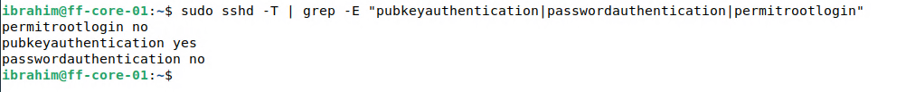
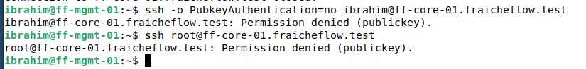

# SSH: Passwort-Anmeldung abschalten

> Auf ff-core-01 wird die Anmeldung mit Passwort abgeschaltet. Nur der Schlüssel funktioniert noch. Ein Test mit Passwort muss scheitern, das ist der Beweis.

## Ziel

Auf ff-core-01 soll der Zugang nur noch mit Schlüssel möglich sein. Die Anmeldung per Passwort und die direkte Anmeldung als `root` werden abgeschaltet. Ein Angreifer im Netz kann dann keine Passwörter mehr durchprobieren. Die Seite zeigt, wie das gefahrlos geschieht und wie man das Ergebnis prüft.

## Grundlagen

Der SSH-Dienst (`sshd`) liest seine Einstellungen aus `/etc/ssh/sshd_config` und aus allen Dateien in `/etc/ssh/sshd_config.d/`. Drei Eigenheiten sind für die Härtung wichtig:

| Eigenheit | Folge |
|---|---|
| Bei `sshd` gilt der **erste** gefundene Wert einer Einstellung | Die eigene Datei muss alphabetisch vor allen anderen stehen, deshalb `00-hardening.conf` |
| `sshd -T` zeigt die Werte, mit denen der Dienst tatsächlich läuft | Aussagekräftiger als ein Blick in die Datei |
| `reload` lädt die Konfiguration neu, ohne bestehende Verbindungen zu trennen | Eine offene Sitzung bleibt als Rückweg erhalten |

Eigene Einstellungen kommen in eine eigene Datei, die Hauptdatei bleibt unverändert. So ist auf einen Blick sichtbar, was geändert wurde, und die Änderung lässt sich durch Löschen der Datei rückgängig machen.

Die drei Einstellungen:

| Einstellung | Wert | Wirkung |
|---|---|---|
| `PubkeyAuthentication` | `yes` | Anmeldung mit Schlüssel bleibt erlaubt |
| `PasswordAuthentication` | `no` | Passwort-Anmeldung ist abgeschaltet |
| `PermitRootLogin` | `no` | Direkte Anmeldung als `root` ist verboten |

## Meine Umsetzung

Die Konfiguration läuft in einer Sitzung auf ff-core-01. Eine zweite Sitzung von ff-mgmt-01 bleibt dauerhaft offen und dient nur als Rückweg, falls die Konfiguration einen Fehler enthält.

**1. Aktuelle Werte lesen.**

```bash
sudo sshd -T | grep -E "pubkeyauthentication|passwordauthentication|permitrootlogin"
```

Vor der Härtung lautete das Ergebnis `pubkeyauthentication yes`, `passwordauthentication yes` und `permitrootlogin without-password`. Der letzte Wert erlaubt `root` nur mit Schlüssel.

**2. Härtungsdatei anlegen.**

```bash
sudo tee /etc/ssh/sshd_config.d/00-hardening.conf > /dev/null <<'ENDE'
PubkeyAuthentication yes
PasswordAuthentication no
PermitRootLogin no
ENDE
```

**3. Syntax prüfen und Konfiguration laden.** `sshd -t` schweigt, wenn alles in Ordnung ist. Erst dann wird neu geladen.

```bash
sudo sshd -t && sudo systemctl reload ssh
```

**4. Wirksame Werte kontrollieren.** Der Befehl aus Schritt 1 wird wiederholt.



*Abbildung 1: `passwordauthentication no`, `permitrootlogin no`, `pubkeyauthentication yes`*

**5. Gegenprobe von ff-mgmt-01 aus.** Der erste Befehl erzwingt eine Anmeldung ohne Schlüssel (der Passwort-Test), der zweite probiert `root`.

```bash
ssh -o PubkeyAuthentication=no ibrahim@ff-core-01.fraicheflow.test
ssh root@ff-core-01.fraicheflow.test
```



*Abbildung 2: Beide Versuche enden mit `Permission denied (publickey)`*

## Ergebnis

ff-core-01 akzeptiert nur noch den Schlüssel. In der Meldung `Permission denied (publickey)` nennt die Klammer die Verfahren, die der Server noch anbietet. Steht dort nur `publickey`, ist der Passwort-Weg geschlossen. Das gilt hier für Passwort und `root` gleichermaßen. Die Anmeldung mit Schlüssel funktioniert weiter (Alias `ff-core`).

## Worauf zu achten ist

| Punkt | Hintergrund |
|---|---|
| Eine Sitzung offen halten | Bei einem Fehler in der Datei kommt man über die geöffnete Sitzung zurück. Bestehende Verbindungen bleiben beim `reload` erhalten |
| Erst `sshd -t`, dann `reload` | Eine fehlerhafte Datei würde sonst den Dienst beeinträchtigen. Das `&&` lädt nur bei erfolgreicher Prüfung |
| Dateiname mit `00-` | Bei `sshd` gewinnt der erste Wert. Eine Datei, die früher gelesen wird, könnte die Härtung sonst überstimmen. `sshd -T` zeigt, was wirklich gilt |
| Gegenprobe nicht vergessen | Nur der Versuch ohne Schlüssel zeigt, dass der Passwort-Weg wirklich zu ist |
| Rückfallplan | Bei verlorenem Zugang an der Konsole des Servers (Hyper-V oder Proxmox) anmelden: `sudo rm /etc/ssh/sshd_config.d/00-hardening.conf`, dann `sudo systemctl reload ssh` |
| Änderungen an `authorized_keys` | Sie wirken sofort, nur Änderungen an der sshd-Konfiguration brauchen `reload` |

Weitere Fälle in [Troubleshooting](21_Troubleshooting.md).

## Dateien

- `/etc/ssh/sshd_config.d/00-hardening.conf` auf ff-core-01

Die Datei liegt im Lab und ist hier nicht als Datei abgelegt. Die wichtigen Teile stehen oben auf der Seite.
