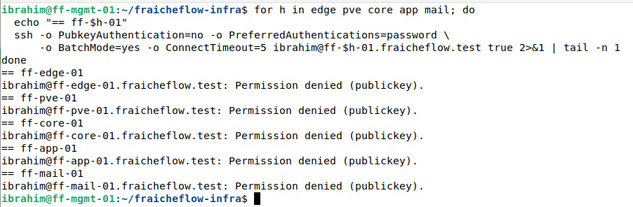
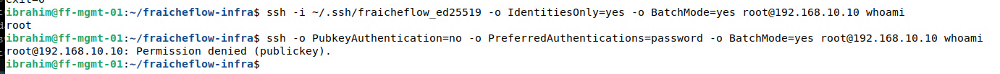

# SSH auf allen Servern

> Alle fünf Linux-Server nehmen nur noch den Schlüssel an. Ein einziger Befehl prüft sie alle.

## Ziel

Was auf ff-core-01 erprobt wurde, soll auf allen fünf Linux-Servern gelten: Anmeldung nur mit dem Schlüssel von ff-mgmt-01, keine Passwörter. Am Ende prüft ein einziger Befehl alle Server.

## Grundlagen

Das Vorgehen ist je Server dasselbe wie in [SSH-Schlüssel und Alias](06_SSH_Schluessel.md) und [Passwort-Anmeldung abschalten](07_SSH_Passwort_abschalten.md). Wichtig ist die Reihenfolge, weil man sich sonst aussperren kann:

| Reihenfolge | Schritt |
|---|---|
| 1 | Schlüssel auf den Server kopieren |
| 2 | Anmeldung mit Schlüssel testen |
| 3 | Erst dann `PasswordAuthentication no` setzen |
| 4 | Von außen prüfen, dass Passwörter abgelehnt werden |

Benutzer und Adressen der Server:

| Server | Adresse | Benutzer |
|---|---|---|
| ff-edge-01 | 192.168.10.1 | ibrahim |
| ff-pve-01 | 192.168.10.10 | root |
| ff-core-01 | 192.168.10.11 | ibrahim (bereits erledigt) |
| ff-app-01 | 192.168.10.13 | student |
| ff-mail-01 | 192.168.10.14 | student |

## Meine Umsetzung

**1. Schlüssel kopieren.** Auf ff-mgmt-01, je Server mit dessen Benutzer:

```bash
ssh-copy-id -i ~/.ssh/fraicheflow_ed25519.pub ibrahim@ff-edge-01.fraicheflow.test
ssh-copy-id -i ~/.ssh/fraicheflow_ed25519.pub student@ff-app-01.fraicheflow.test
ssh-copy-id -i ~/.ssh/fraicheflow_ed25519.pub student@ff-mail-01.fraicheflow.test
```

Anschließend wird je Server die Anmeldung mit Schlüssel getestet.

**2. Sonderfall ff-pve-01.** Dort nahm `ssh-copy-id` das Root-Passwort nicht an. Der Schlüssel wurde deshalb über die Web-Shell von Proxmox eingetragen (Knoten ff-pve-01, Schaltfläche *Shell*). Auf ff-mgmt-01 wird die Zeile angezeigt:

```bash
cat ~/.ssh/fraicheflow_ed25519.pub
```

In der Web-Shell wird die ganze Zeile angehängt (`AAAA...` steht hier für den langen Schlüsseltext):

```bash
echo "ssh-ed25519 AAAA... ibrahim@ff-mgmt-01" >> /root/.ssh/authorized_keys
```

Auf Proxmox ist `/root/.ssh/authorized_keys` eine Verknüpfung auf `/etc/pve/priv/authorized_keys` im Cluster-Dateisystem. Die Zeile muss mit `ssh-ed25519` beginnen, sonst überspringt der Server sie.

**3. Passwort-Anmeldung abschalten.** Erst nach erfolgreichem Schlüssel-Test, auf jedem der vier Server:

```bash
echo "PasswordAuthentication no" | sudo tee /etc/ssh/sshd_config.d/00-hardening.conf
sudo sshd -t && sudo systemctl reload ssh
```

Auf ff-pve-01 ist man als `root` angemeldet, dort entfällt `sudo`. Die Datei enthält auf diesen vier Servern nur die eine Zeile `PasswordAuthentication no`, die weiteren Einstellungen aus der Härtung von ff-core-01 (`PermitRootLogin no`) sind dort nicht gesetzt. Auf ff-mail-01 (LXC-Container) meldete `sshd -T` danach `Missing privilege separation directory: /run/sshd`. Die Ursache wurde nicht untersucht. Maßgeblich waren deshalb `sshd -t` ohne Ausgabe und die Gegenprobe von ff-mgmt-01.

**4. Abschlussprüfung.** Der Befehl versucht auf jedem Server eine Anmeldung ohne Schlüssel. `BatchMode=yes` verhindert die Passwortabfrage, `ConnectTimeout=5` bricht nach fünf Sekunden ab. Der Benutzername spielt keine Rolle, denn die Meldung zeigt nur, welche Verfahren der Server anbietet.

```bash
for h in edge pve core app mail; do
  echo "== ff-$h-01"
  ssh -o PubkeyAuthentication=no -o PreferredAuthentications=password \
      -o BatchMode=yes -o ConnectTimeout=5 ibrahim@ff-$h-01.fraicheflow.test true 2>&1 | tail -n 1
done
```



*Abbildung 1: Fünfmal `Permission denied (publickey)`*

**5. Gegenprobe für ff-pve-01.** Zusätzlich wird gezeigt, dass der Schlüssel dort funktioniert und das Passwort nicht:

```bash
ssh -i ~/.ssh/fraicheflow_ed25519 -o IdentitiesOnly=yes -o BatchMode=yes root@192.168.10.10 whoami
```



*Abbildung 2: Mit Schlüssel erscheint `root`, ohne Schlüssel wird abgelehnt*

## Ergebnis

Alle fünf Server lehnen die Anmeldung ohne Schlüssel ab, ff-mgmt-01 kommt mit dem Schlüssel überall hinein. Auf ff-core-01 enthält die Härtungsdatei drei Einstellungen. Für die übrigen Server wurde nur die Zeile `PasswordAuthentication no` gesetzt. Persönliche Administratorkonten statt gemeinsamer Benutzer sind ein offener Punkt, siehe [Abnahme](20_Abnahme.md).

## Worauf zu achten ist

| Punkt | Hintergrund |
|---|---|
| Zeile in `authorized_keys` ohne `ssh-ed25519` am Anfang | Der Server überspringt sie und der Schlüssel wird nie angeboten. Beim manuellen Eintragen auf ff-pve-01 ist darauf zu achten |
| Passwort erst nach dem Schlüssel-Test abschalten | Sonst sperrt man sich selbst aus |
| `(publickey,password)` in der Fehlermeldung | Der Passwort-Weg ist auf diesem Server noch offen, Konfiguration und `sshd -T` prüfen |
| Tippfehler im Dateinamen | Auf ff-mail-01 entstand versehentlich eine zweite Datei `00-hardening.con` (ohne `f`). Sie wurde wieder gelöscht. `ls /etc/ssh/sshd_config.d/` zeigt, welche Dateien tatsächlich gelesen werden |
| Rückfallplan | Zugang über die Konsole (Hyper-V oder Proxmox) und Härtungsdatei entfernen, wie auf der [vorigen Seite](07_SSH_Passwort_abschalten.md) beschrieben |

Im Lab aufgetreten waren der Tippfehler im Dateinamen und die Meldung von `sshd -T` auf ff-mail-01. Weitere Fälle in [Troubleshooting](21_Troubleshooting.md).

## Dateien

- `/etc/ssh/sshd_config.d/00-hardening.conf` auf allen fünf Servern. Auf ff-core-01 mit drei Einstellungen, auf den anderen vier nur mit der Zeile `PasswordAuthentication no`

Die Datei liegt im Lab und ist hier nicht als Datei abgelegt. Die wichtigen Teile stehen oben auf der Seite.
