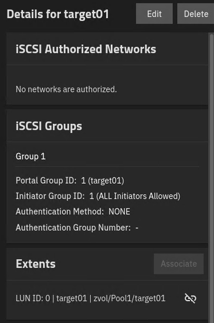
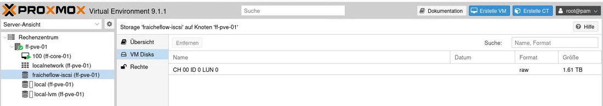

# Speicher mit TrueNAS und iSCSI

> Ein TrueNAS-Server stellt Speicherplatz über das Netzwerk bereit (iSCSI). Proxmox sieht ihn wie eine eigene Festplatte.

## Ziel

Proxmox soll zentralen Speicher über das Netzwerk bekommen, ohne dass dafür ein eigenes Speichersystem gekauft werden muss. Dafür läuft auf ff-store-01 (192.168.10.12) ein TrueNAS, das einen Teil seines Platzes per iSCSI bereitstellt. Ein zweites, getrenntes Target dient später für die Backups (siehe [Backup-Ziel](10_Backup_Ziel.md)).

## Grundlagen

**iSCSI** überträgt Speicherblöcke über das Netzwerk. Der Client sieht den entfernten Speicher wie eine eingebaute Festplatte und legt selbst ein Dateisystem darauf an. Die Begriffe:

| Begriff | Bedeutung |
|---|---|
| Target | Der Server-Teil: stellt Speicher bereit (hier TrueNAS) |
| Initiator | Der Client-Teil: bindet den Speicher ein (hier Proxmox, später ff-app-01) |
| IQN | Eindeutiger Name eines Targets oder Initiators, z. B. `iqn.2005-10.org.freenas.ctl:target01` |
| Portal | Adresse und Port, unter dem das Target erreichbar ist (Standardport 3260) |
| Extent / Zvol | Der tatsächliche Speicherbereich auf dem Pool, den ein Target ausliefert |
| LUN | Nummer des Laufwerks innerhalb eines Targets (hier LUN 0) |

**TrueNAS** verwaltet seine Platten mit dem Dateisystem **ZFS**. Mehrere Platten werden zu einem **Pool** zusammengefasst. Bei **RAID-Z1** ist die Kapazität einer Platte für Paritätsdaten reserviert: Eine Platte darf ausfallen, ohne dass Daten verloren gehen. Aus drei Platten zu je 1 TiB entstehen so rund 2 TiB nutzbarer Platz.

Ein Target kann den Zugriff beschränken: auf bestimmte Initiatoren (anhand des IQN) und mit einem Passwort (CHAP). Beides schützt davor, dass sich fremde Geräte im Netz mit dem Speicher verbinden.

## Meine Umsetzung

**1. TrueNAS-VM in Hyper-V anlegen.** Die VM läuft auf dem Hyper-V-Host, der das Labornetz bereitstellt.

| Einstellung | Wert |
|---|---|
| Name | ff-store-tn-01 (Rolle ff-store-01) |
| Generation | 2, Secure Boot ausgeschaltet |
| Arbeitsspeicher | 2048 MB |
| Prozessoren | 4 |
| Zusätzliche Platten | 3 dynamische Datenträger zu je 1024 GB |
| Netzwerk | feste Adresse 192.168.10.12/24, Gateway .1, DNS .11 |
| Version | TrueNAS 27.0.0-RC.1 (Vorabversion) |

**2. Pool anlegen.** In der Weboberfläche von TrueNAS entsteht aus den drei zusätzlichen Platten der Pool `Pool1` als RAID-Z1 mit 1,98 TiB nutzbarem Platz. Nach einem Neustart der VM blieben Adresse und Pool unverändert.

**3. Target anlegen.** Der iSCSI-Assistent erzeugt Target, Extent und Portal in einem Zug:

| Einstellung | Wert |
|---|---|
| Target-Name | `target01` |
| Basisname | `iqn.2005-10.org.freenas.ctl` |
| Extent | Zvol im Pool1, 1500 GiB, Blockgröße 4k (Modern OS) |
| Portal | alle Schnittstellen, 0.0.0.0:3260 |
| Initiatoren | alle erlaubt |
| Authentifizierung | keine (CHAP nicht eingerichtet) |
| Dienst | iSCSI gestartet, Autostart eingeschaltet |

*Abbildung 1: Das Target mit seiner Gruppe und dem Extent (LUN 0)*

**4. In Proxmox einbinden.** Unter *Datacenter, Storage, Add, iSCSI* wird der Speicher `fraicheflow-iscsi` mit dem Portal 192.168.10.12 angelegt. Proxmox bietet `target01` in der Auswahl selbst an. Die Option *Use LUNs directly* (LUNs direkt benutzen) bleibt ausgeschaltet, damit auf der LUN später LVM angelegt und mehrere VM-Festplatten darauf verwaltet werden können. Die LVM-Schicht selbst ist noch nicht angelegt.

**5. Verbindung prüfen.** Von ff-pve-01 aus wird der Speicher angepingt (`ping 192.168.10.12`, vier von vier Antworten). In der Proxmox-Oberfläche erscheint die LUN mit 1,61 TB.

*Abbildung 2: Der Speicher `fraicheflow-iscsi` zeigt LUN 0 mit 1,61 TB*

## Ergebnis

Proxmox sieht das Target `target01` und die LUN mit 1,61 TB. Der Speicher ist als Grundlage für LVM vorbereitet, genutzt wird er für VM-Festplatten bisher noch nicht. Die Einschränkung auf bestimmte Initiatoren und CHAP sind für `target01` nicht eingerichtet und bewusst für den Labortest offen gelassen.

## Worauf zu achten ist

| Punkt | Hintergrund |
|---|---|
| Initiatoren beschränken und CHAP einrichten | Mit „alle erlaubt“ könnte sich jedes Gerät im Netz mit dem Target verbinden. Für `target01` ist das im Lab offen, für ein echtes Netz wäre es ein Pflichtpunkt |
| Zu wenig Arbeitsspeicher für die VM | Im Lab startete die TrueNAS-VM zeitweise nicht, der Hyper-V-Host meldete `0x8007000E` (nicht genug Speicher). Das fiel erst durch ausgefallene Backups auf, siehe [Backup-Skript](11_Backup_Skript.md). Abhilfe war, den Arbeitsspeicher von ff-pve-01 von 6144 auf 5198 MB zu senken |
| Thin Provisioning auf dem Hyper-V-Host | Die virtuellen Platten sind zusammen größer als der Datenträger des Hosts (Überbuchung). Läuft der Host voll, fallen alle VMs aus. Die Belegung muss beobachtet werden |
| Einzelner Speicherpunkt | Daten und Backup liegen auf demselben TrueNAS. Fällt er aus, sind beide betroffen |
| Vorabversion | Die eingesetzte TrueNAS-Version ist ein Release Candidate und für ein Lab geeignet, nicht für einen Produktivbetrieb |

Im Lab aufgetreten war der Speichermangel, die übrigen Punkte sind Risiken, die dokumentiert und nicht behoben sind. Weitere Fälle in [Troubleshooting](21_Troubleshooting.md).

## Dateien

Die Konfiguration erfolgt in den Weboberflächen von TrueNAS und Proxmox, es gibt dafür keine Konfigurationsdatei.
