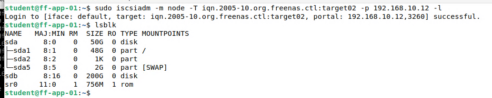
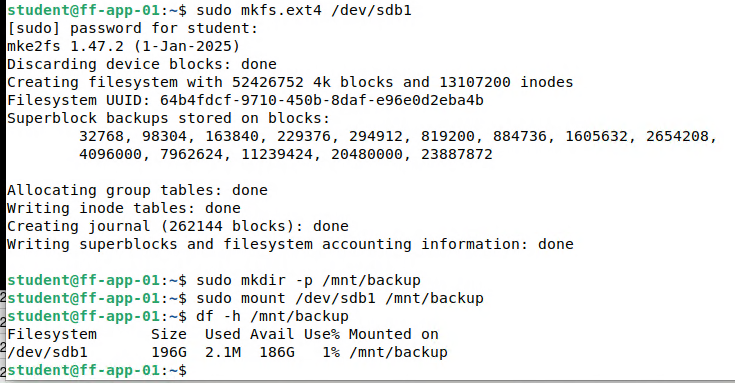

# Backup-Ziel per iSCSI

> Für die Backups gibt es einen eigenen, getrennten Speicherplatz auf TrueNAS. Er ist nur während der Sicherung verbunden.

## Ziel

Die nächtliche Sicherung von ff-app-01 braucht einen Speicherort, der von den Platten der virtuellen Maschinen getrennt ist. Dafür wird auf TrueNAS ein zweites Target (`target02`) eingerichtet, das nur ff-app-01 benutzen darf. ff-app-01 verbindet sich nur für die Dauer der Sicherung. Diese Seite richtet das Ziel ein und prüft es von Hand, das Skript folgt auf der nächsten Seite.

## Grundlagen

Auf dem Client übernimmt das Paket **open-iscsi** die Rolle des Initiators. Der Weg zu einem nutzbaren Laufwerk:

| Schritt | Befehl | Bedeutung |
|---|---|---|
| Discovery | `iscsiadm -m discovery -t sendtargets -p <Adresse>` | Fragt den Server, welche Targets er anbietet |
| Login | `iscsiadm -m node -T <Target> -p <Adresse> -l` | Baut die Sitzung auf, ein neues Blockgerät erscheint |
| Einrichten | `fdisk`, `mkfs`, `mount` | Partition, Dateisystem und Einbindung wie bei einer Festplatte |
| Logout | `iscsiadm … -u` | Beendet die Sitzung, das Gerät verschwindet |

Wer sich anmelden darf, bestimmt der **Initiator-Name** (IQN). Jeder Client hat einen eigenen, er steht in `/etc/iscsi/initiatorname.iscsi` und existiert erst, wenn open-iscsi installiert ist. Beschränkt man ein Target auf diesen Namen, kann kein anderes Gerät darauf zugreifen.

Die Gerätenamen `/dev/sdb`, `/dev/sdc` können sich beim nächsten Login ändern. Stabil ist der Pfad unter `/dev/disk/by-path/`, er enthält Adresse, Target und LUN.

## Meine Umsetzung

**1. Pakete auf ff-app-01 installieren.** Das muss vor dem Anlegen des Targets geschehen, weil die IQN gebraucht wird.

```bash
sudo apt update
sudo apt install -y open-iscsi rsync
cat /etc/iscsi/initiatorname.iscsi
```

**2. `target02` auf TrueNAS anlegen.**

| Einstellung | Wert |
|---|---|
| Target-Name | `target02` |
| Extent | eigener Extent im Pool1, 200 GiB |
| Portal | 192.168.10.12:3260 |
| Initiator | nur die IQN von ff-app-01 |
| Authentifizierung | keine |

TrueNAS rechnet in GiB, deshalb sind es 200 GiB statt 200 GB.

**3. Discovery und Login.** Vorher hält `lsblk` den Ausgangszustand fest (nur `sda` mit 50 G). Danach erscheint ein neues Gerät mit 200 G. Dadurch ist sicher, dass keine falsche Platte angefasst wird.

```bash
lsblk
sudo iscsiadm -m discovery -t sendtargets -p 192.168.10.12
sudo iscsiadm -m node -T iqn.2005-10.org.freenas.ctl:target02 -p 192.168.10.12 -l
lsblk
```

Die Discovery zeigt beide Targets, `target01` und `target02`. Nach dem Login erscheint `sdb` mit 200 G.



*Abbildung 1: Nach dem Login ist `sdb` (200 G) sichtbar*

**4. Partition, Dateisystem und Mount.** Nur das neue Gerät wird bearbeitet. In `fdisk` entsteht eine primäre Partition über die ganze Platte: `n` (neu), `p` (primär), `1` (Nummer), zweimal Enter (Standardwerte für Anfang und Ende), `p` (Tabelle zur Kontrolle anzeigen), `w` (schreiben).

```bash
sudo fdisk /dev/sdb
sudo mkfs.ext4 /dev/sdb1
sudo mkdir -p /mnt/backup
sudo mount /dev/sdb1 /mnt/backup
df -h /mnt/backup
```



*Abbildung 2: `mkfs.ext4`, `mount` und `df -h` mit 196 G Größe und 1 % belegt*

**5. Stabilen Pfad ermitteln und wieder trennen.** Das Skript wird später den Pfad aus `by-path` verwenden. Zum Schluss wird ausgehängt und abgemeldet, danach ist das Backup-Ziel im System nicht mehr sichtbar.

```bash
ls -l /dev/disk/by-path/ | grep iscsi
sudo umount /mnt/backup
sudo iscsiadm -m node -T iqn.2005-10.org.freenas.ctl:target02 -p 192.168.10.12 -u
```

## Ergebnis

`target02` ist nur für ff-app-01 freigegeben und lässt sich von Hand verbinden, formatieren, einbinden und wieder trennen. Das Dateisystem hat nutzbare 196 G. Das Ziel ist dauerhaft nicht eingebunden, nur während einer Sicherung.

## Worauf zu achten ist

| Punkt | Hintergrund |
|---|---|
| IQN vor dem Target beschaffen | Ohne installiertes open-iscsi gibt es die Datei mit dem Initiator-Namen nicht. Im Lab wurde deshalb das Paket vor `target02` installiert |
| Richtiges Gerät erwischen | `lsblk` vor und nach dem Login vergleichen. `mkfs` auf der falschen Platte löscht deren Daten. Im Lab war `sda` die Systemplatte |
| `by-path` statt `/dev/sdb` | Der Gerätename kann sich ändern, der Pfad unter `/dev/disk/by-path/` bleibt gleich |
| Erst aushängen, dann abmelden | Ein Logout bei eingebundenem Dateisystem kann Daten kosten |
| Ziel nicht dauerhaft einbinden | Ein dauerhaft eingebundenes Backup-Ziel wäre bei Fehlern oder Schadsoftware mit betroffen |
| Gleicher Speicher wie `target01` | Beide Targets liegen auf demselben TrueNAS, die Trennung schützt nicht vor dessen Ausfall |

Im Lab aufgetreten war nur der Punkt mit der Reihenfolge von IQN und Target, die übrigen sind Hinweise. Weitere Fälle in [Troubleshooting](21_Troubleshooting.md).

## Dateien

- Konfiguration in den Weboberflächen von TrueNAS, auf ff-app-01 keine Konfigurationsdatei. Das Skript, das dieses Ziel benutzt, steht auf der nächsten Seite: [Backup-Skript](11_Backup_Skript.md).
