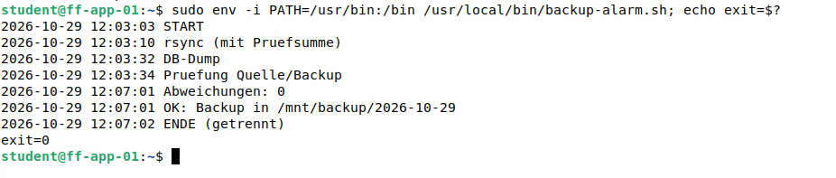

# Backup-Skript für ff-app-01

> Ein Skript sichert jede Nacht um 01:00 Uhr Webdateien, Konfiguration und Datenbank und prüft danach, ob die Kopien stimmen.

## Ziel

ff-app-01 (Nextcloud mit Webdateien, Konfiguration und Datenbank) soll jede Nacht automatisch gesichert werden. Das Ziel ist `target02` auf TrueNAS (siehe [Backup-Ziel](10_Backup_Ziel.md)), das nur während der Sicherung verbunden ist. Das Skript soll bei jedem Fehler abbrechen und das Ergebnis eindeutig ins Log schreiben, damit ein stiller Fehlschlag auffällt.

## Grundlagen

Ein Backup-Skript wiederholt von Hand durchgeführte Schritte in fester Reihenfolge. Für den Betrieb zählen drei Dinge:

| Baustein | Zweck |
|---|---|
| **Ablauf** | Verbinden, einbinden, kopieren, prüfen, aushängen, trennen |
| **Fehlerbehandlung** | Jeder Schritt, der scheitern kann, bricht das Skript mit einem Fehlercode ab (`exit 1`). Der Fehlercode ist das Signal für den Alarm |
| **Aufräumen** | Egal wie das Skript endet, am Schluss wird ausgehängt und abgemeldet (`trap … EXIT`) |

Die Datensicherung selbst besteht aus zwei Teilen:

- **Dateien:** `rsync -a` kopiert Verzeichnisse und behält Rechte, Besitzer und Zeitstempel. Jeder Tag bekommt einen eigenen Ordner.
- **Datenbank:** Ein Dump (`mariadb-dump`) ist eine Textdatei mit allen Befehlen, um die Datenbank neu aufzubauen. Mit `--single-transaction` ist er konsistent, ohne die Datenbank zu sperren.

Eine Sicherung ist erst brauchbar, wenn sie geprüft ist. Dafür wird der Dump auf Lesbarkeit getestet (`gzip -t`) und die kopierten Dateien werden mit der Quelle verglichen (`rsync -aicn`, siehe unten).

## Meine Umsetzung

Das Skript liegt auf ff-app-01 unter `/usr/local/bin/backup.sh` und läuft als `root`. Die erste Fassung enthielt nur Verbinden, Kopieren und Trennen. Die jetzige Fassung ergänzt Fehlerprüfung, Datenbank-Dump und Kontrolle.

**1. Skript anlegen.** Der Text wird mit `tee` geschrieben, weil ein einfaches `>` in `/usr/local/bin` mit Benutzerrechten scheitern würde.

```bash
sudo tee /usr/local/bin/backup.sh >/dev/null <<'EOF'
#!/bin/bash
# Backup ff-app-01 -> TrueNAS target02 (iSCSI), Cron taeglich 01:00
set -o pipefail

ISCSI_TARGET="iqn.2005-10.org.freenas.ctl:target02"
ISCSI_IP="192.168.10.12"
MOUNT_POINT="/mnt/backup"
DATE=$(date +%Y-%m-%d)
BACKUP_DIR="${MOUNT_POINT}/${DATE}"
DISK="/dev/disk/by-path/ip-${ISCSI_IP}:3260-iscsi-${ISCSI_TARGET}-lun-0-part1"

log() { echo "$(date '+%F %T') $*"; }

cleanup() {
  if mountpoint -q "$MOUNT_POINT"; then
    sync
    umount "$MOUNT_POINT" || { log "FEHLER: umount fehlgeschlagen, iSCSI bleibt verbunden"; return; }
  fi
  iscsiadm -m node -T "$ISCSI_TARGET" -p "$ISCSI_IP" -u >/dev/null 2>&1
  log "ENDE (getrennt)"
}
trap cleanup EXIT
trap 'log "ABBRUCH durch Benutzer"; exit 130' INT TERM

log "START"
iscsiadm -m node -T "$ISCSI_TARGET" -p "$ISCSI_IP" -l >/dev/null || { log "FEHLER: iSCSI-Login"; exit 1; }
sleep 5
mkdir -p "$MOUNT_POINT"
mount "$DISK" "$MOUNT_POINT" || { log "FEHLER: Mount"; exit 1; }
mountpoint -q "$MOUNT_POINT" || { log "FEHLER: kein Mountpoint"; exit 1; }

mkdir -p "$BACKUP_DIR"
log "rsync (mit Pruefsumme)"
rsync -a /var/www /etc "$BACKUP_DIR/" || { log "FEHLER: rsync"; exit 1; }
log "DB-Dump"
mariadb-dump --single-transaction nextcloud_db | gzip > "${BACKUP_DIR}/nextcloud_db.sql.gz" || { log "FEHLER: DB-Dump"; exit 1; }
gzip -t "${BACKUP_DIR}/nextcloud_db.sql.gz" || { log "FEHLER: DB-Dump defekt"; exit 1; }
log "Pruefung Quelle/Backup"
DIFF=$(rsync -aicn /var/www /etc "$BACKUP_DIR/" | tee /tmp/backup-diff.txt | wc -l)
log "Abweichungen: ${DIFF}"
log "OK: Backup in ${BACKUP_DIR}"
EOF
sudo chmod 755 /usr/local/bin/backup.sh
```

| Abschnitt | Bedeutung |
|---|---|
| `set -o pipefail` | Ein Fehler in einer Pipe (z. B. beim Dump vor `gzip`) zählt als Fehler des ganzen Befehls |
| Variablen oben | Target, Adresse und Pfade stehen an einer Stelle. `DISK` nutzt den stabilen Pfad aus `/dev/disk/by-path/` |
| `log()` | Schreibt Zeitstempel und Text, jede Zeile im Log ist so zeitlich einzuordnen |
| `cleanup()` mit `trap … EXIT` | Läuft immer am Ende, auch nach einem Fehler: aushängen, nur dann abmelden, wenn das Aushängen gelang. So bleibt kein halb verbundenes Ziel zurück |
| `trap … INT TERM` | Bei einem Abbruch (Strg+C) steht „ABBRUCH“ im Log, danach läuft `cleanup` |
| `\|\| { log …; exit 1; }` | Gelingt der Schritt nicht, wird der Grund geloggt und das Skript endet mit Fehlercode 1 |
| `mountpoint -q` | Prüft, dass wirklich etwas unter `/mnt/backup` eingebunden ist. Ohne die Prüfung würde `rsync` bei einem fehlgeschlagenen Mount auf die lokale Platte schreiben |
| `mariadb-dump … \| gzip` | Datenbank sichern und gleich komprimieren |
| `gzip -t` | Prüft, ob die komprimierte Datei lesbar ist |
| `rsync -aicn` | Trockenlauf (`-n`) mit Prüfsummen (`-c`): Es wird nichts kopiert, aber jede Abweichung zwischen Quelle und Backup wird als Zeile gezählt |

**2. Von Hand starten.** Die Ausgabe geht ins Log, genau wie später bei cron:

```bash
sudo /usr/local/bin/backup.sh 2>&1 | sudo tee -a /var/log/backup.log
```

**3. Mit der Umgebung von cron testen.** cron startet Programme mit einem sehr kleinen `PATH`. `env -i` baut diese Umgebung nach. Läuft das Skript so, finden alle Programme ihren Pfad:

```bash
sudo env -i PATH=/usr/bin:/bin /usr/local/bin/backup.sh; echo exit=$?
```



*Abbildung 1: Das Log eines Laufs mit Ausgang `exit=0`. Es zeigt `Abweichungen: 0` und `ENDE (getrennt)`. Der Lauf in der Abbildung ging über den Alarm-Wrapper der nächsten Seite, der dasselbe Skript ausführt*

**4. Zeitsteuerung.** In der Crontab von `root` (`sudo crontab -e`) läuft die Sicherung täglich um 01:00 Uhr. Nach der Einführung des Alarm-Wrappers ([nächste Seite](12_Backup_Alarm.md)) ruft cron den Wrapper statt des Skripts direkt auf:

```text
0 1 * * * /usr/local/bin/backup-alarm.sh >> /var/log/backup.log 2>&1
```

| Teil | Bedeutung |
|---|---|
| `0 1 * * *` | Minute 0, Stunde 1, jeden Tag, jeden Monat, jeden Wochentag |
| `>> /var/log/backup.log` | Ausgabe ans Ende der Log-Datei anhängen |
| `2>&1` | Fehlermeldungen (stderr) in dieselbe Datei wie die normale Ausgabe (stdout) |

Als normaler Benutzer scheitert `sudo skript >> /var/log/backup.log` mit „Permission denied“, weil die Umleitung `>>` von der Shell des Benutzers ausgeführt wird und nicht von `sudo`. In der Crontab von `root` tritt das nicht auf.

## Ergebnis

Das Skript sichert `/var/www`, `/etc` und die Datenbank `nextcloud_db` in einen Tagesordner auf `target02`, prüft Dump und Dateien und trennt das Ziel wieder. Ein Lauf dauert gut vier Minuten. Der letzte gezeigte Lauf endete mit `Abweichungen: 0`.

Das Skript bricht bei jedem technischen Fehler ab. Abweichungen aus dem Vergleich werden dagegen nur im Log gezählt und führen nicht zu einem Fehlercode. Wiederherstellung und Alarm folgen auf den nächsten Seiten.

## Worauf zu achten ist

| Punkt | Hintergrund |
|---|---|
| Mount prüfen, bevor kopiert wird | Die erste Fassung hatte keine Prüfung. Fiel das Ziel aus, schlug der Mount fehl, und `rsync` hätte auf die lokale Platte geschrieben. Das Log aus dieser Zeit zeigt `connection timed out` und `mount … failed`. Daher `mountpoint -q` |
| Ausfall unbemerkt | Das Ziel (die TrueNAS-VM) lief zwei Nächte nicht, ohne dass es jemand merkte. Das war der Anlass für Alarm und Überwachung, siehe [Backup-Alarm](12_Backup_Alarm.md) |
| Kernel-Fehler beim Verschwinden des Ziels | Wird das iSCSI-Gerät mitten im Betrieb getrennt, meldet der Kernel `device offline` und `Buffer I/O error` für `sdb1`. Deshalb wird erst ausgehängt und nur bei Erfolg abgemeldet |
| Vergleich mit denselben Optionen wie die Kopie | Der erste Vergleich mit anderen Optionen (`-rcn`) meldete 740 Abweichungen. Nach Anpassung auf `-aicn` zeigte ein neuer Lauf 0. Eine Abweichung ist ein Hinweis, kein bewiesener Fehler |
| Text im Log passt nicht ganz | Die Zeile `rsync (mit Pruefsumme)` stammt aus einer früheren Fassung. Inzwischen kopiert `rsync -a` ohne Prüfsumme, die Prüfsummen laufen erst im Vergleich |
| Skript läuft in der Shell, aber nicht in cron | cron hat nur `PATH=/usr/bin:/bin`. Den Test mit `env -i PATH=/usr/bin:/bin` vor dem Einrichten ausführen |
| Sicherung bleibt auf demselben Speichersystem | `target02` liegt auf demselben TrueNAS wie `target01`. Ein zweites Medium oder ein Offsite-Backup fehlt |
| Keine Aufbewahrungsregel | Jeder Tag bekommt einen Ordner, alte Ordner werden nicht gelöscht. Die 200 GiB laufen irgendwann voll |
| Mail-Daten nicht enthalten | Dieses Skript sichert nur ff-app-01. Der Mailserver wird separat gesichert, siehe [Container-Backup](13_Container_Backup_Restore.md) |

Im Lab aufgetreten waren die ersten vier Punkte, der Rest sind Hinweise und bekannte offene Punkte. Weitere Fälle in [Troubleshooting](21_Troubleshooting.md).

## Dateien

- `/usr/local/bin/backup.sh` auf ff-app-01 (vollständig auf dieser Seite)
- Crontab von `root` auf ff-app-01 (`sudo crontab -l`)
