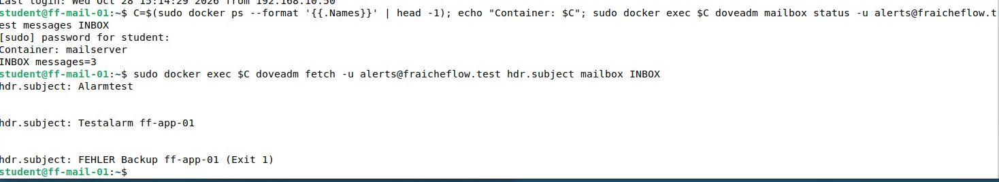

# Backup-Alarm

> Scheitert ein Backup, kommt eine Mail. Bleibt die Meldung ganz aus, schlägt die Überwachung an. Anlass: Zwei Nächte lang scheiterte das Backup unbemerkt.

## Ziel

Ein fehlgeschlagenes Backup muss auffallen, ohne dass jemand das Log liest. Zwei Nächte lang scheiterte die Sicherung, weil die TrueNAS-VM nicht lief, und niemand merkte es. Dafür gibt es jetzt zwei Meldewege: eine Alarmmail bei einem Fehler und eine Überwachung, die anschlägt, wenn gar keine Meldung kommt.

## Grundlagen

Ein Skript meldet seinen Ausgang über den **Exit-Code**: `0` heißt Erfolg, jeder andere Wert Fehler. Ein **Wrapper** ist ein kleines Skript, das ein anderes Skript startet und dessen Exit-Code auswertet. So lässt sich der Alarm einbauen, ohne das Backup-Skript zu ändern.

Zwei Fälle brauchen verschiedene Erkennung:

| Fall | Erkennung | Meldung |
|---|---|---|
| Das Skript läuft und scheitert | Der Wrapper sieht einen Exit-Code ungleich 0 | Alarmmail an `alerts@fraicheflow.test` |
| Das Skript läuft gar nicht (Server aus, cron steht) | Die Überwachung bekommt keine Erfolgsmeldung mehr | Alarm von Uptime Kuma |

Der zweite Weg schließt die Lücke des ersten: Ein Skript, das nicht läuft, kann auch keine Alarmmail schicken. Dafür wird eine **Push-Überwachung** genutzt. Das Skript ruft nach jedem erfolgreichen Lauf eine bestimmte Adresse in Uptime Kuma auf. Kommt der Aufruf innerhalb eines Zeitfensters nicht, schlägt Kuma Alarm.

Eine Mail lässt sich ohne Mailprogramm mit `curl` über SMTP senden. Die Adresse der Push-Überwachung enthält einen geheimen Schlüssel und gehört deshalb nicht in das Skript, sondern in eine Konfigurationsdatei, die nur `root` lesen darf.

## Meine Umsetzung

**1. Push-Monitor in Uptime Kuma anlegen.** Auf ff-mgmt-01 (Uptime Kuma, siehe [Monitoring](19_Monitoring_Kuma.md)) entsteht ein Monitor vom Typ *Push* mit einem Zeitfenster von 25 Stunden (90000 Sekunden: 24 Stunden Abstand der Läufe plus eine Stunde Reserve). Kuma zeigt dafür eine Push-Adresse an.

**2. Push-Adresse in der Konfigurationsdatei ablegen.** Auf ff-app-01 wird die Adresse abgefragt und mit Rechten nur für `root` gespeichert. Sie zeigt auf ff-mgmt-01 (192.168.10.50), da Uptime Kuma dort läuft. Der Parameter `?status=…` wird abgeschnitten, das Skript hängt ihn selbst an.

```bash
read -r -p "Push-URL: " U; U=${U/localhost/192.168.10.50}
echo "PUSH_URL=\"${U%%\?*}\"" | sudo tee /etc/backup-alarm.conf >/dev/null
sudo chmod 600 /etc/backup-alarm.conf
```

**3. Wrapper anlegen.** `/usr/local/bin/backup-alarm.sh` startet das Backup und wertet den Exit-Code aus:

```bash
sudo tee /usr/local/bin/backup-alarm.sh >/dev/null <<'EOF'
#!/bin/bash
# Fuehrt backup.sh aus; bei Fehler Alarmmail an alerts@, bei Erfolg Meldung an Uptime Kuma (Push)
BACKUP="${BACKUP:-/usr/local/bin/backup.sh}"
[ -r /etc/backup-alarm.conf ] && . /etc/backup-alarm.conf
"$BACKUP"
RC=$?
if [ "$RC" -ne 0 ]; then
  {
    echo "From: alerts@fraicheflow.test"
    echo "To: alerts@fraicheflow.test"
    echo "Subject: FEHLER Backup ff-app-01 (Exit $RC)"
    echo
    echo "Backup fehlgeschlagen: $(date '+%F %T'), Exit-Code $RC"
    echo "Details: /var/log/backup.log auf ff-app-01"
  } | curl -s --max-time 20 --url "smtp://mail.fraicheflow.test:25/ff-app-01.fraicheflow.test" --mail-from alerts@fraicheflow.test --mail-rcpt alerts@fraicheflow.test -T - || echo "$(date '+%F %T') WARNUNG: Alarmmail nicht gesendet"
elif [ -n "$PUSH_URL" ]; then
  curl -fsS -m 20 -o /dev/null "${PUSH_URL}?status=up&msg=Backup%20OK&ping=" || echo "$(date '+%F %T') WARNUNG: Kuma-Push nicht gesendet"
fi
exit "$RC"
EOF
sudo chmod 755 /usr/local/bin/backup-alarm.sh
```

| Abschnitt | Bedeutung |
|---|---|
| `BACKUP="${BACKUP:-…}"` | Das auszuführende Skript lässt sich von außen ersetzen. Das macht den Test ohne echtes Backup möglich |
| `. /etc/backup-alarm.conf` | Lädt die Push-Adresse, falls die Datei lesbar ist |
| `"$BACKUP"` und `RC=$?` | Skript starten, Exit-Code merken |
| Block bei `RC` ungleich 0 | Baut eine Mail mit Absender, Empfänger, Betreff und Text und schickt sie per `curl` über SMTP an den Mailserver ff-mail-01 |
| `ff-app-01.fraicheflow.test` am Ende der URL | Der Name, mit dem sich `curl` beim Mailserver meldet (HELO). Der Mailserver verlangt einen vollständigen Rechnernamen |
| `elif` mit `PUSH_URL` | Bei Erfolg wird die Push-Adresse von Uptime Kuma aufgerufen |
| `\|\| echo … WARNUNG` | Scheitert die Meldung selbst, wird das im Log vermerkt |
| `exit "$RC"` | Der Wrapper gibt den Exit-Code des Backups unverändert weiter |

**4. cron auf den Wrapper umstellen.** Der Eintrag in der Crontab von `root` zeigt jetzt auf den Wrapper (siehe [Backup-Skript](11_Backup_Skript.md)):

```bash
sudo crontab -l > ~/crontab.alt
sed 's#/usr/local/bin/backup.sh#/usr/local/bin/backup-alarm.sh#' ~/crontab.alt > /tmp/cron.new
sudo crontab /tmp/cron.new
sudo crontab -l | grep backup
```

**5. Beide Zweige testen.** Mit der Variable `BACKUP` wird statt des echten Skripts ein Programm ausgeführt, das immer scheitert (`/bin/false`) oder immer gelingt (`/bin/true`). So wird der Alarmweg getestet, ohne ein Backup zu beschädigen:

```bash
sudo env BACKUP=/bin/false /usr/local/bin/backup-alarm.sh; echo exit=$?
sudo env BACKUP=/bin/true /usr/local/bin/backup-alarm.sh; echo exit=$?
sudo env -i PATH=/usr/bin:/bin /usr/local/bin/backup-alarm.sh; echo exit=$?
```

Der erste Aufruf endet mit `exit=1` und schickt die Mail, der zweite mit `exit=0` und meldet an Uptime Kuma. Der dritte ist ein echter Lauf mit der reduzierten Umgebung von cron.

**6. Ergebnis im Postfach prüfen.** Auf ff-mail-01 wird der Posteingang von `alerts@` gelesen:

```bash
sudo docker exec mailserver doveadm fetch -u alerts@fraicheflow.test hdr.subject mailbox INBOX
```



*Abbildung 1: Im Postfach `alerts@` liegen die Testmails und die Mail `FEHLER Backup ff-app-01 (Exit 1)`*

## Ergebnis

Ein simulierter Fehler löst eine Alarmmail aus, ein erfolgreicher Lauf meldet sich bei Uptime Kuma. Der Wrapper gibt den Exit-Code des Backups unverändert weiter, `exit=1` bei Fehler und `exit=0` bei Erfolg. Getestet wurde der Fehlerfall mit dem simulierten Fehler (`BACKUP=/bin/false`), nicht mit einem echten Ausfall des Ziels. Das Ausbleiben der Meldung (Alarm von Kuma nach dem Zeitfenster) wurde mit einem verkürzten Intervall von 60 Sekunden getestet, nicht über die vollen 25 Stunden.

## Worauf zu achten ist

| Punkt | Hintergrund |
|---|---|
| Der Wrapper kann nur Fehler melden | Ein Skript, das nicht startet, sendet nichts. Deshalb der zweite Weg über den Push-Monitor mit Zeitfenster |
| Mailserver verlangt einen Rechnernamen | Beim ersten Test mit `curl` lehnte Postfix die Mail ab: `Helo command rejected: need fully-qualified hostname`. Erst mit dem vollständigen Namen am Ende der URL kam die Mail an. Beim ersten Versuch zeigte `curl` nur den Exit-Code 55, der Grund stand im Log des Mailservers |
| Geheimnisse nicht ins Skript | Die Push-Adresse liegt in `/etc/backup-alarm.conf` (`chmod 600`). Vor dem Einchecken in Git wurde mit `grep` geprüft, dass `api/push` nicht im Skript steht |
| Test mit der Umgebung von cron | `env -i PATH=/usr/bin:/bin` zeigt, ob alle Programme im Skript ohne den normalen `PATH` gefunden werden |
| Meldung im Alarmfall selbst kann scheitern | Ist der Mailserver nicht erreichbar, steht nur die `WARNUNG` im Log. Der Push-Monitor fängt das auf, weil dann kein Erfolg gemeldet wird |
| Mailserver ist selbst ein Einzelpunkt | Läuft ff-mail-01 nicht, kommt keine Alarmmail an, auch die Mails von Uptime Kuma laufen über ihn. Der Ausfall ist dann nur in der Oberfläche von Uptime Kuma sichtbar (SMTP- und IMAP-Monitor) |

Im Lab aufgetreten waren die Ablehnung durch den Mailserver und die Tests mit dem simulierten Fehler. Weitere Fälle in [Troubleshooting](21_Troubleshooting.md).

## Dateien

- `/usr/local/bin/backup-alarm.sh` auf ff-app-01 (vollständig auf dieser Seite)
- Crontab von `root` auf ff-app-01
- Die Datei `/etc/backup-alarm.conf` enthält die geheime Push-Adresse und ist bewusst nicht veröffentlicht.
