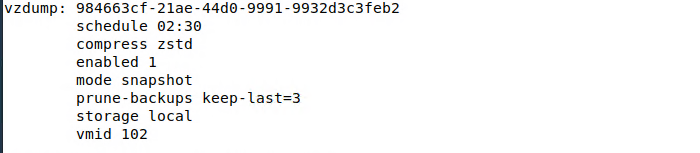
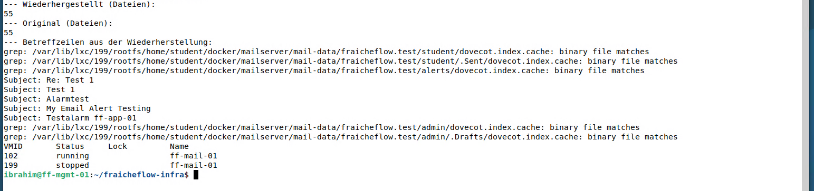

# Container-Backup und Restore-Test

> Der Mailserver wird nachts von Proxmox gesichert. Ein Test zeigt, dass die Mail-Daten im Backup vollständig sind (55 von 55 Dateien).

## Ziel

Der Mailserver läuft als LXC-Container 102 (ff-mail-01) auf Proxmox. Seine Postfächer liegen im Container und werden vom Skript auf ff-app-01 nicht erfasst. Deshalb sichert Proxmox den ganzen Container jede Nacht selbst. Dazu kommt ein Restore-Test: Ein Backup gilt erst als brauchbar, wenn sich daraus wirklich etwas zurückholen lässt.

## Grundlagen

**vzdump** ist das Sicherungsprogramm von Proxmox für Container und VMs. Wichtige Einstellungen:

| Einstellung | Bedeutung |
|---|---|
| `--mode snapshot` | Sicherung im laufenden Betrieb: Proxmox friert einen Zwischenstand (Snapshot) ein und sichert diesen, der Container muss nicht angehalten werden |
| `--compress zstd` | Komprimierung mit zstd, schnell und platzsparend |
| `--storage` | Ablageort der Sicherung auf Proxmox (`local` ist das Verzeichnis `/var/lib/vz/dump`) |
| `--prune-backups keep-last=3` | Aufbewahrung: Nur die letzten drei Sicherungen bleiben, ältere werden gelöscht |
| `--schedule` | Zeitplan des Auftrags |

Bei der Wiederherstellung (`pct restore`) entsteht aus dem Archiv ein neuer Container mit einer neuen Nummer. Mit `--unique 1` bekommt er eine neue MAC-Adresse, damit er nicht mit dem Original kollidiert. Wird der Test-Container nur eingebunden (`pct mount`) und nicht gestartet, gibt es keine doppelte IP-Adresse im Netz.

Zwei Kennzahlen beschreiben, was ein Backup leistet:

- **RPO** (Recovery Point Objective): Wie viel Datenstand darf maximal verloren gehen? Bei einer Sicherung pro Nacht sind es bis zu 24 Stunden.
- **RTO** (Recovery Time Objective): Wie lange darf die Wiederherstellung dauern? Dieser Wert wurde nicht gemessen.

## Meine Umsetzung

Alle Befehle laufen auf ff-pve-01 (192.168.10.10) und werden hier von ff-mgmt-01 aus per SSH abgesetzt.

**1. Sicherungsauftrag anlegen.** Täglich 02:30 Uhr, nur Container 102, die letzten drei Stände bleiben:

```bash
pvesh create /cluster/backup --vmid 102 --storage local --mode snapshot --compress zstd --schedule 02:30 --prune-backups keep-last=3 --enabled 1
cat /etc/pve/jobs.cfg
```



*Abbildung 1: Der Auftrag in `/etc/pve/jobs.cfg`*

Die Uhrzeit liegt nach dem Datei-Backup von ff-app-01 (01:00 Uhr).

**2. Einmal von Hand ausführen.** Statt bis zur Nacht zu warten, wird der Auftrag sofort gestartet:

```bash
vzdump 102 --storage local --mode snapshot --compress zstd
ls -lh /var/lib/vz/dump/
```

Der Lauf dauerte 57 Sekunden und erzeugte eine Datei `vzdump-lxc-102-….tar.zst` mit 919 MB (aus 2,1 GiB Daten). Die Meldung `Backup job finished successfully` bestätigt den Erfolg. Proxmox warnt dabei, dass der Thin-Pool überbucht ist (siehe unten).

**3. Wiederherstellung testen.** Der Test-Container bekommt die Nummer 199 und wird nicht gestartet. Das Dateisystem wird eingebunden, und die Dateien der Mail-Daten werden im Test-Container und im laufenden Original gezählt:

```bash
pct restore 199 /var/lib/vz/dump/vzdump-lxc-102-<Zeitstempel>.tar.zst --storage local-lvm --unique 1
pct mount 199
find /var/lib/lxc/199/rootfs/home/student/docker/mailserver/mail-data -type f | wc -l
pct exec 102 -- find /home/student/docker/mailserver/mail-data -type f | wc -l
grep -rh "^Subject:" /var/lib/lxc/199/rootfs/home/student/docker/mailserver/mail-data | head -5
pct unmount 199
pct list
```

| Schritt | Bedeutung |
|---|---|
| `pct restore 199 … --unique 1` | Neuer Container 199 aus dem Archiv, mit neuer MAC-Adresse |
| `pct mount 199` | Dateisystem einbinden, ohne den Container zu starten |
| zwei `find … \| wc -l` | Anzahl der Dateien in den Mail-Daten, wiederhergestellt und im Original |
| `grep "^Subject:"` | Zeigt Betreffzeilen aus den wiederhergestellten Maildateien |
| `pct list` | 102 läuft, 199 ist gestoppt |



*Abbildung 2: 55 Dateien in der Wiederherstellung, 55 im Original, dazu echte Betreffzeilen*

**4. Test-Container wieder entfernen.**

```bash
pct destroy 199 --purge
```

## Ergebnis

Der Container 102 wird jede Nacht um 02:30 Uhr gesichert, die letzten drei Stände bleiben erhalten. Der Restore-Test zeigt, dass sich der Container aus dem Backup wiederherstellen lässt und die Mail-Daten vollständig sind: 55 Dateien in der Wiederherstellung, 55 im Original, mit lesbaren Betreffzeilen.

Nicht belegt ist, dass der wiederhergestellte Container startet und seinen Dienst liefert, denn er wurde nur eingebunden. Eine VM (ff-core-01, ff-app-01) wurde nicht wiederhergestellt. Nachgewiesen ist der manuelle Lauf, ein nächtlicher Lauf des Auftrags um 02:30 Uhr ist hier nicht belegt.

## Worauf zu achten ist

| Punkt | Hintergrund |
|---|---|
| Sicherung liegt auf dem Proxmox-Host | Speicher `local` ist ein Verzeichnis auf ff-pve-01 selbst. Fällt der Host aus, ist die Sicherung mit weg. Ein getrenntes Ziel fehlt |
| Test-Container nicht starten | Die Kopie hat dieselbe Netzwerkkonfiguration wie das Original. Gleichzeitiger Betrieb würde die IP-Adresse doppelt vergeben. `--unique 1` ändert nur die MAC-Adresse |
| Aufräumen nach dem Test | `pct destroy 199 --purge` entfernt den Test-Container samt Platte, sonst bleibt Speicher belegt |
| Thin-Pool überbucht | Proxmox warnt bei jedem Lauf: Die zugesagten Größen der virtuellen Platten (182 GiB) übersteigen den physischen Platz des Pools. Aktuell sind rund 9 % belegt, das Wachstum muss beobachtet werden |
| Dateizahl allein beweist nicht alles | Ein gleicher Zähler zeigt Vollständigkeit, nicht Funktion. Betreffzeilen zeigen, dass der Inhalt lesbar ist, der Start des Containers wäre ein weiterer Test |
| Aufbewahrung | `keep-last=3` reicht für drei Nächte. Für längere Fristen wäre ein größerer Wert nötig |

Im Lab aufgetreten war die Warnung zum Thin-Pool, die übrigen Punkte sind Hinweise und offene Risiken. Weitere Fälle in [Troubleshooting](21_Troubleshooting.md).

## Dateien

- `/etc/pve/jobs.cfg` auf ff-pve-01 (Sicherungsauftrag, Abbildung 1)
