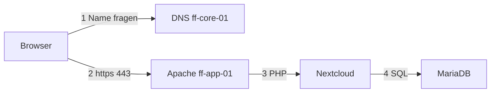
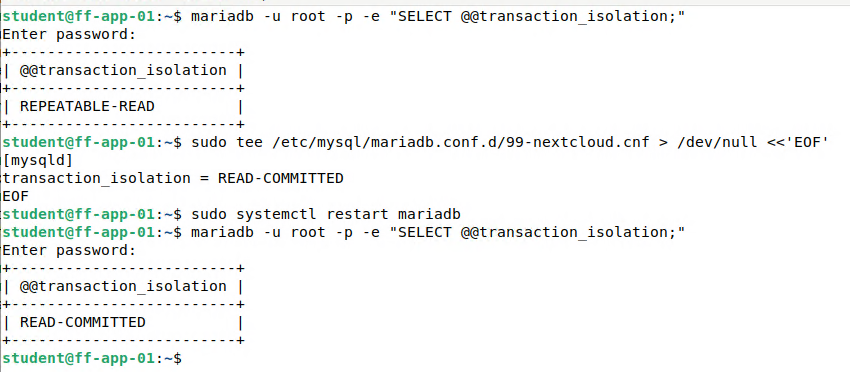
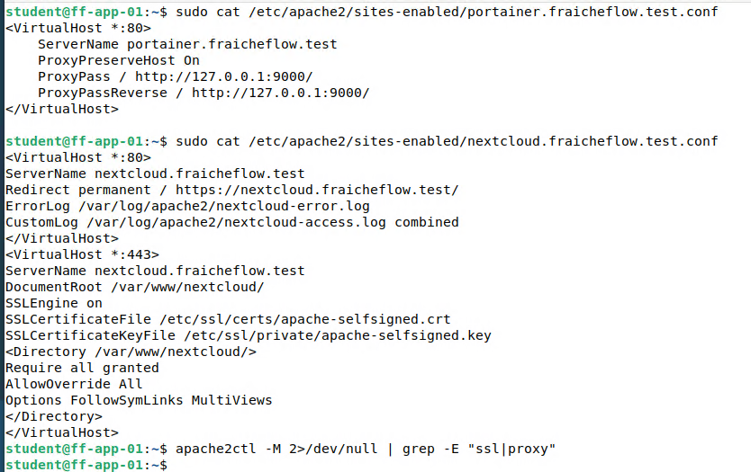
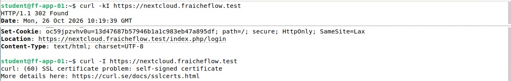

# Nextcloud mit Apache, MariaDB und TLS

> Nextcloud ist das interne Dokumentenportal. Es läuft mit Apache, MariaDB und PHP und ist über HTTPS erreichbar.

## Ziel

Auf ff-app-01 entsteht das interne Dokumentenportal von Fraîche Flow: Nextcloud, erreichbar über `https://nextcloud.fraicheflow.test`. Die F&E-Abteilung und die Projektpartner sollen technische Unterlagen austauschen können, ohne öffentliche Filesharing-Dienste zu nutzen. Aufrufe über HTTP werden auf HTTPS umgeleitet.

## Grundlagen

Ein Seitenaufruf durchläuft mehrere Stationen. Jede davon lässt sich einzeln prüfen:



| Baustein | Aufgabe |
|---|---|
| **Apache** | Webserver. Er nimmt die Anfrage an und wählt anhand des Hostnamens die passende Konfiguration |
| **Virtual Host** (VHost) | Eine Webseite im Webserver. Mehrere Namen können auf derselben IP-Adresse liegen und werden über den Namen in der Anfrage (`Host`-Header) unterschieden |
| **PHP** | Programmiersprache, in der Nextcloud geschrieben ist. Apache führt sie über ein Modul aus |
| **MariaDB** | Datenbankserver. Nextcloud speichert dort Benutzer, Dateiverzeichnis und Einstellungen |
| **TLS** | Verschlüsselt die Verbindung zwischen Browser und Server. Das Zertifikat belegt die Identität des Servers |
| **Selbstsigniertes Zertifikat** | Vom Betreiber selbst ausgestellt. Die Verschlüsselung funktioniert, aber kein Browser kennt den Aussteller und warnt deshalb |

Eingesetzte Versionen: Apache 2.4.69, MariaDB 11.8.6, PHP 8.4, Nextcloud 35.0.2 auf Debian 13.

## Meine Umsetzung

Alle Schritte laufen auf ff-app-01 (192.168.10.13) als Benutzer `student` mit `sudo`.

**1. Ausgangslage prüfen.** Vor der Installation wurden Hostname, `sudo`, DNS-Server, Ping und `apt update` kontrolliert. Es gab keine Hindernisse. Ein Snapshot der VM wurde nicht angelegt.

**2. Apache installieren und prüfen.**

```bash
sudo apt install -y apache2 curl
systemctl is-active apache2
ss -tlnp | grep ':80'
curl -I http://localhost
```

`curl` war auf dem Server zunächst nicht vorhanden und wurde mit installiert. Die Standardseite antwortet mit `200 OK`.

**3. Virtual Host für das Portal.** Das Verzeichnis `/var/www/portal` enthält eine einfache `index.html`. Der VHost liegt in `/etc/apache2/sites-available/portal.fraicheflow.test.conf`:

```apache
<VirtualHost *:80>
    ServerName portal.fraicheflow.test
    DocumentRoot /var/www/portal/
    ErrorLog /var/log/apache2/portal-error.log
    CustomLog /var/log/apache2/portal-access.log combined
</VirtualHost>
```

| Einstellung | Bedeutung |
|---|---|
| `ServerName` | Der Name, bei dem dieser VHost antwortet |
| `DocumentRoot` | Verzeichnis, aus dem Apache die Dateien liefert |
| `ErrorLog`, `CustomLog` | Eigene Logdateien je VHost |

```bash
sudo a2ensite portal.fraicheflow.test.conf
sudo apache2ctl configtest && sudo systemctl reload apache2
curl -s -H "Host: portal.fraicheflow.test" http://localhost | head
```

`a2ensite` aktiviert die Datei, `configtest` prüft die Syntax vor dem Neuladen. Mit dem Header `-H "Host: …"` lässt sich der VHost auch ohne DNS ansprechen. Ohne den Header antwortet der Standard-VHost mit der Apache-Testseite.

**4. DNS-Einträge.** Die Namen `portal` und `nextcloud` zeigen als CNAME auf ff-app-01. Wie sie in der Zone stehen und welche Fehler dabei auftraten, steht auf der Seite [DNS mit Bind9](04_DNS_Bind9.md).

**5. MariaDB einrichten.** Nextcloud bekommt eine eigene Datenbank und einen eigenen Benutzer, der nur auf diese Datenbank zugreifen darf:

```bash
sudo apt install -y mariadb-server
sudo mariadb
```

```sql
CREATE DATABASE nextcloud_db;
CREATE USER nextclouduser@localhost IDENTIFIED BY '********';
GRANT ALL PRIVILEGES ON nextcloud_db.* TO nextclouduser@localhost;
FLUSH PRIVILEGES;
```

Das Passwort steht nicht in dieser Dokumentation. `@localhost` beschränkt den Benutzer auf Verbindungen vom Server selbst. `SHOW GRANTS FOR nextclouduser@localhost;` bestätigt, dass die Rechte nur für `nextcloud_db` gelten.

**6. Transaktionsisolation anpassen.** Nextcloud verlangt `READ-COMMITTED`, MariaDB arbeitet standardmäßig mit `REPEATABLE-READ`. Die Isolationsstufe legt fest, welche Änderungen anderer Sitzungen eine laufende Transaktion sieht. Der Wert wird in einer eigenen Datei gesetzt:

```bash
sudo tee /etc/mysql/mariadb.conf.d/99-nextcloud.cnf >/dev/null <<'EOF'
[mysqld]
transaction_isolation = READ-COMMITTED
EOF
sudo systemctl restart mariadb
mariadb -u root -p -e "SELECT @@transaction_isolation;"
```



*Abbildung 1: Vorher `REPEATABLE-READ`, nach dem Neustart `READ-COMMITTED`*

**7. PHP installieren und einstellen.** Neben den Grundpaketen (`php`, `php-curl`, `php-mysql`, `php-gd`, `php-zip`, `php-xml`, `php-mbstring`) wurden die weiteren Pakete aus der Nextcloud-Anleitung installiert, darunter `php-intl`, `php-bcmath`, `php-gmp`, `php-apcu`, `php-imagick`, `php-bz2` und `php-soap`. Die Laufzeitwerte stehen in einer eigenen Datei `/etc/php/8.4/apache2/conf.d/99-nextcloud.ini`, damit die mitgelieferte `php.ini` unverändert bleibt:

```ini
date.timezone = Europe/Berlin
memory_limit = 512M
upload_max_filesize = 500M
post_max_size = 600M
max_execution_time = 300
file_uploads = On
allow_url_fopen = On
display_errors = Off
output_buffering = Off
opcache.enable = 1
opcache.interned_strings_buffer = 8
opcache.max_accelerated_files = 10000
opcache.memory_consumption = 128
opcache.save_comments = 1
opcache.revalidate_freq = 1
```

| Einstellung | Bedeutung |
|---|---|
| `memory_limit` | Arbeitsspeicher, den ein PHP-Prozess höchstens belegen darf |
| `upload_max_filesize`, `post_max_size` | Größte erlaubte Datei und größte Anfrage. `post_max_size` muss größer als das Upload-Limit sein |
| `max_execution_time` | Laufzeitgrenze in Sekunden, wichtig bei großen Uploads |
| `opcache.*` | Zwischenspeicher für übersetzten PHP-Code, macht Nextcloud schneller |

`opcache` war als Modul schon geladen. Die wirksamen Werte lassen sich nur über Apache abfragen, denn die Kommandozeile nutzt eine andere `php.ini`. Dafür diente eine kurze Testseite mit `ini_get(...)`, die danach wieder gelöscht wurde. Sie lieferte 512M, 500M und 600M.

**8. Nextcloud herunterladen und VHost anlegen.**

```bash
cd /var/www/
sudo curl -o nextcloud.zip https://download.nextcloud.com/server/releases/latest.zip
sudo unzip -q nextcloud.zip
sudo chown -R www-data:www-data nextcloud
```

`www-data` ist der Benutzer, unter dem Apache läuft. Er braucht Schreibrechte, damit Nextcloud Dateien und Konfiguration ablegen kann. Der VHost `nextcloud.fraicheflow.test.conf` zeigt auf das Verzeichnis. Die Anweisungen im Block `<Directory>` erlauben den Zugriff und die Auswertung der mitgelieferten `.htaccess`.

```apache
<VirtualHost *:80>
    ServerName nextcloud.fraicheflow.test
    DocumentRoot /var/www/nextcloud/
    <Directory /var/www/nextcloud/>
        Require all granted
        AllowOverride All
        Options FollowSymLinks MultiViews
    </Directory>
</VirtualHost>
```

Die Einrichtung läuft danach im Browser: Datenverzeichnis auf dem Standardwert, Datenbanktyp MySQL/MariaDB mit `nextcloud_db`, `nextclouduser` und `localhost`. Die empfohlenen Apps wurden übersprungen.

**9. TLS-Zertifikat erstellen.** Im Lab gibt es weder eine öffentliche Domain noch eine eigene Zertifizierungsstelle. Deshalb wird ein selbstsigniertes Zertifikat verwendet, gültig ein Jahr, mit beiden Webnamen als *Subject Alternative Name* (SAN, die Namen, für die das Zertifikat gilt):

```bash
sudo a2enmod ssl
sudo openssl req -x509 -nodes -days 365 -newkey rsa:4096 \
  -keyout /etc/ssl/private/apache-selfsigned.key \
  -out /etc/ssl/certs/apache-selfsigned.crt \
  -subj "/CN=nextcloud.fraicheflow.test" \
  -addext "subjectAltName=DNS:nextcloud.fraicheflow.test,DNS:portal.fraicheflow.test"
```

| Option | Bedeutung |
|---|---|
| `-x509` | Zertifikat statt Zertifikatsanfrage erzeugen |
| `-nodes` | Schlüssel ohne Passphrase speichern, sonst fragt Apache beim Start danach |
| `-days 365` | Gültigkeit |
| `-newkey rsa:4096` | Neuer RSA-Schlüssel mit 4096 Bit |
| `-addext subjectAltName=…` | Namen, für die das Zertifikat gilt. Moderne Browser prüfen diese Liste und nicht mehr den `CN` |

**10. HTTPS-VHost und Weiterleitung.** Die Datei `nextcloud.fraicheflow.test.conf` enthält am Ende zwei Blöcke. Der HTTP-Block leitet um, der HTTPS-Block liefert die Anwendung. Die Datei wurde vorher als `.bak` gesichert.

```apache
<VirtualHost *:80>
    ServerName nextcloud.fraicheflow.test
    Redirect permanent / https://nextcloud.fraicheflow.test/
    ErrorLog /var/log/apache2/nextcloud-error.log
    CustomLog /var/log/apache2/nextcloud-access.log combined
</VirtualHost>

<VirtualHost *:443>
    ServerName nextcloud.fraicheflow.test
    DocumentRoot /var/www/nextcloud/
    SSLEngine on
    SSLCertificateFile /etc/ssl/certs/apache-selfsigned.crt
    SSLCertificateKeyFile /etc/ssl/private/apache-selfsigned.key
    <Directory /var/www/nextcloud/>
        Require all granted
        AllowOverride All
        Options FollowSymLinks MultiViews
    </Directory>
</VirtualHost>
```

```bash
sudo apache2ctl configtest && sudo systemctl reload apache2
sudo apache2ctl -S
```



*Abbildung 2: Die aktiven VHost-Dateien. `Redirect permanent` auf HTTPS und der HTTPS-Block mit Zertifikat*

**11. Von außen prüfen.** `curl` fragt nur die Kopfzeilen ab (`-I`). Mit `-k` wird die Zertifikatsprüfung übersprungen, weil das Zertifikat selbstsigniert ist:

```bash
curl -I http://nextcloud.fraicheflow.test
curl -kI https://nextcloud.fraicheflow.test
curl -I https://nextcloud.fraicheflow.test
```



*Abbildung 3: Mit `-k` kommt `302 Found` mit Ziel `…/index.php/login`, ohne `-k` die Meldung `self-signed certificate`*

Der erste Aufruf liefert `301` mit `Location: https://…`, der zweite `302` auf die Anmeldeseite von Nextcloud. Der dritte scheitert mit `self-signed certificate`. Im Browser erscheint die Anmeldeseite über HTTPS, Firefox kennzeichnet sie wegen des Zertifikats als „Nicht sicher“.

## Ergebnis

Nextcloud 35.0.2 läuft unter `https://nextcloud.fraicheflow.test`, `portal.fraicheflow.test` liefert die einfache Portalseite. DNS, VHost, TLS, PHP und Datenbank antworten, und HTTP wird dauerhaft auf HTTPS umgeleitet.

Nicht umgesetzt oder nicht belegt: ein Zertifikat einer anerkannten Zertifizierungsstelle, weitere Einstellungen in Nextcloud (diese Seite beschreibt nur die Grundinstallation) und ein Snapshot der VM vor den Änderungen. Das Backup von Webdateien und Datenbank beschreibt [Backup-Skript](11_Backup_Skript.md).

## Worauf zu achten ist

| Punkt | Hintergrund |
|---|---|
| CNAME und andere Einträge für denselben Namen | `named-checkzone` meldete „CNAME and other data“, als `portal` und `nextcloud` als A-Record und CNAME gleichzeitig standen. Pro Name nur eine Art Eintrag. Aufgetreten im Lab, Lösung auf der [DNS-Seite](04_DNS_Bind9.md) |
| Name löst nur auf dem Server auf, nicht auf dem Client | Der Zwischenspeicher von `systemd-resolved` auf ff-mgmt-01 hielt eine negative Antwort. `resolvectl flush-caches` half. Aufgetreten im Lab |
| `curl` nicht vorinstalliert | Auf ff-app-01 fehlte das Programm und wurde nachinstalliert. Aufgetreten im Lab |
| Isolationsstufe | Nextcloud verlangt `READ-COMMITTED`. Der Wert wird in einer eigenen Datei unter `mariadb.conf.d` gesetzt und nach dem Neustart mit `SELECT @@transaction_isolation;` geprüft |
| PHP-Werte nur im Apache-Kontext prüfen | `php -m` und die Kommandozeile lesen eine andere Konfiguration. Wirksame Werte über eine kurze Testseite abfragen und diese danach löschen |
| Falsche Seite erscheint | Trifft die Anfrage den Standard-VHost, fehlt der Name im DNS oder im `Host`-Header. `apache2ctl -S` zeigt, welcher VHost für welchen Namen zuständig ist |
| Selbstsigniertes Zertifikat | Browser warnen, `curl` braucht `-k`, Uptime Kuma braucht im Monitor die Option `Ignore TLS/SSL errors`. Auf Dauer wäre eine eigene Zertifizierungsstelle (CA) besser. Aufgetreten im Lab |
| Schlüsseldatei | `/etc/ssl/private/apache-selfsigned.key` gehört nicht ins Repository |

Weitere Fälle in [Troubleshooting](21_Troubleshooting.md).

## Dateien

- `/etc/apache2/sites-available/` auf ff-app-01 (VHost-Dateien, auf dieser Seite abgedruckt)
- Das Passwort des Datenbankbenutzers und der private Schlüssel des Zertifikats sind bewusst nicht veröffentlicht.
