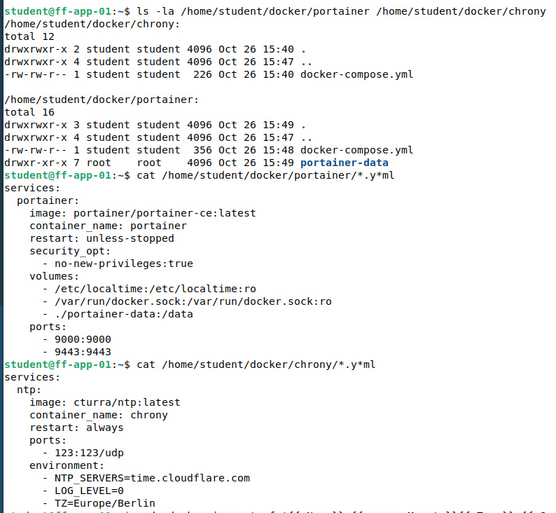
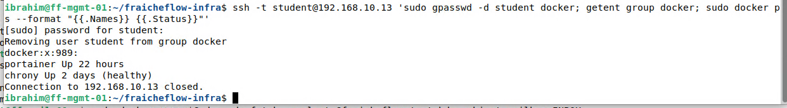

# Docker und Docker Compose auf ff-app-01

> Kleine Dienste laufen als Docker-Container, jeder in einer Textdatei (Compose) beschrieben. So lässt er sich jederzeit gleich neu starten.

## Ziel

Für Fraîche Flow sollen später mehrere kleine Dienste laufen, zum Beispiel Zeitserver, Monitoring und Dashboards. Für jeden Dienst eine eigene VM zu bauen, wäre für diesen Aufbau zu aufwendig. ff-app-01 wird deshalb zum Docker-Host: Die Dienste laufen als Container, jeder in einer Compose-Datei beschrieben, sodass er sich jederzeit identisch neu starten lässt.

## Grundlagen

| Begriff | Bedeutung |
|---|---|
| **Docker Engine** | Software auf dem Host, die Images lädt und Container startet |
| **Image** | Unveränderliche Vorlage mit Anwendung und allem, was sie braucht |
| **Container** | Laufende Instanz eines Images. Er nutzt den Kernel des Hosts und startet in Sekunden |
| **Registry** | Ablage für Images, zum Beispiel Docker Hub |
| **Port-Mapping** | `9000:9000` leitet Anfragen an Port 9000 des Hosts an Port 9000 im Container weiter. Ohne Mapping ist der Dienst von außen nicht erreichbar |
| **Volume / Bind Mount** | Dauerhafter Speicher außerhalb des Containers. Das Dateisystem eines Containers selbst ist flüchtig |
| **Docker Compose** | Beschreibt einen oder mehrere Container in einer YAML-Datei. `docker compose up -d` startet sie im Hintergrund |

Virtuelle Maschine und Container unterscheiden sich vor allem in der Isolation:

| Kriterium | Virtuelle Maschine | Container |
|---|---|---|
| Betriebssystem | Eigenes Gast-System | Kernel des Hosts |
| Start | Minuten, hoher RAM-Bedarf | Sekunden, geringer Bedarf |
| Isolation | Stark, durch den Hypervisor | Schwächer, der Kernel wird geteilt |
| Einsatz hier | Zentrale Server (DNS, Router, Management) | Kleine Dienste (Zeitserver, Portainer, Mailserver) |

Eine Compose-Datei ist zugleich Dokumentation: Ports, Datenpfade und Neustartverhalten stehen darin und lassen sich in Git versionieren.

## Meine Umsetzung

**1. Ausgangslage prüfen.** Per SSH von ff-mgmt-01 auf ff-app-01 wurden `sudo`, Paketquellen, DNS und die belegten Ports kontrolliert. Docker war noch nicht installiert (`docker: command not found`). Apache belegte Port 80 und 443 mit drei VHosts (Standard, Portal, Nextcloud).

**2. Arbeitsspeicher erhöhen.** `free -h` zeigte auf ff-app-01 nur 949 MiB. Geplant waren 4 GB für ff-app-01 und 6 GB für den Proxmox-Host ff-pve-01. Beim Hochsetzen von ff-pve-01 in Hyper-V auf 6144 MB startete die VM nicht, Hyper-V meldete `0x8007000E` (nicht genügend Arbeitsspeicher). Dadurch waren auch ff-core-01 und ff-app-01 aus. Die TrueNAS-VM ff-store-tn-01 wurde für diesen Tag heruntergefahren, danach startete ff-pve-01 mit 6144 MB. In Proxmox bekam ff-app-01 4096 MiB, `free -h` zeigt danach 3,8 Gi.

**3. Docker-Repository einbinden.** Docker kommt aus dem offiziellen Docker-Repository und nicht aus den Debian-Paketquellen, so empfiehlt es die Docker-Anleitung. Das System ist Debian 13, daher steht in der Zeile `trixie`:

```bash
sudo apt install ca-certificates curl -y
sudo install -m 0755 -d /etc/apt/keyrings
sudo curl -fsSL https://download.docker.com/linux/debian/gpg -o /etc/apt/keyrings/docker.asc
sudo chmod a+r /etc/apt/keyrings/docker.asc
echo "deb [arch=amd64 signed-by=/etc/apt/keyrings/docker.asc] https://download.docker.com/linux/debian trixie stable" | sudo tee /etc/apt/sources.list.d/docker.list
sudo apt update
```

| Teil | Bedeutung |
|---|---|
| `/etc/apt/keyrings/docker.asc` | Öffentlicher Schlüssel des Repositorys. `apt` prüft damit die Signatur der Pakete |
| `signed-by=…` | Bindet den Schlüssel nur an dieses Repository |
| `trixie` | Name der Debian-Version. Bei Debian 12 (ff-mail-01) heißt er `bookworm` |

**4. Engine installieren und testen.**

```bash
sudo apt install docker-ce docker-ce-cli containerd.io docker-buildx-plugin docker-compose-plugin -y
sudo docker run hello-world
docker --version
docker compose version
```

Installiert sind Docker 29.9.2 und Compose v5.6.1. `hello-world` ist ein kleines Testimage: Läuft es, funktionieren Download, Engine und Container.

**5. Compose-Dateien anlegen.** Jeder Dienst bekommt ein eigenes Verzeichnis unter `/home/student/docker/` mit einer `docker-compose.yml`. Die Dateien selbst stehen auf den Seiten [Portainer mit HTTPS-Proxy](16_Portainer_Proxy.md) und [Zeitserver chrony](17_chrony.md). Gestartet wird immer gleich:

```bash
cd /home/student/docker/chrony
docker compose config -q
sudo docker compose up -d
sudo docker ps --format "{{.Names}}  {{.Status}}"
```

`docker compose config -q` prüft die Datei auf Fehler und gibt bei Erfolg nichts aus.



*Abbildung 1: Verzeichnisse und Inhalt der Compose-Dateien von Portainer und chrony*

**6. Image-Versionen festlegen.** In den ersten Dateien stand `:latest`. Diese Bezeichnung zeigt auf das jeweils neueste Image und ändert sich, sobald jemand neu lädt. Stattdessen wird der **Digest** eingetragen, der eindeutige Fingerabdruck eines Images:

```bash
sudo docker image inspect portainer/portainer-ce:latest --format '{{index .RepoDigests 0}}'
```

In der Compose-Datei steht danach zum Beispiel:

```yaml
image: portainer/portainer-ce@sha256:3609c3...   # war :latest am 2026-10-29
```

Der Container wird mit `sudo docker compose up -d` neu erstellt. Die Daten im Bind Mount bleiben erhalten. Eine Aktualisierung ist so eine bewusste Entscheidung: neuen Digest eintragen, neu starten.

**7. Docker-Gruppe leeren.** Zuerst wurde `student` wie in der Docker-Anleitung in die Gruppe `docker` aufgenommen. Wer in dieser Gruppe ist, kann über Docker faktisch Root-Rechte erlangen, denn ein Container lässt sich mit dem Wurzelverzeichnis des Hosts starten. Deshalb wurde der Benutzer später wieder entfernt, Docker-Befehle laufen seitdem mit `sudo`:

```bash
sudo gpasswd -d student docker
getent group docker
sudo docker ps --format "{{.Names}} {{.Status}}"
```



*Abbildung 2: Die Gruppe `docker` hat keine Mitglieder mehr, `portainer` und `chrony` laufen weiter*

## Ergebnis

Docker 29.9.2 mit Compose läuft auf ff-app-01. Zwei Dienste laufen als Container, jeweils in einer Compose-Datei beschrieben und mit festem Image-Stand: Portainer und chrony. Kein Benutzer hat über die Gruppe `docker` Root-Rechte. Dieselbe Vorgehensweise gilt auf ff-mail-01 für den Mailserver, siehe [Mailserver](18_Mailserver.md).

Nicht belegt ist, dass sich ein Container nach einem Neustart des Hosts wieder von selbst startet. Das Neustartverhalten (`restart: always`, `unless-stopped`) steht in den Dateien, wurde aber nicht durch einen Neustart des Servers geprüft.

## Worauf zu achten ist

| Punkt | Hintergrund |
|---|---|
| Zu wenig Arbeitsspeicher beim Hochsetzen | Hyper-V meldete `0x8007000E`. Der Host hat nicht genug freien RAM, wenn alle VMs laufen. Eine nicht benötigte VM herunterfahren. Aufgetreten im Lab |
| Gruppenrechte gelten erst nach neuer Anmeldung | Nach `usermod -aG docker` muss man sich neu anmelden, sonst scheitert Docker ohne `sudo` weiter |
| `:latest` | Ändert sich unbemerkt. Digest eintragen, siehe Schritt 6 |
| Gruppe `docker` ist Root-Recht | Nur Benutzer aufnehmen, die ohnehin Administratoren sind. Im Lab ist die Gruppe leer |
| Docker-Repository je Debian-Version | `trixie` auf ff-app-01, `bookworm` auf ff-mail-01. Eine falsche Zeile lässt `apt update` fehlschlagen oder installiert nicht passende Pakete |
| Alter Container und neue Compose-Datei | Wurde ein Dienst zuerst mit `docker run` gestartet, muss der Container vor dem Wechsel zu Compose gestoppt und gelöscht werden (`docker stop`, `docker rm`). Sonst belegt er mit `restart: always` nach einem Neustart den Port erneut. Im Lab vorsorglich gelöscht |
| Daten gehören in Volumes | Alles, was ein Container behalten soll, liegt in einem Bind Mount oder Volume und muss mit gesichert werden |

Im Lab aufgetreten war der Speicherfehler, die übrigen Punkte sind Hinweise. Weitere Fälle in [Troubleshooting](21_Troubleshooting.md).

## Dateien

- `/home/student/docker/portainer/docker-compose.yml` auf ff-app-01 (siehe [Portainer](16_Portainer_Proxy.md))
- `/home/student/docker/chrony/docker-compose.yml` auf ff-app-01 (siehe [chrony](17_chrony.md))
