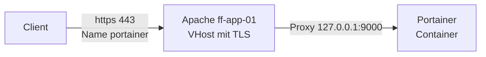
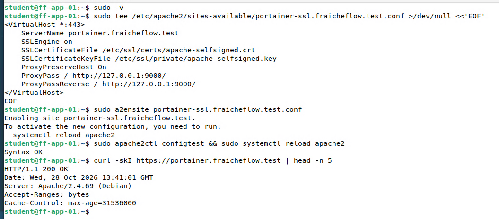

# Portainer mit HTTPS-Proxy

> Portainer ist eine Weboberfläche für Docker. Apache nimmt die Anfragen entgegen, sichert sie mit HTTPS und reicht sie an Portainer weiter.

## Ziel

Portainer ist eine Weboberfläche, mit der sich Docker-Container, Images und Volumes verwalten lassen. Es soll als Container auf ff-app-01 laufen und über den Namen `portainer.fraicheflow.test` per HTTPS erreichbar sein, auch von außen über den Router ff-edge-01.

## Grundlagen

Portainer verwaltet Docker über den **Docker-Socket**, eine Datei (`/var/run/docker.sock`), über die Programme der Docker Engine Befehle schicken. Wer diesen Socket benutzen darf, hat auf dem Host praktisch Root-Rechte. Auch ein schreibgeschützter Einbau (`:ro`) schützt nur die Datei, nicht vor Docker-Befehlen. Deshalb braucht die Weboberfläche ein gutes Passwort.

Ein **Reverse Proxy** nimmt Anfragen entgegen und reicht sie anhand des Namens an einen internen Dienst weiter. Hier übernimmt Apache diese Aufgabe. Er hat bereits die Ports 80 und 443 und trennt die Dienste über VHosts:



| Anweisung | Bedeutung |
|---|---|
| `ProxyPass / http://127.0.0.1:9000/` | Leitet alle Anfragen an Portainer weiter |
| `ProxyPassReverse` | Schreibt Weiterleitungen in den Antworten so um, dass sie wieder auf den Proxy zeigen |
| `ProxyPreserveHost On` | Gibt den ursprünglichen Hostnamen an Portainer weiter |

## Meine Umsetzung

**1. Compose-Datei anlegen.** Verzeichnis `/home/student/docker/portainer`, Datei `docker-compose.yml`:

```yaml
services:
  portainer:
    image: portainer/portainer-ce:latest
    container_name: portainer
    restart: unless-stopped
    security_opt:
      - no-new-privileges:true
    volumes:
      - /etc/localtime:/etc/localtime:ro
      - /var/run/docker.sock:/var/run/docker.sock:ro
      - ./portainer-data:/data
    ports:
      - 9000:9000
      - 9443:9443
```

| Einstellung | Bedeutung |
|---|---|
| `restart: unless-stopped` | Startet den Container nach einem Absturz oder Neustart wieder, außer er wurde absichtlich gestoppt |
| `no-new-privileges` | Prozesse im Container können keine zusätzlichen Rechte erlangen |
| `./portainer-data:/data` | Bind Mount: Die Daten liegen auf dem Host unter `portainer-data` und bleiben beim Neuerstellen erhalten |
| `9000:9000` | HTTP-Oberfläche, hier das Ziel des Proxys |
| `9443:9443` | HTTPS-Oberfläche mit eigenem Zertifikat von Portainer |

Der Stand `:latest` wurde später durch einen Digest ersetzt, siehe [Docker und Docker Compose](15_Docker_Compose.md).

```bash
cd /home/student/docker/portainer
sudo docker compose up -d
sudo docker ps --format "{{.Names}}  {{.Status}}"
```

**2. Ersten Benutzer anlegen.** Die Weboberfläche unter `https://192.168.10.13:9443` zeigt zuerst eine Zertifikatswarnung, weil Portainer ein selbstsigniertes Zertifikat benutzt. Im Lab wurde sie bestätigt. Beim Anlegen des Administrators verlangt das Formular ein *Setup token*. Das Token steht im Log des Containers. Portainer sperrt eine neue Installation aus Sicherheitsgründen nach 5 Minuten ohne Einrichtung. Im Lab war die Frist beim ersten Versuch abgelaufen. Dann hilft ein Neustart des Containers und ein neues Token:

```bash
sudo docker restart portainer
sudo docker logs portainer 2>&1 | grep setup_token | tail -1
```

Das neue Token wird im Formular eingetragen, der Administrator innerhalb der 5 Minuten angelegt. Danach zeigt Portainer die Container-Liste mit `chrony` und `portainer`. Zugangsdaten stehen nicht in dieser Dokumentation.

**3. DNS-Name anlegen.** Auf ff-core-01 kommt in die Zone ein CNAME, wie bei `portal` und `nextcloud`:

```text
portainer   IN  CNAME  ff-app-01.fraicheflow.test.
```

Der Punkt am Ende des Namens ist wichtig. Ohne ihn hängt Bind die Zone noch einmal an. Vor der Änderung wurde die Zonendatei gesichert, die Seriennummer erhöht und mit `named-checkzone` geprüft. Details dazu auf der Seite [DNS mit Bind9](04_DNS_Bind9.md).

**4. Proxy-VHost über HTTP.** Zuerst wurden die Module aktiviert und ein einfacher VHost auf Port 80 angelegt:

```bash
sudo a2enmod proxy proxy_http
```

```apache
<VirtualHost *:80>
    ServerName portainer.fraicheflow.test
    ProxyPreserveHost On
    ProxyPass / http://127.0.0.1:9000/
    ProxyPassReverse / http://127.0.0.1:9000/
</VirtualHost>
```

Die vorhandenen VHosts von Portal und Nextcloud blieben unverändert. Apache wählt über den `ServerName`, deshalb gibt es keinen Konflikt. Der Aufruf `curl -sI http://portainer.fraicheflow.test` lieferte `200 OK`.

**5. HTTPS-VHost ergänzen.** Über HTTP würden Zugangsdaten unverschlüsselt übertragen. Deshalb kam ein zweiter VHost mit dem selbstsignierten Zertifikat aus der [Nextcloud-Einrichtung](14_Nextcloud_Apache.md) dazu, Datei `portainer-ssl.fraicheflow.test.conf`:

```bash
sudo tee /etc/apache2/sites-available/portainer-ssl.fraicheflow.test.conf >/dev/null <<'EOF'
<VirtualHost *:443>
    ServerName portainer.fraicheflow.test
    SSLEngine on
    SSLCertificateFile /etc/ssl/certs/apache-selfsigned.crt
    SSLCertificateKeyFile /etc/ssl/private/apache-selfsigned.key
    ProxyPreserveHost On
    ProxyPass / http://127.0.0.1:9000/
    ProxyPassReverse / http://127.0.0.1:9000/
</VirtualHost>
EOF
sudo a2ensite portainer-ssl.fraicheflow.test.conf
sudo apache2ctl configtest && sudo systemctl reload apache2
curl -skI https://portainer.fraicheflow.test | head -n 5
```



*Abbildung 1: VHost anlegen, aktivieren, Syntax prüfen, Apache neu laden. Der Abruf über HTTPS liefert `200 OK`*

**6. Zugriff von außen.** Als externer Client diente der Windows-Host des Remote-Labs. In dessen `hosts`-Datei (`C:\Windows\System32\drivers\etc\hosts`) steht:

```text
10.100.20.128 portainer.fraicheflow.test
```

Der Name zeigt damit auf die äußere Adresse von ff-edge-01. Die DNAT-Regeln dort leiten Port 80 und 443 an ff-app-01 weiter, Apache wählt über den Namen den Portainer-VHost. Die Regeln und der Zählertest stehen auf der Seite [Edge, NAT und DNAT](03_Edge_NAT_DNAT.md). Beim ersten Test über Port 80 zählte die Regel 26 Pakete und Portainer erschien im Browser des Windows-Hosts.

## Ergebnis

Portainer läuft in einem Container, der Administrator ist angelegt und die Oberfläche ist über `https://portainer.fraicheflow.test` erreichbar. Der Weg Name, Router, Apache, Container ist von außen getestet, zuerst über HTTP, danach über HTTPS (`200 OK`).

Nicht umgesetzt: ein Zertifikat einer anerkannten Zertifizierungsstelle. Das Zertifikat ist selbstsigniert, Browser warnen.

## Worauf zu achten ist

| Punkt | Hintergrund |
|---|---|
| Setup-Token und Frist von 5 Minuten | Das Formular verlangt ein Token, das im Log steht. Nach der Frist ist keine Einrichtung mehr möglich. Dann `docker restart portainer` und neues Token holen. Aufgetreten im Lab |
| Zugang zur Oberfläche verloren | Beim ersten Benutzerkonto ging der Zugang später verloren. Er wurde mit dem Hilfs-Image `portainer/helper-reset-password` zurückgesetzt. Zugangsdaten stehen nicht in der Dokumentation. Aufgetreten im Lab |
| Nur HTTP-VHost | Der erste VHost hatte kein TLS. Zugangsdaten wären unverschlüsselt gelaufen. Deshalb der zweite VHost auf Port 443. Aufgetreten im Lab |
| Docker-Socket in Portainer | Wer Portainer beherrscht, beherrscht den Docker-Host. Gutes Passwort, Zugriff nur über den Proxy |
| Ports 9000 und 9443 | Die Compose-Datei veröffentlicht beide Ports auf allen Adressen des Hosts. Portainer ist damit auch direkt unter `192.168.10.13:9000` ohne TLS erreichbar. Eine Beschränkung auf `127.0.0.1:9000:9000` würde den direkten Zugang schließen |
| Zertifikat nennt `portainer` nicht | Das Zertifikat aus der Nextcloud-Einrichtung gilt nur für `nextcloud` und `portal`. Für `portainer.fraicheflow.test` warnt der Browser deshalb zusätzlich wegen des Namens, `curl -k` umgeht beides. Ein Zertifikat mit allen drei Namen würde das beheben |
| Punkt am Ende im CNAME | Ohne den Punkt hängt Bind den Zonennamen an das Ziel an, der Eintrag löst nicht richtig auf |
| Image-Updates | Neuen Digest eintragen und `docker compose up -d`. Die Daten bleiben im Bind Mount |

Weitere Fälle in [Troubleshooting](21_Troubleshooting.md).

## Dateien

- `/home/student/docker/portainer/docker-compose.yml` auf ff-app-01
- `/etc/apache2/sites-available/portainer-ssl.fraicheflow.test.conf` auf ff-app-01
- Das Verzeichnis `portainer-data` mit der Datenbank von Portainer ist bewusst nicht veröffentlicht.
