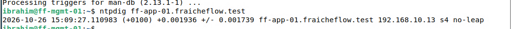

# Zeitserver chrony als Container

> Ein eigener Zeitserver (chrony) läuft als Container. Geräte sollen dieselbe Uhrzeit haben, das ist wichtig für Logs, Zertifikate und Backups.

## Ziel

Logs, Zertifikate und Backups brauchen auf allen Geräten dieselbe Uhrzeit. Eine Alarmmail mit falschem Zeitstempel oder ein Zertifikat, das „noch nicht gültig“ erscheint, sind typische Folgen abweichender Uhren. ff-app-01 stellt deshalb als erster Containerdienst einen eigenen Zeitserver (NTP) bereit, den die anderen Rechner des Labs abfragen können.

## Grundlagen

**NTP** (Network Time Protocol) gleicht Uhren über das Netzwerk ab, Port 123 (UDP). **chrony** ist ein NTP-Programm, das sich selbst bei einem Zeitserver im Internet synchronisiert und die Zeit an Clients weitergibt. Server sind in **Stratum**-Stufen gegliedert: Eine Atomuhr oder GPS-Quelle ist Stratum 0, der Server direkt daran Stratum 1, jeder weitere Schritt zählt eins höher. Der Zeitserver des Labs hängt an einem Server im Internet und liegt deshalb tiefer.

| Begriff | Bedeutung |
|---|---|
| Upstream-Server | Quelle, bei der chrony die Zeit holt. Hier `time.cloudflare.com` |
| Offset | Abweichung der Uhr zur Quelle, in Sekunden |
| `123:123/udp` | Port-Mapping: UDP-Port 123 des Hosts geht an Port 123 im Container |

Als Image dient `cturra/ntp`, ein fertiges chrony-Image. Zuerst wurde der Container direkt mit `docker run` gestartet, danach in eine Compose-Datei überführt, siehe [Docker und Docker Compose](15_Docker_Compose.md).

## Meine Umsetzung

**1. Zum Test mit `docker run` starten.**

```bash
sudo docker run --name=ntp --restart=always --detach --publish=123:123/udp cturra/ntp
sudo docker ps
sudo ss -tulpen | grep ':123'
```

`docker ps` zeigt den Container mit `123/udp`, `ss` bestätigt, dass der Host-Port belegt ist.

**2. Von einem anderen Rechner abfragen.** Dass der Container läuft, beweist noch nicht, dass er im Netz antwortet. Deshalb wurde er von ff-mgmt-01 aus abgefragt:

```bash
sudo apt install ntpsec-ntpdate -y
ntpdig ff-app-01.fraicheflow.test
```

`ntpdig` fragt einen NTP-Server einmal ab und zeigt Zeit und Abweichung.



*Abbildung 1: Antwort von 192.168.10.13, Stratum 4, Abweichung +0,0019 s*

**3. In Compose überführen.** Der Container aus Schritt 1 wird gestoppt und gelöscht, bevor die Compose-Datei startet. Er hat `restart=always` und würde nach einem Neustart den Port 123 wieder belegen:

```bash
sudo docker stop ntp
sudo docker rm ntp
```

Datei `/home/student/docker/chrony/docker-compose.yml`:

```yaml
services:
  ntp:
    image: cturra/ntp:latest
    container_name: chrony
    restart: always
    ports:
      - 123:123/udp
    environment:
      - NTP_SERVERS=time.cloudflare.com
      - LOG_LEVEL=0
      - TZ=Europe/Berlin
```

| Einstellung | Bedeutung |
|---|---|
| `container_name: chrony` | Fester Name statt eines zufälligen |
| `restart: always` | Startet den Container nach Absturz oder Neustart des Hosts wieder |
| `NTP_SERVERS` | Upstream-Server, bei dem der Container die Zeit holt |
| `LOG_LEVEL=0` | Ausführlichkeit der Protokollierung, 0 ist die niedrigste Stufe |
| `TZ` | Zeitzone für Logs, die Zeitübertragung selbst ist davon unabhängig |

```bash
cd /home/student/docker/chrony
docker compose config -q
sudo docker compose up -d
sudo docker ps --format "{{.Names}}  {{.Status}}"
```

Der Status zeigt `Up … (healthy)`. Der Stand `:latest` wurde später durch einen Digest ersetzt.

**4. NTP-Server im DHCP bekanntgeben.** Damit Clients den Zeitserver automatisch bekommen, wurde in der Kea-Konfiguration auf ff-core-01 die Option `ntp-servers` ergänzt. Die Datei `/etc/kea/kea-dhcp4.conf` wurde vorher als `.bak` gesichert. In `option-data` kam dieser Eintrag hinzu:

```json
{ "name": "ntp-servers", "data": "192.168.10.13" }
```

Die Datei ist JSON. Beim Anhängen der neuen Zeile fehlte das Komma hinter dem vorherigen Eintrag, und `kea-dhcp4-server` stand danach auf `failed`. Nach der Korrektur (Eintrag in einer eigenen Zeile, Komma hinter `domain-name-servers`) und einem Neustart läuft der Dienst wieder. Zum Aufbau von Kea siehe [DHCP mit Kea](05_DHCP_Kea.md).

## Ergebnis

Der Zeitserver läuft auf ff-app-01 als Container `chrony` und antwortet im Netz: Von ff-mgmt-01 kam eine Antwort mit Stratum 4 und einer Abweichung von rund 2 Millisekunden.

Nicht belegt: Ob ein DHCP-Client die Option `ntp-servers` tatsächlich erhält und seine Uhr danach stellt, wurde nicht gemessen. Auch die Syntaxprüfung `kea-dhcp4 -t` meldete danach weiter „Unable to open file“. Die Ursache wurde nicht geklärt. Als Nachweis galt der laufende Dienst. Eine Umstellung der anderen Server auf diesen Zeitserver ist hier nicht dokumentiert.

## Worauf zu achten ist

| Punkt | Hintergrund |
|---|---|
| Alten Container entfernen | Nach dem Wechsel von `docker run` auf Compose den alten Container löschen. Sonst belegt er mit `restart=always` nach einem Neustart Port 123 erneut. Vorsorglich gelöscht |
| Fehlendes Komma in JSON | Kea ist nach der Änderung nicht gestartet. Bei JSON-Dateien jede Zeile prüfen, vor allem das Komma zwischen Einträgen. Aufgetreten im Lab |
| Dienst nach der Änderung prüfen | `systemctl status kea-dhcp4-server` direkt nach dem Neustart. Eine Sicherung der Datei als `.bak` vorher erleichtert den Rückweg |
| Abfrage von einem anderen Rechner | `ntpdig` vom Client aus zeigt, ob der Server im Netz antwortet. `docker ps` allein genügt nicht |
| UDP 123 in Firewalls | Zwischen Client und Server muss UDP 123 erlaubt sein. Im Lab sind alle Rechner im selben Netz |
| Upstream-Server | Der Container braucht Zugang zu `time.cloudflare.com`. Ohne Internet bleibt der Server auf dem eigenen Stand |
| Zeitserver ist ein Dienst von ff-app-01 | Fällt ff-app-01 aus, fehlt auch der Zeitserver. Für höhere Verfügbarkeit wäre ein zweiter Server nötig |

Im Lab aufgetreten war das fehlende Komma, die übrigen Punkte sind Hinweise. Weitere Fälle in [Troubleshooting](21_Troubleshooting.md).

## Dateien

- `/home/student/docker/chrony/docker-compose.yml` auf ff-app-01
