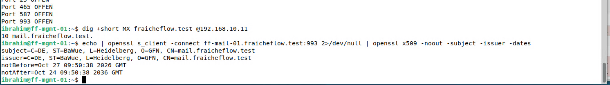

# Mailserver ff-mail-01

> Ein eigener Mailserver nimmt Systemalarme an, zum Beispiel vom Backup. Er läuft als Container in einem LXC-Container auf Proxmox.

## Ziel

Fraîche Flow braucht einen eigenen Weg für technische Meldungen, zum Beispiel bei einem fehlgeschlagenen Backup oder einem ausgefallenen Dienst. Dafür entsteht der Mailserver ff-mail-01. Er läuft als LXC-Container 102 auf ff-pve-01, darin als Docker-Container der `docker-mailserver`. Am Ende werden mit Thunderbird Mails zwischen zwei Postfächern gesendet, empfangen und beantwortet. Das Postfach `alerts@fraicheflow.test` nimmt später die Systemalarme von [Backup](12_Backup_Alarm.md) und [Monitoring](19_Monitoring_Kuma.md) an.

## Grundlagen

Mailbetrieb besteht aus drei Rollen:

| Rolle | Aufgabe | Hier |
|---|---|---|
| **MUA** (Mail User Agent) | Mails schreiben und lesen | Thunderbird auf ff-mgmt-01 |
| **MTA** (Mail Transfer Agent) | Mails per SMTP annehmen und weiterleiten | Postfix im Mailserver |
| **MDA** (Mail Delivery Agent) | Mails ins richtige Postfach einsortieren | Dovecot |

Wie eine Mail ihr Ziel findet: Der Absender liest die Domain hinter dem `@`, fragt per DNS den **MX-Record** der Domain ab (er nennt den zuständigen Mailserver) und holt die IP-Adresse des Servers über dessen **A-Record**. Ohne passende DNS-Einträge ist ein Mailtest unvollständig.

| Dienst | Port | Zweck |
|---|---|---|
| SMTP | 25 | Übertragung zwischen Mailservern |
| Submission | 587 | Versand vom Mailprogramm zum Server, mit Anmeldung und STARTTLS |
| SMTPS | 465 | Versand mit sofort aufgebauter Verschlüsselung |
| IMAPS | 993 | Postfachabruf mit sofort aufgebauter Verschlüsselung |

**LXC** (Linux Containers) ist eine leichte Virtualisierung: Der Container nutzt den Kernel von Proxmox, bringt aber ein eigenes System mit Benutzern und Diensten. Er braucht wenig Arbeitsspeicher und startet schnell. Die Isolation ist schwächer als bei einer VM. Damit Docker im Container läuft, müssen die Funktionen *Nesting* und *keyctl* aktiviert sein.

## Meine Umsetzung

**1. Ausgangslage.** Proxmox war über `192.168.10.10:8006` erreichbar. Im Speicher `local` gab es noch kein Container-Template, Gateway und DNS-Server antworteten, und `192.168.10.14` war frei. Im Debian-System lauscht ein lokaler Postfix auf Port 25, siehe Schritt 4.

**2. LXC-Container anlegen.** Das Template `debian-12-standard_12.12-1` wurde in Proxmox heruntergeladen. Der Container wurde im Assistenten angelegt, aber ohne automatischen Start, damit vor dem ersten Start Nesting und keyctl gesetzt werden können.

| Parameter | Wert |
|---|---|
| ID, Hostname | 102, `ff-mail-01` |
| Typ | unprivilegierter Container |
| Ressourcen | 2 Kerne, 1024 MiB RAM, 1024 MiB Swap, 50 GiB auf `local-lvm` |
| Netzwerk | `192.168.10.14/24`, Gateway `192.168.10.1` |
| DNS | Server `192.168.10.11`, Domain `fraicheflow.test` |
| Features | `nesting=1`, `keyctl=1` |

In der Konsole des Containers wurde die Basis eingerichtet und der Zugang geprüft:

```bash
apt update
apt install sudo openssh-server -y
adduser student
usermod -aG sudo student
systemctl enable --now ssh
hostname -f
```

Danach funktionierte die Anmeldung per SSH von ff-mgmt-01, `sudo whoami` lieferte `root`. Die SSH-Härtung folgte später, siehe [SSH auf allen Servern](08_SSH_Alle_Server.md).

**3. Docker installieren.** Wie auf ff-app-01 ([Docker und Docker Compose](15_Docker_Compose.md)), nur mit `bookworm` in der Repository-Zeile, weil der Container auf Debian 12 basiert. Danach lieferten `docker --version` Version 29.9.2 und `docker compose version` v5.6.1, `docker ps` war leer.

**4. Port 25 freimachen.** `ss -tulpen` zeigte den Postfix von Debian auf Port 25, nur auf localhost. Der Mailserver braucht den Port selbst:

```bash
sudo systemctl stop postfix
sudo systemctl disable postfix
```

Danach hörte nur noch SSH auf Port 22.

**5. Compose-Datei und Umgebungsdatei.** Projektverzeichnis `~/docker/mailserver`, Datei `docker-compose.yml`:

```yaml
services:
  mailserver:
    image: docker.io/mailserver/docker-mailserver:latest
    container_name: mailserver
    hostname: mail
    domainname: fraicheflow.test
    env_file: mailserver.env
    ports:
      - "25:25"
      - "465:465"
      - "587:587"
      - "993:993"
    volumes:
      - ./mail-data/:/var/mail/
      - ./mail-state/:/var/mail-state/
      - ./mail-logs/:/var/log/mail/
      - ./config/:/tmp/docker-mailserver/
      - ./cert/:/etc/owncert/
      - /etc/localtime:/etc/localtime:ro
    restart: always
```

Die Vorlage wurde um die Zeile `./cert/:/etc/owncert/` für das Zertifikat ergänzt. Der Stand `:latest` wurde später durch einen Digest ersetzt (v16.0.1, siehe [Docker](15_Docker_Compose.md)).

| Verzeichnis | Inhalt |
|---|---|
| `mail-data` | Die Postfächer, eine Datei pro Mail |
| `mail-state` | Zustand des Servers |
| `config` | Konten und Einstellungen |
| `cert` | Zertifikat und Schlüssel, nicht im Repository |
| `mail-logs` | Logdateien |

Die Datei `mailserver.env` stammt aus dem Projekt des Mailservers. Geändert wurden nur diese Werte:

```text
OVERRIDE_HOSTNAME=mail.fraicheflow.test
POSTMASTER_ADDRESS=admin@fraicheflow.test
TZ=Europe/Berlin
SPOOF_PROTECTION=1
ENABLE_OPENDKIM=0
ENABLE_OPENDMARC=0
ENABLE_POLICYD_SPF=0
ENABLE_CLAMAV=0
ENABLE_RSPAMD=1
RSPAMD_LEARN=1
RSPAMD_GREYLISTING=1
RSPAMD_HFILTER=0
ENABLE_AMAVIS=0
SSL_TYPE=manual
SSL_CERT_PATH=/etc/owncert/cert.pem
SSL_KEY_PATH=/etc/owncert/key.pem
```

| Einstellung | Bedeutung |
|---|---|
| `OVERRIDE_HOSTNAME` | Name, mit dem sich der Server meldet. Er passt zum DNS-Eintrag |
| `SPOOF_PROTECTION=1` | Ein angemeldeter Benutzer darf nur mit der eigenen Absenderadresse senden |
| `ENABLE_RSPAMD=1` | Spamfilter an |
| `ENABLE_CLAMAV=0` | Virenscanner aus. Er braucht viel Arbeitsspeicher, der Container hat nur 1 GiB |
| `ENABLE_OPENDKIM`, `_OPENDMARC`, `_POLICYD_SPF` | Signatur- und Absenderprüfungen (DKIM, DMARC, SPF) sind ausgeschaltet. Für den Versand an externe Server wären sie nötig |
| `SSL_TYPE=manual` | Eigenes Zertifikat statt automatisch bezogenem |

**6. DNS-Einträge.** Auf ff-core-01 wurden in der Zone `fraicheflow.test` drei Zeilen ergänzt. Vorher wurde die Zonendatei gesichert, danach die Seriennummer erhöht (`2026102303` auf `2026102701`) und mit `named-checkzone` geprüft:

```text
ff-mail-01   IN  A    192.168.10.14
mail         IN  A    192.168.10.14
@            IN  MX   10 mail.fraicheflow.test.
```

Für `mail` steht bewusst ein A-Record statt eines CNAME, weil ein MX-Record nicht auf einen Alias zeigen soll. Ein PTR-Record (Rückwärtsauflösung) wurde nicht angelegt. Weitere Hintergründe auf der Seite [DNS mit Bind9](04_DNS_Bind9.md).

```bash
dig +short A mail.fraicheflow.test @192.168.10.11
dig +short MX fraicheflow.test @192.168.10.11
```

**7. Zertifikat und Postfächer.** Das selbstsignierte Zertifikat gilt zehn Jahre und trägt den Namen des Mailservers:

```bash
mkdir -p ~/docker/mailserver/cert && cd ~/docker/mailserver/cert
openssl req -x509 -newkey rsa:4096 -keyout key.pem -out cert.pem -sha256 -days 3650 -nodes \
  -subj "/C=DE/ST=BaWue/L=Heidelberg/O=GFN/OU=/CN=mail.fraicheflow.test"
```

Die Meldung `No value provided for subject name attribute "OU", skipped` ist unkritisch. Der Mailserver beendet sich 120 Sekunden nach dem Start, solange kein Konto existiert. Die Konten werden deshalb direkt nach dem Start angelegt (Passwörter stehen nicht in dieser Dokumentation):

```bash
cd ~/docker/mailserver
sudo docker compose up -d
sudo docker exec -it mailserver setup email add admin@fraicheflow.test
sudo docker exec -it mailserver setup email add student@fraicheflow.test
sudo docker exec -it mailserver setup email add alerts@fraicheflow.test
sudo docker exec mailserver setup email list
```

**8. Ports und Zertifikat prüfen.** Auf ff-mgmt-01 wurde geprüft, ob die Ports offen sind und welches Zertifikat der Server ausliefert:

```bash
dig +short MX fraicheflow.test @192.168.10.11
echo | openssl s_client -connect ff-mail-01.fraicheflow.test:993 2>/dev/null | openssl x509 -noout -subject -issuer -dates
```



*Abbildung 1: Ports 465, 587 und 993 offen, MX auf `mail.fraicheflow.test`, Zertifikat bis 2036*

**9. Thunderbird einrichten.** Auf ff-mgmt-01 fand Thunderbird die Einstellungen nicht selbst. Sie wurden von Hand eingetragen, als Benutzername dient die volle Adresse:

| Dienst | Server | Port | Verschlüsselung |
|---|---|---|---|
| IMAP | `mail.fraicheflow.test` | 993 | SSL/TLS |
| SMTP | `mail.fraicheflow.test` | 587 | STARTTLS, normales Passwort |

Das Zertifikat ist selbstsigniert. Thunderbird verlangt daher beim Einrichten eine Sicherheitsausnahme. Zwei Konten wurden eingerichtet (`admin@` und `student@`). Eine Testmail von `admin@` an `student@` kam an, die Antwort von `student@` ebenfalls.

**10. Zustellung im Postfach prüfen.** Ohne Mailprogramm lassen sich Mails auf dem Server auslesen:

```bash
sudo docker exec mailserver doveadm mailbox status -u alerts@fraicheflow.test messages INBOX
sudo docker exec mailserver doveadm fetch -u alerts@fraicheflow.test "date.received hdr.subject" mailbox INBOX all
```

Betreffzeilen mit Sonderzeichen erscheinen kodiert, zum Beispiel `=?UTF-8?Q?=5BTest_Down=5D?=`. Das ist das MIME-Format für Nicht-ASCII-Zeichen. `=5B` und `=5D` sind eckige Klammern, `_` ist ein Leerzeichen. Mailprogramme zeigen es dekodiert an. Ein Beispiel für die Mails im Postfach `alerts@` zeigt [Backup-Alarm](12_Backup_Alarm.md).

## Ergebnis

Der Mailserver nimmt Mails an, stellt sie zu und speichert sie. Die Ports 25, 465, 587 und 993 sind offen, der MX-Record zeigt auf `mail.fraicheflow.test`. Mit Thunderbird wurde eine Mail zwischen zwei Postfächern gesendet und beantwortet. Die Alarmmails von Backup und Monitoring landen in `alerts@`. Die Daten des Containers werden nachts von Proxmox gesichert, siehe [Container-Backup](13_Container_Backup_Restore.md).

Nicht umgesetzt oder nicht belegt: ein Zertifikat einer anerkannten Zertifizierungsstelle, PTR-Record, SPF, DKIM und DMARC (für den Versand an externe Server wären sie nötig), ein Virenscanner und ein Webmail-Zugang. Roundcube wurde nur auf Eignung bewertet, nicht installiert.

## Worauf zu achten ist

| Punkt | Hintergrund |
|---|---|
| Netzmaske im Proxmox-Assistenten | Die Maske `/24` wurde zunächst vergessen, der Assistent ließ sich nicht abschließen. Aufgetreten im Lab |
| Postfix auf Port 25 | Das Debian-Paket startet lokal einen eigenen Postfix. Ohne Stoppen und Deaktivieren kollidiert der Port. Aufgetreten im Lab |
| Kein Konto, kein Start | Der Mailserver beendet sich nach 120 Sekunden, wenn kein Konto existiert. Konten direkt nach dem Start anlegen. Aufgetreten im Lab |
| Zertifikatsverzeichnis fehlt in der Vorlage | Die Zeile `./cert/:/etc/owncert/` ergänzen, sonst findet der Mailserver das Zertifikat nicht |
| Zertifikat als CA importiert | Der Versuch, das Zertifikat in Thunderbird als Zertifizierungsstelle zu importieren, schlug fehl. Es war als CA gekennzeichnet (`basic constraints`) und wurde als Serverzertifikat abgelehnt. Gelöst wurde es mit einer Sicherheitsausnahme für `mail.fraicheflow.test:587`. Aufgetreten im Lab |
| Server prüfen, bevor der Client beschuldigt wird | `openssl s_client` auf Port 465 und 587 zeigt eine saubere TLS-1.3-Verbindung. Nur die Prüfung der Zertifikatskette schlug erwartungsgemäß fehl |
| Zertifikat ohne CA-Kennzeichnung | Für den Dauerbetrieb ein Zertifikat einer echten CA nehmen oder ein eigenes ohne CA-Kennzeichnung und mit Subject Alternative Name erzeugen |
| Kurzer Ausfall beim Neuerstellen | Wird der Container nach einer Änderung neu erstellt, ist der Mailserver rund eine Minute nicht erreichbar. Uptime Kuma meldet das als kurze Störung |
| Alarmpostfach muss existieren | Existiert `alerts@` nicht, wird die Alarmmail nicht zugestellt. Aufgetreten im Lab |
| Speicher | 1 GiB RAM sind knapp, daher kein ClamAV. Postfächer liegen im Container und müssen über das Container-Backup mitgesichert werden |

Weitere Fälle in [Troubleshooting](21_Troubleshooting.md).

## Dateien

- `/home/student/docker/mailserver/docker-compose.yml` und `mailserver.env` auf ff-mail-01 (die geänderten Werte stehen auf dieser Seite)
- Die Verzeichnisse `cert/` (Schlüssel), `config/` (Konten) und `mail-data/` (Mails) sind bewusst nicht veröffentlicht.
