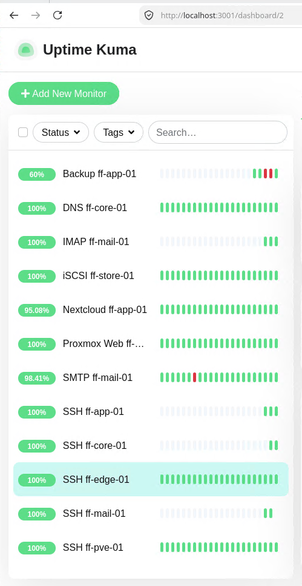

# Monitoring mit Uptime Kuma

> Uptime Kuma prüft jede Minute zwölf Dienste und schickt bei einem Ausfall eine Mail.

## Ziel

Ausfälle sollen auffallen, ohne dass jemand nachsieht. Zwei Nächte lang scheiterte die Sicherung, weil die TrueNAS-VM nicht lief, und niemand merkte es. Uptime Kuma fragt deshalb jede Minute die wichtigen Dienste ab und schickt bei einer Änderung eine Mail an `alerts@fraicheflow.test`.

## Grundlagen

**Monitoring** heißt: Ein Programm prüft laufend, ob ein Dienst erreichbar ist und richtig antwortet, und meldet es, wenn nicht. **Uptime Kuma** ist ein solches Programm mit Weboberfläche. Es kennt mehrere Prüfarten (*Monitor-Typen*):

| Typ | Prüft | Aussagekraft |
|---|---|---|
| TCP-Port | Kommt eine Verbindung zum Port zustande? | Der Dienst nimmt Verbindungen an. Eine Anmeldung findet nicht statt |
| HTTPS | Antwortet die Webseite mit einem gültigen Statuscode? | Webserver und Anwendung antworten |
| DNS | Liefert ein DNS-Server für einen Namen die richtige Adresse? | Namensauflösung funktioniert |
| Push | Hat sich ein Skript innerhalb eines Zeitfensters gemeldet? | Ein Vorgang ist gelaufen. Ohne Meldung schlägt Kuma Alarm |

Der Push-Monitor ergänzt die anderen: Er erkennt, dass etwas **nicht** passiert ist, zum Beispiel ein Backup, das gar nicht gestartet wurde. Den Aufbau des Backup-Alarms beschreibt [Backup-Alarm](12_Backup_Alarm.md).

## Meine Umsetzung

Uptime Kuma läuft als Docker-Container auf ff-mgmt-01 (192.168.10.50).

**1. Kuma starten.**

```bash
sudo apt install -y docker.io
sudo docker run -d --name uptime-kuma --restart=unless-stopped \
  -p 3001:3001 -v uptime-kuma:/app/data louislam/uptime-kuma:2
```

| Option | Bedeutung |
|---|---|
| `-d` | Im Hintergrund starten |
| `--restart=unless-stopped` | Startet den Container nach einem Neustart wieder, außer er wurde absichtlich gestoppt |
| `-p 3001:3001` | Weboberfläche auf Port 3001 |
| `-v uptime-kuma:/app/data` | Benanntes Volume für die Daten von Kuma |

**2. Einrichtung im Browser.** Die Oberfläche läuft unter Port 3001. Beim ersten Aufruf wird ein Benutzer angelegt und als Datenbank SQLite gewählt. Zugangsdaten stehen nicht in dieser Dokumentation.

**3. Benachrichtigung per Mail anlegen.** Typ *E-Mail (SMTP)*: Server `mail.fraicheflow.test`, Port 25, Absender und Empfänger `alerts@fraicheflow.test`. Die Benachrichtigung wird auf alle Monitore angewendet. Sie nutzt denselben Weg wie der Backup-Alarm.

**4. Monitore anlegen.** Zwölf Prüfungen laufen im Minutentakt:

| Name | Typ | Ziel | Aussage |
|---|---|---|---|
| DNS ff-core-01 | DNS | `mail.fraicheflow.test` über 192.168.10.11 | Namensauflösung liefert die richtige Adresse |
| IMAP ff-mail-01 | TCP-Port | 192.168.10.14:993 | Postfachzugriff erreichbar |
| SMTP ff-mail-01 | TCP-Port | 192.168.10.14:25 | Mailannahme erreichbar |
| iSCSI ff-store-01 | TCP-Port | 192.168.10.12:3260 | Speicher- und Backup-Ziel erreichbar |
| Nextcloud ff-app-01 | HTTPS | `https://nextcloud.fraicheflow.test/` | Anwendung antwortet |
| Proxmox Web ff-pve-01 | TCP-Port | 192.168.10.10:8006 | Weboberfläche erreichbar |
| SSH ff-edge-01, ff-pve-01, ff-core-01, ff-app-01, ff-mail-01 | TCP-Port | Port 22 | Administrationszugang erreichbar |
| Backup ff-app-01 | Push | Zeitfenster 25 Stunden | Das Backup hat sich gemeldet |

Beim Nextcloud-Monitor muss die Option *Ignore TLS/SSL errors* gesetzt sein, weil das Zertifikat selbstsigniert ist.



*Abbildung 1: Die Monitore mit ihrem Verlauf. Rote Striche stammen aus den Tests unten*

**5. Push-Monitor für das Backup.** Typ *Push* mit einem Zeitfenster von 90000 Sekunden (25 Stunden: 24 Stunden Abstand der Läufe plus eine Stunde Reserve). Kuma zeigt dafür eine Push-Adresse mit einem geheimen Token an. Sie enthält `localhost`, weil Kuma seine eigene Adresse anzeigt. Für das Skript auf ff-app-01 wird `localhost` durch `192.168.10.50` ersetzt. Die Adresse steht in `/etc/backup-alarm.conf` auf ff-app-01 und nicht im Repository.

**6. Alarmweg testen.** Ein Monitor ist erst brauchbar, wenn der Alarm nachweislich ankommt:

| Test | Erwartung | Ergebnis |
|---|---|---|
| Temporärer TCP-Monitor auf einen geschlossenen Port (192.168.10.14:9999) | `DOWN` und Mail `[Down] Connection failed` | Eingetreten. Der Monitor wurde danach gelöscht |
| Push-Monitor auf 60 Sekunden verkürzt, keine Meldung senden | `DOWN` und Mail `No heartbeat in the time window` | Eingetreten |
| Danach `sudo BACKUP=/bin/true /usr/local/bin/backup-alarm.sh` auf ff-app-01 | `Up` und Mail `[Up] Backup OK` | Eingetreten |
| Mailserver-Container nach einer Image-Änderung neu erstellt | Kurzer `DOWN` bei SMTP, danach `Up` | Eingetreten, die Störung wurde erkannt |

Der Test mit dem geschlossenen Port verändert kein produktives System. Nach dem Test mit dem verkürzten Zeitfenster muss der Push-Monitor wieder auf 90000 Sekunden stehen, sonst gibt es Fehlalarme.

## Ergebnis

Zwölf Prüfungen laufen jede Minute, Ausfälle und Wiederherstellung werden per Mail an `alerts@` gemeldet. Der Alarm für einen Ausfall und der Alarm für eine ausbleibende Meldung wurden getestet.

Nicht belegt oder nicht möglich:

- Der Push-Monitor wurde mit verkürztem Zeitfenster getestet, nicht über die vollen 25 Stunden.
- DHCP (Kea) lässt sich nicht prüfen, ein Monitor für den Dienst fehlt.
- Zertifikate werden nicht geprüft, solange sie selbstsigniert sind.
- Die Kuma-Daten sind nicht gesichert. Die Monitore sind auf dieser Seite dokumentiert und lassen sich neu anlegen.

## Worauf zu achten ist

| Punkt | Hintergrund |
|---|---|
| Selbstsigniertes Zertifikat | Der Nextcloud-Monitor zeigte `DOWN` mit `self-signed certificate`. Abhilfe: *Ignore TLS/SSL errors*. Dauerhaft wäre eine eigene Zertifizierungsstelle besser. Aufgetreten im Lab |
| `localhost` in der Push-Adresse | Kuma zeigt seine eigene Adresse. Das Skript auf einem anderen Rechner muss die IP von ff-mgmt-01 benutzen. Aufgetreten im Lab |
| Rote Hinweise bleiben stehen | Fehlermeldungen in Kuma haben standardmäßig kein Zeitlimit und müssen von Hand geschlossen werden. Aufgetreten im Lab |
| TCP-Port-Test | Er zeigt nur, dass der Port offen ist. Ein Dienst, der den Port hält, aber falsch antwortet, wird nicht erkannt |
| Einzelpunkt ff-mgmt-01 | Wird der Rechner heruntergefahren, endet die Überwachung. Dann kommen auch keine Alarme mehr |
| Einzelpunkt Mailserver | Die Alarme laufen über ff-mail-01. Fällt er aus, kommt keine Mail an. Der Ausfall ist dann nur in der Oberfläche von Kuma sichtbar (SMTP- und IMAP-Monitor) |
| Geheimer Token | Die Push-Adresse enthält ein Token und gehört nicht in Git und nicht in Screenshots |
| Push-Zeitfenster | Es muss größer sein als der Abstand der Läufe, sonst gibt es Fehlalarme |

Weitere Fälle in [Troubleshooting](21_Troubleshooting.md).

## Dateien

Der Start des Containers steht in Schritt 1 dieser Seite (`docker run`), es gibt keine weitere Konfigurationsdatei. Die Einstellungen der Monitore stehen in der Tabelle.
