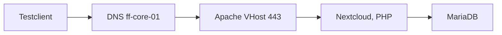

# Technische Abnahme

> Am Ende wurden 15 Anforderungen mit Nachweis geprüft: 14 erfüllt, eine teilweise. Offene Punkte stehen ausdrücklich dabei.

## Ziel

Am Ende des Projekts wurde geprüft, ob die Umgebung die 15 vereinbarten Anforderungen erfüllt. Geprüft wurde, ob sich jede Anforderung mit einem Nachweis belegen lässt.

## Grundlagen

Eine **Nachweismatrix** ordnet jeder Anforderung einen prüfbaren Nachweis zu. Eine Anforderung gilt nur dann als erfüllt, wenn es eine Terminalausgabe, eine Konfigurationsdatei oder einen Screenshot dazu gibt. Nachweise aus früheren Prüfungen sind als solche gekennzeichnet und wurden bei der Abnahme nicht erneut getestet.

Ein Dienst funktioniert erst, wenn **alle** Schichten auf seinem Weg funktionieren. Deshalb wird zusätzlich jeder Dienstpfad von Anfang bis Ende geprüft:

## Meine Umsetzung

**1. Nachweismatrix.**

| Nr. | Anforderung | Status | Nachweis |
|---|---|---|---|
| 1 | Projektstruktur und Konfigurationsstände sind nachvollziehbar versioniert | erfüllt | Konfigurationen aller Systeme in Git, [Management und Git](02_Management_Git.md) |
| 2 | Der Managementzugriff auf die vorgesehenen Systeme ist dokumentiert | erfüllt | SSH von ff-mgmt-01 auf alle Server geprüft, [SSH auf allen Servern](08_SSH_Alle_Server.md) |
| 3 | Der digitale Zwilling ist vom produktiven Netz getrennt | erfüllt | Privater Switch, Übergang nur über ff-edge-01 (frühere Prüfung), [Architektur](01_Architektur.md) |
| 4 | Netzwerkadressen, Gateways und Systemnamen entsprechen der Planung | erfüllt | Werte entsprechen dem Plan, Abweichungen begründet (frühere Prüfung) |
| 5 | Die interne DNS-Auflösung funktioniert für alle zentralen Systeme | erfüllt | `dig @192.168.10.11`: sieben A-Records und PTR korrekt, [DNS mit Bind9](04_DNS_Bind9.md) |
| 6 | Administrative SSH-Zugänge sind funktionsfähig und abgesichert | erfüllt | Anmeldung mit Schlüssel, Passwort auf fünf Servern abgelehnt, [SSH-Schlüssel](06_SSH_Schluessel.md) |
| 7 | Rollen, Benutzerrechte und privilegierte Zugriffe sind dokumentiert | erfüllt | Je Server ein Administratorkonto, Gruppe `docker` leer, [Docker](15_Docker_Compose.md) |
| 8 | Persistente Daten liegen auf nachvollziehbar zugeordnetem Speicher | teilweise | Backups auf `target02`. Die Mail-Daten waren zum Zeitpunkt der Abnahme nur lokal |
| 9 | Backup-Ziel, Sicherungsumfang und Intervall sind definiert | erfüllt | Ziel `target02`, 01:00 Uhr, `/etc`, `/var/www`, Datenbank, [Backup-Skript](11_Backup_Skript.md) |
| 10 | Ein Wiederherstellungsweg ist beschrieben oder praktisch getestet | erfüllt | Wiederherstellung einer Testdatei (frühere Prüfung), VM-Restore offen |
| 11 | Web- und Dokumentenportal sind über einen vollständigen Dienstpfad prüfbar | erfüllt | Nextcloud: DNS, VHost, TLS, Datenbank geprüft (HTTP 302), [Nextcloud](14_Nextcloud_Apache.md) |
| 12 | Containerdienste sind reproduzierbar über Docker Compose beschrieben | erfüllt | Compose mit Ports, Mounts und Neustartverhalten, [Docker](15_Docker_Compose.md) |
| 13 | Externe Zugriffe über DNS, Reverse Proxy und DNAT sind nachvollziehbar | erfüllt | DNAT für 80 und 443, Zähler der Regel für Port 443: 24 Pakete, Regeln gespeichert, [Edge](03_Edge_NAT_DNAT.md) |
| 14 | Mail und Alarmierung sind über DNS, TLS, Postfach und Clienttest bewertet | erfüllt | A, MX, TLS, Postfach, Backup-Alarm zugestellt, [Mailserver](18_Mailserver.md) |
| 15 | Die Betriebsdokumentation ermöglicht die Übergabe an ein anderes Team | erfüllt | Übersicht, Zugriffe und Prüfbefehle dokumentiert |

14 von 15 Anforderungen sind erfüllt, eine ist teilweise erfüllt (Nr. 8).

**2. Dienstpfade.**

| Dienstpfad | Schichten | Bewertung |
|---|---|---|
| Portalzugriff | DNS, Webserver, VHost, Datenbank und PHP, TLS | alle Schichten geprüft |
| Containerzugriff | DNS, Reverse Proxy, Port-Mapping, DNAT, Containerstatus | bis zum Container geprüft |
| Mailpfad | A- und MX-Record, SMTP und IMAP, TLS, Postfach, Clienttest | geprüft |
| Backup und Wiederanlauf | Speicher, Ziel, Skriptlogik, Log, Wiederherstellung | Lauf, Log und Alarm geprüft, VM-Restore offen |

**3. Befunde der Erstprüfung und Nacharbeit.** Bei der Erstprüfung fielen Lücken auf. Sie wurden behoben und erneut geprüft:

| Befund | Nacharbeit | Nachprüfung |
|---|---|---|
| Backup-Ziel nicht erreichbar, Backups schlugen fehl | TrueNAS-VM gestartet (Arbeitsspeicher von ff-pve-01 von 6144 auf 5198 MB verringert), Skript mit Mount-Prüfung, Prüfsummenvergleich und Datenbank-Dump überarbeitet | Lauf mit der Umgebung von cron: 0 Abweichungen, Exit-Code 0 |
| Passwort-Anmeldung offen (edge, mail, app, pve) | Schlüssel mit `ssh-copy-id`, Drop-in-Datei mit `PasswordAuthentication no` | Passworttest liefert `Permission denied (publickey)` |
| Kein Alarm bei Backup-Fehler | Wrapper `backup-alarm.sh`, Cron-Eintrag angepasst | Simulierter Fehler: Mail im Postfach `alerts@` |
| Benutzer `student` in der Gruppe `docker` | Aus der Gruppe entfernt (app, mail) | Gruppe leer, Container laufen weiter |
| Portainer-VHost nur über HTTP | VHost mit Proxy und TLS angelegt | HTTPS-Abruf liefert 200 |
| DNAT-Regeln nicht gespeichert | `netfilter-persistent save` | Regeln in `rules.v4`, Zähler nach Test: 24 Pakete |
| Postfach `alerts@` fehlte | Postfach angelegt | Testmails zugestellt |

**4. Entscheidung zum Zeitpunkt der Abnahme.**

| Feld | Formulierung |
|---|---|
| Technische Entscheidung | Abnahme mit Auflagen |
| Wichtigste erfüllte Anforderungen | DNS, Web, Container und Edge, Mail, Backup mit Alarm |
| Wichtigste offene Punkte | Mail-Daten nicht im Backup, VM-Restore, Monitoring, Git-Remote |
| Empfehlung für den Betrieb | Erst nach den Auflagen 1 bis 3. Restrisiko: Der Speicher ist ein Einzelpunkt, Daten und Backup liegen auf demselben TrueNAS |
| Begründung | Die Kerndienste sind nachweisbar. Die offenen Punkte sind planbar, müssen aber vor einem Einsatz geschlossen werden |

**5. Stand der Auflagen nach der Nacharbeit.**

| Auflage | Status | Beleg |
|---|---|---|
| Mail-Daten ins Backup aufnehmen | erledigt | Proxmox-Sicherungsauftrag für Container 102, Restore-Test mit 55 von 55 Dateien, [Container-Backup](13_Container_Backup_Restore.md) |
| Monitoring einführen | erledigt | Uptime Kuma mit zwölf Prüfungen, Alarm getestet, [Monitoring](19_Monitoring_Kuma.md) |
| Feste Image-Versionen | erledigt | Digests in den Compose-Dateien, [Docker](15_Docker_Compose.md) |
| Git-Remote anlegen | offen | Das Git-Repository liegt nur auf ff-mgmt-01. Veröffentlicht wird hier nur die Dokumentation |
| VM-Restore testen | offen | Nur ein Container wurde wiederhergestellt |
| Persönliche Administratorkonten | offen | Es gibt gemeinsame Konten je Server |
| Eigene Zertifizierungsstelle statt selbstsigniertem Zertifikat | offen | Browser und Monitoring umgehen die Zertifikatsprüfung |

## Ergebnis

Die Abnahme endete mit Auflagen: 14 von 15 Anforderungen erfüllt, eine teilweise. Von den Auflagen sind das Mail-Backup, das Monitoring und die festen Image-Versionen erledigt. Vier Punkte sind offen: Git-Remote, VM-Restore, persönliche Administratorkonten und eine eigene Zertifizierungsstelle.

Strukturelle Restrisiken bleiben bewusst dokumentiert:

- Daten und Backup liegen auf demselben TrueNAS.
- Das Container-Backup liegt auf dem Proxmox-Host selbst.
- Der Arbeitsspeicher des Proxmox-Knotens ist zu rund 78 % belegt und der Thin-Pool überbucht. Vor dem Aufbau weiterer Standorte muss die Kapazität geplant werden.
- Uptime Kuma läuft auf einer einzelnen VM.

## Worauf zu achten ist

| Punkt | Hintergrund |
|---|---|
| Nachweise aus früheren Prüfungen | Anforderungen 3, 4 und 10 stützen sich auf frühere Prüfungen und wurden bei der Abnahme nicht erneut getestet |
| Status nur mit Nachweis | „Erfüllt“ steht nur dort, wo es einen Beleg gibt. Was nur geplant oder nur teilweise belegt ist, trägt den entsprechenden Status |
| Stand der Matrix | Die Matrix zeigt den Stand der Abnahme. Was danach behoben wurde, steht im Abschnitt zu den Auflagen |
| Weitere Umgebungen | Die Abnahme gilt für dieses Lab, nicht für eine produktive Umgebung |

## Dateien

Die Nachweise stammen aus Terminalausgaben und Screenshots der ursprünglichen Abnahmedokumentation und stehen auf den jeweiligen Themenseiten.
